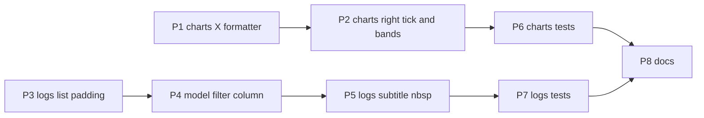

# Charts and Logs Polish — Implementation Plan

- **Date:** 2026-11-09
- **Feature slug:** `charts-logs-polish`
- **Stage:** 3 of 4 (plan). Source-of-truth order for the implementation stage: **this file** → [`charts-logs-polish-design-spec.md`](charts-logs-polish-design-spec.md) → [`charts-logs-polish-analysis.md`](charts-logs-polish-analysis.md).
- **Required inputs:** [`charts-logs-polish-analysis.md`](charts-logs-polish-analysis.md) (Stage 1 — confirmed root causes, constraint surface, token inventory, tests that must keep passing) and [`charts-logs-polish-design-spec.md`](charts-logs-polish-design-spec.md) (Stage 2 — decisions D1–D5, target shapes, acceptance criteria, test-impact table, new assertions T1–T7).
- **Task type:** UI polish/refinement with visual output change; the design-spec stage was required and has run. No logic, service, model, navigation, telemetry or backend change.
- **Scope discipline:** no code was changed in this stage. No `flutter test`, `flutter analyze`, `dart format`, or build was run. Every snippet below was read from the current working tree at the time of writing and carries that tree's line numbers; every replacement was checked against the real current text before it was prescribed — nothing is quoted from memory or from the prior phase's plan.

---

## 0. Change set

### 0.1 Files to modify (complete list)

| # | File | Folder | Why it is in scope |
|---|---|---|---|
| 1 | [`lib/widgets/charts.dart`](../../lib/widgets/charts.dart:1) | `lib/widgets/` | Issues 1a, 1b, 1c — X formatter, rightmost tick, bottom bands |
| 2 | [`lib/screens/logs_reports_screen.dart`](../../lib/screens/logs_reports_screen.dart:1) | `lib/screens/` | Issues 4, 2, 3 — list padding, `_ModelFilter`, row subtitle |
| 3 | [`test/widgets/charts_test.dart`](../../test/widgets/charts_test.dart:1) | `test/` | New X assertions T1–T3 |
| 4 | [`test/screens/logs_reports_screen_test.dart`](../../test/screens/logs_reports_screen_test.dart:1) | `test/` | Four subtitle string edits + T5–T7 |
| 5 | `docs/changelog.md`, `docs/session-log.md`, `docs/implementation-progress.md` | `docs/` | Mandatory per [`.roo/rules/rules-frontend/06-doc-update.md`](../../.roo/rules/rules-frontend/06-doc-update.md) |

Items 3–4 are **outside** the four UI-owned folders ([`.roo/rules/rules-frontend/01-scope.md`](../../.roo/rules/rules-frontend/01-scope.md)). They are the explicitly flagged consequence recorded in design-spec §10.1/§11: the rendered subtitle string and the selector geometry those assertions describe are being changed, so four assertions cannot survive verbatim, and six new assertions are the only honest proof. [inferred-from-codebase]

### 0.2 Forbidden — must not be touched

`lib/widgets/bounding_box_painter.dart` · `lib/widgets/status_pill.dart` · `lib/widgets/depth_heatmap_view.dart` · `lib/widgets/detection_information_overlay.dart` · `lib/widgets/detection_action_controls.dart` · `lib/screens/ultralytics_detection_screen.dart` · all of `lib/theme/` (no token is added, `kChartHeight` is not edited) · `lib/models/` · `lib/services/` · `lib/navigation/` · `lib/main.dart` · `plugins/` · `android/` · `pubspec.yaml` (the `fl_chart` version must not change) · `.roo/` · the three prior phase documents ([`charts-logs-polish-analysis.md`](charts-logs-polish-analysis.md), `detection-alignment-charts-design-spec.md`, [`detection-alignment-charts-plan.md`](detection-alignment-charts-plan.md)).

Rationale is per-file in design-spec §1.2 and §13.3.

---

## 1. Facts re-confirmed in the current tree before prescribing anything

These changed or constrained a step below; each was read, not assumed.

| # | Fact | Anchor |
|---|---|---|
| 1.1 | `_formatAxisTick` has exactly **one** caller after the previous phase moved Y to `_formatYAxisTick` (used at [:303](../../lib/widgets/charts.dart:303)); the X axis is that caller ([:325](../../lib/widgets/charts.dart:325)). Deleting it therefore cannot orphan another call site, but it **must** be deleted or `flutter analyze` reports an unused private element. | [`charts.dart:336-352`](../../lib/widgets/charts.dart:336) |
| 1.2 | The bottom block currently reads `style: tickStyle` (a `TextStyle` value, not the old `tickStyle()` closure call) in both the axis name and the tick `Text`, and the tick already carries `maxLines: 1` / `softWrap: false`. The `_chartTitles` signature already takes `BuildContext context`. | [`charts.dart:312-332`](../../lib/widgets/charts.dart:312), [:270-282](../../lib/widgets/charts.dart:270) |
| 1.3 | The doc comment on `_formatYAxisTick` names the symbol being deleted: *"The X axis deliberately keeps [_formatAxisTick] …"*. It must be rewritten in the same step as 1.1. | [`charts.dart:359-360`](../../lib/widgets/charts.dart:359) |
| 1.4 | `math.max(elapsedSeconds.last, 1.0)` floors `maxX` at 1.0 for both line charts, so `xInterval = maxX / 2 >= 0.5`. At one decimal, two adjacent X ticks can therefore never print the same label. This is what makes D1 safe without an interval-aware formatter. | [`charts.dart:46`](../../lib/widgets/charts.dart:46), [:141](../../lib/widgets/charts.dart:141) |
| 1.5 | `minuteLabels` bypasses the formatter entirely (`minuteLabels ? '${value.round() + 1}' : …`), so the bar chart's integer ticks are untouched by D1 by construction. | [`charts.dart:323-325`](../../lib/widgets/charts.dart:323) |
| 1.6 | `_LightCard` padding is `EdgeInsets.all(kSpace16)`; the Charts tab's list padding is `symmetric(horizontal: kSpace16, vertical: kSpace16)`; the populated Logs list is `symmetric(vertical: kSpace8)`. The three numbers in design-spec §8.1 are correct. | [`logs_reports_screen.dart:1707`](../../lib/screens/logs_reports_screen.dart:1707), [:1684-1687](../../lib/screens/logs_reports_screen.dart:1684), [:1395](../../lib/screens/logs_reports_screen.dart:1395) |
| 1.7 | The populated Logs list is a `ListView.builder` inside `Center` → `ConstrainedBox(maxWidth: 480)` with **no** `SafeArea`; the empty state returns `_BoundedScrollView` (which has `SafeArea`). Confirms design-spec §8.1 and the NV-5 scope call. | [`logs_reports_screen.dart:1384-1399`](../../lib/screens/logs_reports_screen.dart:1384), [:1361-1382](../../lib/screens/logs_reports_screen.dart:1361) |
| 1.8 | The dropdown item `Text`s have `overflow: TextOverflow.ellipsis` and **no** `maxLines`, and there is no `selectedItemBuilder`. Adding `maxLines: 1` is therefore both a behaviour equaliser (selected vs menu item) and what makes `didExceedMaxLines` a usable signal. | [`logs_reports_screen.dart:2038-2052`](../../lib/screens/logs_reports_screen.dart:2038) |
| 1.9 | With `buildHomeTheme()` the dropdown item inherits `titleMedium` = **18 sp w600** and the label is `bodyLarge` = **18 sp w500**; `labelSmall` = 14 sp w500; `bodyMedium` = 16 sp w400. | [`app_home_theme.dart:64-93`](../../lib/theme/app_home_theme.dart:64) |
| 1.10 | `pumpLogsScreen` defaults to a 390 × 2400 logical surface (physical 1170 × 7200 at dpr 3), and `paintedParagraph` is a **function local to one group** (defined at [:1367](../../test/screens/logs_reports_screen_test.dart:1367)). A new truncation test must live inside that group, or the helper must be duplicated. | [`logs_reports_screen_test.dart:208-245`](../../test/screens/logs_reports_screen_test.dart:208), [:1367](../../test/screens/logs_reports_screen_test.dart:1367) |
| 1.11 | `charts_test.dart` has two harnesses: `wrap()` (bare `MaterialApp`, Material default tick size) at [:24](../../test/widgets/charts_test.dart:24) and `wrapThemed()` (`buildHomeTheme()`, the 14 sp tick) at [:40](../../test/widgets/charts_test.dart:40). New tests pick deliberately; neither harness is modified. | [`charts_test.dart:24-51`](../../test/widgets/charts_test.dart:24) |
| 1.12 | A repository-wide search for `center · ` in `test/` returns exactly four sites ([:714](../../test/screens/logs_reports_screen_test.dart:714), [:1530](../../test/screens/logs_reports_screen_test.dart:1530), [:1535](../../test/screens/logs_reports_screen_test.dart:1535), [:1832](../../test/screens/logs_reports_screen_test.dart:1832)); a search for `All models (mixed)` / `Detector model` returns the two `find.text` sites and the semantics test only. The test deltas in §3 are therefore complete. | search of `test/**/*.dart` |

No contradiction was found between the analysis, the design-spec and the current code. One clarification is recorded: analysis §2.1 quotes the bottom block with `style: tickStyle` already applied, and the design-spec's D1 rule and D2 half-widths are consistent with it.

---

## 2. Change list (implementation order)

Grouped by file, source before the tests that assert it, and **Issue 4 before Issue 2** because D5 narrows the Logs filter card by 32 dp and D3 must be verified against the narrower card (design-spec §8.3).



| Step | File | Change | Trace |
|---|---|---|---|
| **P1** | `charts.dart` | Replace `_formatAxisTick` with the value-only `_formatXAxisTick`; switch the X call site; rewrite the `_formatYAxisTick` doc comment | design-spec D1 / §4; analysis §2.1, §2.4 |
| **P2** | `charts.dart` | Bottom axis: `fitInside` from `TitleMeta`, `reservedSize: 36`, `axisNameSize: 36` | design-spec D2a/D2b / §5; analysis §2.2, §2.3, classification 1b/1c |
| **P3** | `logs_reports_screen.dart` | Populated Logs list padding gains `horizontal: kSpace16` | design-spec D5 / §8; analysis §5.1 |
| **P4** | `logs_reports_screen.dart` | `_ModelFilter` → label above a full-width dropdown, `maxLines: 1` on items | design-spec D3 / §6; analysis §3.2, §3.3 |
| **P5** | `logs_reports_screen.dart` | Subtitle number+unit joined with a non-breaking space | design-spec D4 / §7; analysis §4.2, §4.4 |
| **P6** | `charts_test.dart` | Add T1, T2, T3 | design-spec §11 |
| **P7** | `logs_reports_screen_test.dart` | Four subtitle string edits + T5, T6, T7 | design-spec §10.1, §11 |
| **P8** | `docs/*` | Changelog, session log, implementation progress | `.roo/rules/rules-frontend/06-doc-update.md` |

Each step compiles on its own; no step references a symbol introduced by a later one. P1 and P2 touch the same function, in that order, so the tree is analysable between them.

---

### P1 — `charts.dart`: one-decimal X formatter

**File:** [`lib/widgets/charts.dart`](../../lib/widgets/charts.dart:1)
**Trace:** design-spec §4 (D1). **Acceptance:** design-spec §4.4 items 1–4. **Proves:** T1, and re-runs [:167-169](../../test/widgets/charts_test.dart:167) / [:202-204](../../test/widgets/charts_test.dart:202).

**P1.1 — current formatter, to be replaced** ([:336-352](../../lib/widgets/charts.dart:336)):

```dart
String _formatAxisTick(double value, double interval) {
  var precision = 0;
  var scaledValue = value;
  var scaledInterval = interval;
  while (precision < 6 &&
      ((scaledValue - scaledValue.round()).abs() > 1e-8 ||
          (scaledInterval - scaledInterval.round()).abs() > 1e-8)) {
    scaledValue *= 10;
    scaledInterval *= 10;
    precision++;
  }
  if (precision == 0) return value.toStringAsFixed(0);
  return value
      .toStringAsFixed(precision)
      .replaceFirst(RegExp(r'0+$'), '')
      .replaceFirst(RegExp(r'\.$'), '');
}
```

Replace with:

```dart
/// X ticks read at most one decimal.
///
/// Precision belongs to the axis, not to the interval: the elapsed-time axis
/// carries at most three ticks and the line charts floor `maxX` at 1.0, so the
/// interval is never below 0.5 and one decimal can never merge two labels.
/// `toStringAsFixed` never emits thousands separators, and a trailing `.0` is
/// stripped so `3.0` reads `3`. Integer minute labels never reach here: the
/// bucket chart takes the `minuteLabels` branch.
String _formatXAxisTick(double value) {
  final text = value.toStringAsFixed(1);
  return text.endsWith('.0') ? text.substring(0, text.length - 2) : text;
}
```

**P1.2 — X call site.** Current ([:322-329](../../lib/widgets/charts.dart:322)):

```dart
          child: Text(
            minuteLabels
                ? '${value.round() + 1}'
                : _formatAxisTick(value, xInterval),
            style: tickStyle,
            maxLines: 1,
            softWrap: false,
          ),
```

Replace only the expression line with `: _formatXAxisTick(value),`. `minuteLabels`, `tickStyle`, `maxLines: 1` and `softWrap: false` are **kept**.

**P1.3 — the `_formatYAxisTick` doc comment.** Current ([:354-360](../../lib/widgets/charts.dart:354)):

```dart
/// Y ticks read at most one decimal.
///
/// An integral value on an integral interval prints as an integer; anything
/// else keeps exactly one decimal so the scale stays honest and `.0` is
/// stripped. `toStringAsFixed` never emits thousands separators.
/// The X axis deliberately keeps [_formatAxisTick]: fractional elapsed-time
/// ticks (`0.5`, `1.5`) carry meaning and are asserted at 200% text scale.
```

Replace the last two lines with:

```dart
/// The X axis uses [_formatXAxisTick]: fractional elapsed-time ticks (`0.5`,
/// `1.5`) carry meaning and are asserted at 200% text scale.
```

Leave the function body untouched.

**Acceptance:** `_formatAxisTick` no longer exists; the X labels for the existing datasets are byte-identical (`0`/`0.5`/`1`, `0`/`1.5`/`3`, `0`/`4.5`/`9`); the bar chart still shows integer minute labels.
**Proves:** T1 (§3.1).

---

### P2 — `charts.dart`: keep the rightmost tick inside, size the bottom bands

**File:** [`lib/widgets/charts.dart`](../../lib/widgets/charts.dart:1)
**Trace:** design-spec §5 (D2a/D2b), Context7-verified API. **Acceptance:** design-spec §5.5 items 1–5. **Proves:** T2, T3, and re-runs [:149-182](../../test/widgets/charts_test.dart:149) / [:184-217](../../test/widgets/charts_test.dart:184) / [:219-232](../../test/widgets/charts_test.dart:219).

**Current bottom block** ([:312-332](../../lib/widgets/charts.dart:312), post-P1 — only the formatter expression inside it differs from the tree as read):

```dart
    bottomTitles: AxisTitles(
      axisNameWidget: Text(xName, style: tickStyle, maxLines: 1),
      axisNameSize: 22,
      sideTitles: SideTitles(
        showTitles: true,
        interval: xInterval,
        reservedSize: 22,
        getTitlesWidget: (value, meta) => SideTitleWidget(
          meta: meta,
          space: 4,
          child: Text(
            minuteLabels
                ? '${value.round() + 1}'
                : _formatXAxisTick(value),
            style: tickStyle,
            maxLines: 1,
            softWrap: false,
          ),
        ),
      ),
    ),
```

Replace with:

```dart
    bottomTitles: AxisTitles(
      axisNameWidget: Text(xName, style: tickStyle, maxLines: 1),
      // Both bands are layout metrics, not tokens. `labelSmall` is 14 sp; at
      // 2.0 text scale one line box is ~33.6 dp, so the 22 dp fl_chart default
      // could not hold it. 36 gives ~2.4 dp of slack. The cost comes out of the
      // fixed kChartHeight (180): the plot drops from 136 dp to 108 dp and the
      // card height does not change.
      axisNameSize: 36,
      sideTitles: SideTitles(
        showTitles: true,
        interval: xInterval,
        reservedSize: 36,
        getTitlesWidget: (value, meta) => SideTitleWidget(
          meta: meta,
          space: 4,
          // The maximum-value title is centred on maxX, which is the plot's
          // right edge, so half of it used to sit outside the chart box. No
          // right gutter is reserved: `fitInside` clamps only a tick whose box
          // would cross the axis edge, so the plot width is unchanged.
          fitInside: SideTitleFitInsideData(
            enabled: true,
            distanceFromEdge: 4,
            parentAxisSize: meta.parentAxisSize,
            axisPosition: meta.axisPosition,
          ),
          child: Text(
            minuteLabels
                ? '${value.round() + 1}'
                : _formatXAxisTick(value),
            style: tickStyle,
            maxLines: 1,
            softWrap: false,
          ),
        ),
      ),
    ),
```

`SideTitleFitInsideData` and `TitleMeta`'s `parentAxisSize` / `axisPosition` are API-confirmed for fl_chart 1.2.0 (design-spec §5.2), so no new import, dependency or version change is needed. `rightTitles` ([:285](../../lib/widgets/charts.dart:285)) and `topTitles` ([:284](../../lib/widgets/charts.dart:284)) stay exactly as they are; the left axis ([:286-311](../../lib/widgets/charts.dart:286)) is **not** touched.

**Acceptance:** plot width unchanged at 320/360/390 dp (design-spec §5.3 table); the last X label is fully inside the `LineChart` rect; no tick-rect overlap at 200 %; no exception from any dataset.
**Proves:** T2, T3.

---

### P3 — `logs_reports_screen.dart`: give the populated Logs list the Charts gutter

**File:** [`lib/screens/logs_reports_screen.dart`](../../lib/screens/logs_reports_screen.dart:1)
**Trace:** design-spec §8 (D5). **Acceptance:** design-spec §8.4 items 1–4. **Proves:** T6.

**Current** ([:1392-1399](../../lib/screens/logs_reports_screen.dart:1392)):

```dart
                child: ListView.builder(
                  // One extra row carries the model filter above the list.
                  itemCount: records.length + 1,
                  padding: const EdgeInsets.symmetric(vertical: kSpace8),
                  itemBuilder: (context, index) {
                    if (index == 0) {
                      return Padding(
                        padding: const EdgeInsets.only(bottom: kSpace8),
```

Replace the `padding:` line only, keeping the one-extra-row comment and every following line:

```dart
                child: ListView.builder(
                  // One extra row carries the model filter above the list.
                  itemCount: records.length + 1,
                  // Horizontal inset matches every Charts card so both tabs
                  // share one gutter; the vertical rhythm is unchanged.
                  padding: const EdgeInsets.symmetric(
                    horizontal: kSpace16,
                    vertical: kSpace8,
                  ),
                  itemBuilder: (context, index) {
                    if (index == 0) {
                      return Padding(
                        padding: const EdgeInsets.only(bottom: kSpace8),
```

Do **not** add `SafeArea` (design-spec NV-5), do **not** change the filter row's `only(bottom: kSpace8)`, and do **not** touch `_BoundedScrollView` or the empty state.

**Acceptance:** at 390 dp the filter card is left 16 / right 374 / width 358 / inner 326, matching Charts exactly; at 320 dp both are 288 / 256 (design-spec §8.2).
**Proves:** T6; re-run `Logs has no overflow at 200 percent text scale`.

---

### P4 — `logs_reports_screen.dart`: label above a full-width model dropdown

**File:** [`lib/screens/logs_reports_screen.dart`](../../lib/screens/logs_reports_screen.dart:1)
**Trace:** design-spec §6 (D3). **Acceptance:** design-spec §6.4 items 1–5. **Proves:** T5, and re-runs the merged-semantics test at [:2252](../../test/screens/logs_reports_screen_test.dart:2252).

**Current** ([:2024-2061](../../lib/screens/logs_reports_screen.dart:2024)):

```dart
    return _LightCard(
      // The sibling label and the dropdown's own button/expanded annotation
      // merge into a single labelled control node; layout is unchanged.
      child: MergeSemantics(
        child: Row(
          children: [
            Text('Detector model', style: theme.textTheme.bodyLarge),
            const SizedBox(width: kSpace12),
            Expanded(
              child: DropdownButtonHideUnderline(
                child: DropdownButton<String?>(
                  isExpanded: true,
                  value: selected,
                  items: [
                    const DropdownMenuItem<String?>(
                      value: null,
                      child: Text(
                        _allModelsLabel,
                        overflow: TextOverflow.ellipsis,
                      ),
                    ),
                    for (final model in models)
                      DropdownMenuItem<String?>(
                        value: model.key,
                        child: Text(
                          model.label,
                          overflow: TextOverflow.ellipsis,
                        ),
                      ),
                  ],
                  onChanged: onChanged,
                ),
              ),
            ),
          ],
        ),
      ),
    );
```

Replace with:

```dart
    return _LightCard(
      // The label and the dropdown still merge into one labelled control node,
      // and the label is still first so the merged label starts with it. The
      // label sits above the control so the selected value no longer competes
      // with an 18 sp label plus a 12 dp gap inside one row.
      child: MergeSemantics(
        child: Column(
          crossAxisAlignment: CrossAxisAlignment.stretch,
          children: [
            Text('Detector model', style: theme.textTheme.bodyLarge),
            const SizedBox(height: kSpace8),
            DropdownButtonHideUnderline(
              child: DropdownButton<String?>(
                isExpanded: true,
                value: selected,
                items: [
                  const DropdownMenuItem<String?>(
                    value: null,
                    child: Text(
                      _allModelsLabel,
                      // `maxLines: 1` makes truncation measurable: with an
                      // unbounded line count the ellipsis path is ambiguous.
                      maxLines: 1,
                      overflow: TextOverflow.ellipsis,
                    ),
                  ),
                  for (final model in models)
                    DropdownMenuItem<String?>(
                      value: model.key,
                      child: Text(
                        model.label,
                        maxLines: 1,
                        overflow: TextOverflow.ellipsis,
                      ),
                    ),
                ],
                onChanged: onChanged,
              ),
            ),
          ],
        ),
      ),
    );
```

`kSpace12` is dropped as a *horizontal* gap and `kSpace8` is used as the vertical gap; no new token. `isExpanded: true` and the widget's generic argument are unchanged, so every `find.byType(DropdownButton<String?>)` site still resolves.

**Acceptance:** `didExceedMaxLines` is `false` for `All models (mixed)` at 390 dp / 100 % on both tabs; one merged semantics node starting with `Detector model`; listener/filter behaviour unchanged.
**Proves:** T5.

---

### P5 — `logs_reports_screen.dart`: keep the latency value atomic

**File:** [`lib/screens/logs_reports_screen.dart`](../../lib/screens/logs_reports_screen.dart:1)
**Trace:** design-spec §7 (D4). **Acceptance:** design-spec §7.4 items 1–4. **Proves:** T7 and the four edited assertions.

**Current** ([:1418-1427](../../lib/screens/logs_reports_screen.dart:1418)):

```dart
                      subtitle: Text(
                        [
                          // The readable model name comes first: it is what the
                          // numbers below belong to.
                          if (r.detectorModelName != null) r.detectorModelName!,
                          r.engine.label,
                          r.position,
                          '${r.latencyMs.toStringAsFixed(0)} ms',
                        ].join(' · '),
                      ),
```

Replace with:

```dart
                      subtitle: Text(
                        [
                          // The readable model name comes first: it is what the
                          // numbers below belong to.
                          if (r.detectorModelName != null) r.detectorModelName!,
                          r.engine.label,
                          r.position,
                          // Non-breaking space keeps the number and its unit on
                          // one line. The ` · ` separators stay breakable so a
                          // long model name wraps between fields, never inside a
                          // value.
                          '${r.latencyMs.toStringAsFixed(0)}\u00A0ms',
                        ].join(' · '),
                      ),
```

`softWrap`, `maxLines` and `overflow` stay at their defaults (nothing is hidden); `title` ([:1415-1417](../../lib/screens/logs_reports_screen.dart:1415)), `trailing` ([:1428-1433](../../lib/screens/logs_reports_screen.dart:1428)) and the `ListTile` flags are untouched.

**Acceptance:** no rendered subtitle contains `RegExp(r'\d ms')`; field order and the ` · ` separators are visually unchanged; the `Ultralytics · center · 120 ms` fixture occupies one line at 390 dp / 100 %.
**Proves:** T7 plus the four edited assertions.

---

## 3. Test plan

### 3.1 New tests — `test/widgets/charts_test.dart`

**T1 — `X ticks carry at most one decimal on a wall-clock interval`.** Dataset: three `RuntimeSample`s at 0 / 4150 / 8300 ms (latency 30, fps 12, engine `ultralytics`), pumped with `wrap(LatencyChart(samples: …))` (the unthemed harness, matching the neighbouring X tests). Ticks are `0`, `4.15`, `8.3`; expected labels `0`, `4.2`, `8.3`.

```dart
    expect(find.text('4.15'), findsNothing);
    expect(find.text('4.2'), findsOneWidget);
    expect(find.text('8.3'), findsOneWidget);
    expect(find.textContaining(RegExp(r'\.\d\d')), findsNothing);
```

`4.2` is deterministic: `maxX` is `8.3` and `xInterval` is exactly `maxX / 2` (halving is exact in binary), and `4.15…0355` rounds to `4.2` at one decimal. Y ticks for a constant 30 ms series are `0`, `11.5`, `23`, `34.5`, `46`, so `4.2` and `8.3` are not shadowed by a Y label.

**T2 — `the rightmost X tick stays inside the chart box`.** Same dataset, `wrap(…, width: 320)`; rect comparison, not an exception check (a clipped title never throws):

```dart
    final chartRect = tester.getRect(find.byType(LineChart));
    final lastRect = tester.getRect(find.text('8.3'));
    expect(lastRect.right, lessThanOrEqualTo(chartRect.right));
    expect(lastRect.left, greaterThanOrEqualTo(chartRect.left));
```

Add the symmetric first-label check with the same bottom-most reduction the existing tests use for `0`, since `0` also appears on the Y axis.

**T3 — `X ticks fit the raised bottom band at 200 percent text scale`** (conditional, design-spec NV-6): `wrapThemed(LatencyChart(samples: samples([30, 40])), textScale: 2, width: 320)` then `expect(tester.getSize(find.text('0.5')).height, lessThanOrEqualTo(36));`. If the measured line box exceeds 36 in the themed harness, **stop and report** — the number in P2 comes from the 14 sp × 1.2 × 2.0 arithmetic, not from a measurement, and the plan's fallback (design-spec NV-6) is `reservedSize: 36` with `axisNameSize` reverted to 22. Do not silently raise the constant.

### 3.2 Edited assertions — `test/screens/logs_reports_screen_test.dart`

Exactly four, all caused by P5 (D4). Each keeps its finder, its `findsOneWidget` and its position; only the expected substring changes — a normal space becomes `\u00A0` before `ms`:

| file:line | Current | Replacement |
|---|---|---|
| [:714](../../test/screens/logs_reports_screen_test.dart:714) | `find.textContaining('Ultralytics · center · 120 ms')` | `find.textContaining('Ultralytics · center · 120\u00A0ms')` |
| [:1530](../../test/screens/logs_reports_screen_test.dart:1530) | `find.textContaining('Built-in YOLOv8n · Ultralytics · center · 100 ms')` | `… 'center · 100\u00A0ms')` |
| [:1535](../../test/screens/logs_reports_screen_test.dart:1535) | `find.textContaining('Obstacle Detector v2 · Ultralytics · center · 100 ms')` | `… 'center · 100\u00A0ms')` |
| [:1832](../../test/screens/logs_reports_screen_test.dart:1832) | `find.textContaining('Built-in YOLOv8n · Ultralytics · center · 100 ms')` | `… 'center · 100\u00A0ms')` |

[:1835](../../test/screens/logs_reports_screen_test.dart:1835) (`'Obstacle Detector v2 · '`) and [:711](../../test/screens/logs_reports_screen_test.dart:711) (`'person — 82%'`) are unchanged.

### 3.3 New tests — `test/screens/logs_reports_screen_test.dart`

**T5 — `the model filter shows All models mixed whole`.** Must be added **inside** the group that defines `paintedParagraph` ([:1367](../../test/screens/logs_reports_screen_test.dart:1367)); that helper is a function local, so any test outside the group would have to duplicate it.

```dart
      final value = find.text('All models (mixed)');
      expect(paintedParagraph(tester, value).didExceedMaxLines, isFalse);
```

Assert it on the Charts tab (`selectTab(tester, 'Charts')`) and again on the Logs tab (`selectTab(tester, 'Logs')`), both at the default 390 dp / 100 % surface, using `buildTwoModelTelemetry()` so the filter offers more than one option. This is the font-independent signal that the ellipsis path was not taken.

**T6 — `the Logs filter card shares the Charts gutter`.** One test, two tab states, using `buildTwoModelTelemetry()`:

```dart
      await selectTab(tester, 'Charts');
      final chartsLeft = tester.getTopLeft(find.textContaining('Inference Latency')).dx;
      await selectTab(tester, 'Logs');
      final logsLeft = tester.getTopLeft(find.text('Detector model')).dx;
      expect(logsLeft, chartsLeft);
```

Both are the first child inside a `_LightCard` whose padding is `kSpace16`, so equal left edges prove a shared gutter without reaching into private widgets. At 390 dp the expected value is 32.0; the assertion deliberately compares the two tabs rather than pinning the literal, so it stays meaningful if the card padding ever changes.

**T7 — `a log row keeps the latency number and unit together`.** With `buildTelemetry(populated: true)`:

```dart
      final subtitle = find.textContaining('Ultralytics · center · 120\u00A0ms');
      expect(
        tester.widget<Text>(subtitle).data,
        isNot(contains(RegExp(r'\d ms'))),
      );
      expect(
        tester.renderObject<RenderParagraph>(subtitle).computeLineMetrics().length,
        1,
      );
```

The first expectation is the structural guard (it fails if anyone reintroduces a breakable number+unit pair); the second is the "rows do not wrap unnecessarily" guard for the shortest real fixture. `RenderParagraph.computeLineMetrics()` is design-spec NV-7: confirm the name at implementation time; the fallback is `expect(tester.getSize(subtitle).height, lessThanOrEqualTo(24.0))` with a comment.

### 3.4 Suites to re-run without edits (must stay green)

[`charts_test.dart`](../../test/widgets/charts_test.dart:1) entire, [`logs_reports_screen_test.dart`](../../test/screens/logs_reports_screen_test.dart:1) entire, [`semantics_test.dart`](../../test/accessibility/semantics_test.dart:342) (chart summaries), [`detection_screen_alignment_test.dart`](../../test/screens/detection_screen_alignment_test.dart:1), [`depth_heatmap_view_test.dart`](../../test/widgets/depth_heatmap_view_test.dart:23), [`gesture_navigation_direction_test.dart`](../../test/screens/gesture_navigation_direction_test.dart:250). The last three are the previous phase's preservation list — safe by non-overlap, but run, not assumed.

---

## 4. Verification commands

Run in this order; stop at the first failure and fix before continuing.

```text
dart format lib/widgets/charts.dart lib/screens/logs_reports_screen.dart test/widgets/charts_test.dart test/screens/logs_reports_screen_test.dart
flutter test --no-pub test/widgets/charts_test.dart
flutter test --no-pub test/screens/logs_reports_screen_test.dart
flutter test --no-pub test/accessibility/semantics_test.dart
flutter test --no-pub test/screens/detection_screen_alignment_test.dart
flutter test --no-pub test/widgets/depth_heatmap_view_test.dart
flutter test --no-pub test/screens/gesture_navigation_direction_test.dart
flutter analyze --no-pub
flutter test --no-pub
```

- **Baseline:** `flutter test --no-pub` → **876 passing, 0 failing**; `flutter analyze --no-pub` → **0 issues**. Treat a different count as a signal to investigate, not as the new baseline; report the actual numbers rather than asserting success.
- The two new chart tests and the three new Logs tests are additions, so the total is expected to rise by five to eight (T3 is conditional, and T5/T6 may be two `testWidgets` or one each per tab). Any *decrease* means an existing test was deleted rather than edited.
- **Device pass (separate gate, not a command):** the five device-only checks in design-spec NV-9 must be done on the physical Snapdragon 695 / API 33 device per [`.roo/rules/rules-frontend/07-verification.md`](../../.roo/rules/rules-frontend/07-verification.md). No widget test substitutes for them and none is claimed in this plan. **Those five checks and NV-8 were then confirmed on the target Android device on 2026-11-09.**

---

## 5. Docs to update (C-class) after implementation

| File | What to record |
|---|---|
| [`docs/changelog.md`](../../docs/changelog.md:1) | X ticks now ≤ 1 decimal on the elapsed-time axis; the rightmost X tick is clamped inside the plot; the bottom axis bands are 36/36 for the 14 sp tick (plot 108 of 180); the model filter puts its label above a full-width dropdown so `All models (mixed)` renders whole; Logs metadata keeps `n ms` atomic; the populated Logs list now shares the Charts 16 dp gutter |
| [`docs/session-log.md`](../../docs/session-log.md:1) | The four settled decisions, the two superseded prior statements (X formatter byte-identical; 22 dp bottom bands), and which device gates remain open |
| [`docs/implementation-progress.md`](../../docs/implementation-progress.md:1) | Charts/Logs polish entry with the test counts actually observed and the device gates still open |

**`docs/architecture.md` needs no change.** No screen, reusable component, dependency, token or convention is added or removed; `charts.dart` and `logs_reports_screen.dart` keep the responsibilities already listed there (chart widget with dynamic bounds and benchmark lines; Logs & Reports dashboard). The only edited values are layout metrics inside private functions and one list padding — none of them is architecture-level.

**No `.roo/rules/docs/` re-copy is triggered** by the three files above: none of them is on the allow-list, and none of the allow-listed files (`architecture.md`, `ui-conventions.md`, `known-issues.md`, `project-status.md`, the five condensed summaries) changes. If the implementer decides to record the new device gates in `known-issues.md`, that file **is** allow-listed and the re-copy rule then applies (design-spec NV-10).

---

## 6. Risks and rollback

| # | Risk | Mitigation in this plan |
|---|---|---|
| R1 | `fitInside` moves a label the existing overlap assertions depend on | P1 lands first so any X-format fallout is isolated; T2 compares rects rather than trusting the absence of exceptions |
| R2 | The 36 dp bands make the plot feel short (108 of 180) | arithmetic recorded in the P2 comment; device gate NV-6; rollback is `axisNameSize: 22` (one line) |
| R3 | P3 alone worsens Issue 2 on the Logs tab | P4 is ordered immediately after P3 and T5 is asserted against the post-P3 width |
| R4 | `reservedSize: 36` is still too small if the real line box is taller than 1.2 em | T3 measures the rendered height; the plan says stop and report rather than silently raising the constant |
| R5 | A non-breaking space makes a row look uneven | visual only, no data change; device gate NV-8; rollback is one string |
| R6 | `_formatAxisTick` deletion leaves a stale doc reference | P1.3 rewrites the comment in the same step; `flutter analyze` catches residue |
| R7 | T7's `computeLineMetrics()` API name is wrong | flagged as NV-7 with an explicit height-based fallback |

**Rollback:** every change is a single contiguous block in two files (P1/P2 in `charts.dart`, P3/P4/P5 in `logs_reports_screen.dart`). No data shape, setting, telemetry field, persistence format or navigation route changes, so reverting any step is a code-only revert with no migration consequence. Revert in reverse order (P5 → P3) if a single cause is suspected.

---

## 7. Open Questions / Needs Verification

Carried from the design-spec, with what the implementation stage must do about each.

| # | Item | Tag | Implementation-stage action |
|---|---|---|---|
| NV-1 | Which render object performs the *visible* clip of an overhanging title is unverified. | `[inferred-from-codebase]` | Do not claim "the card clips it". T2 asserts containment only. |
| NV-2 | `fitInside` clamping interior ticks is inferred from its documented purpose, not measured. | `[inferred-from-codebase]` | Keep the existing overlap assertions; if one fails, report it rather than adjusting the assertion. |
| NV-3 | The 1.2 line-height factor behind 33.6 dp is an assumption about IBM Plex metrics. | `[inferred-from-codebase]` | T3 measures the real band height; if it exceeds 36, stop and report (design-spec NV-6 fallback). |
| NV-4 | At 200 % text scale the selector value may still ellipsise on 390 dp, because the dropdown icon and padding do not scale. | `[product-decision]` | T5 asserts full display at 100 % only. Do **not** add `FittedBox`, a smaller type role, or a `selectedItemBuilder` unless Luke approves it after the device pass. |
| NV-5 | `SafeArea` is deliberately not added to the populated Logs state. | `[inferred-from-codebase]` | Out of scope. Structural parity across all four states is a separate change. |
| NV-6 | The 108 dp plot height is an accepted trade, not a measurement. | `[product-decision]` | Device check. Fallback: keep `reservedSize: 36`, revert `axisNameSize` to 22 (plot 122 dp), record the axis name as over-constrained. |
| NV-7 | `RenderParagraph.computeLineMetrics()` is believed to exist but was not confirmed against the SDK in this stage. | `[inferred-from-codebase]` | Confirm at implementation time; fall back to a `getSize(...).height` bound with a comment. |
| NV-8 | A non-breaking space renders at normal space width in IBM Plex Sans is expected, not observed. | `[product-decision]` | Device check; no code change expected. |
| NV-9 | The five device-only gates: X label legibility, the rightmost tick on device, `All models (mixed)` at 100 % and 200 % on device, metadata row single-line behaviour at 200 %, cross-tab visual parity. | `[product-decision]` | Must be checked on the physical Android device. No test result is claimed for them. **Confirmed on the target Android device on 2026-11-09** (the 200 % selector case accepted as-is). |
| NV-10 | Whether to record the new device gates in [`known-issues.md`](../../docs/known-issues.md). | `[product-decision]` | If yes, apply the `.roo/rules/docs/` allow-list re-copy rule (§5). |
| NV-11 | No test currently pins the two-decimal X case; T1 is that pin. | `[inferred-from-codebase]` | If T1 is dropped for any reason, the defect becomes unguarded again — report it rather than dropping the test. |

### 7.1 Deliberately not in this plan

- No domain headroom for the X axis (breaks [`charts_test.dart:139-145`](../../test/widgets/charts_test.dart:139)).
- No `fl_chart` version change; the whole axis question is answered inside the pinned version.
- No new token, no theme edit, no `kChartHeight` change.
- No change to the Logs row `title`, `trailing` timestamp, chart semantics summaries, telemetry, exports, research logging or navigation.
- No screenshot-based verification (none is available in this phase).

---

*End of plan. No code, test, theme or doc file other than this one and the design spec was created or modified.*
