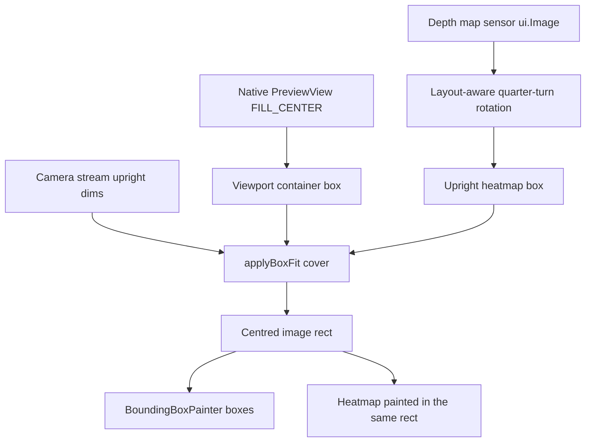

# Detection Alignment and Chart Readability — Analysis

- **Date:** 2026-11-09
- **Feature slug:** `detection-alignment-charts`
- **Stage:** 1 of 4 (analysis). Sources of truth for downstream stages: `{slug}-plan.md` → `{slug}-design-spec.md` → this file.
- **Task type:** UI alignment/readability fix — visual output changes, so the design-spec stage **IS** required.
- **Document location:** `docs/frontend-workflow/` — the established location for pipeline documents in this repository (same directory as [`detection-redesign-plan.md`](detection-redesign-plan.md), [`detection-screen-analysis.md`](detection-screen-analysis.md)). Not `docs/` root.
- **Scope discipline:** no code was changed in this stage. No `flutter test`, `flutter analyze`, or build was run. Every line number below was read from the current working tree at the time of writing; line numbers may shift if the files are edited before the design-spec stage.

---

## 0. Live entry points and the removed Custom screen

| Purpose | Verified location |
|---|---|
| Detection screen widget | [`UltralyticsDetectionScreen`](../../lib/screens/ultralytics_detection_screen.dart:231) (state class at [:297](../../lib/screens/ultralytics_detection_screen.dart:297)) |
| Engine wrapper | [`engine_detection_screen.dart:121`](../../lib/screens/engine_detection_screen.dart:121) returns `UltralyticsDetectionScreen` |
| Shell injection | [`app_shell.dart:360-362`](../../lib/navigation/app_shell.dart:360) — tab index 1 builds `EngineDetectionScreen` |
| Logs & Reports push | [`app_shell.dart:341-343`](../../lib/navigation/app_shell.dart:341) → [`LogsReportsScreen`](../../lib/screens/logs_reports_screen.dart:49) |
| Charts host | [`_ChartsTab`](../../lib/screens/logs_reports_screen.dart:1270) inside `LogsReportsScreen` |

**`lib/screens/detection_screen.dart` no longer exists.** Confirmed by a directory listing of `lib/screens/`, which contains only `engine_detection_screen.dart`, `help_screen.dart`, `home_screen.dart`, `logs_reports_screen.dart`, `settings_screen.dart`, and `ultralytics_detection_screen.dart`. The absence is already recorded in [`talkback-semantics-analysis.md:25`](talkback-semantics-analysis.md:25) and guarded by [`test/architecture/no_custom_engine_test.dart:11-21`](../../test/architecture/no_custom_engine_test.dart:11), which fails the suite if `InferenceEngine.custom`, `Custom EyeCue`, `tflite_flutter`, `inference_isolate`, `tensor_rotation`, `png_encoder`, `forensic_log`, `inference_worker_lifecycle`, or `classicLiteRt` reappear anywhere under `lib/`, `test/`, or `android/`.

**Downstream stages must never be told to edit `detection_screen.dart`.** There is exactly one Detection screen.

---

## 1. File map

Legend: **UI-owned** = `lib/screens/`, `lib/widgets/`, `lib/navigation/`, `lib/theme/` (the only folders UI work may modify). **Out of scope** = everything else.

| File | Role for these five fixes | Ownership |
|---|---|---|
| [`lib/screens/ultralytics_detection_screen.dart`](../../lib/screens/ultralytics_detection_screen.dart:1) | The only Detection screen. Owns Issue 1 (top-bar / viewport / action-row insets) and Issue 3 (`_AudioPill`, [:1892](../../lib/screens/ultralytics_detection_screen.dart:1892)). Also composes Issue 2's heatmap call site ([:1722-1726](../../lib/screens/ultralytics_detection_screen.dart:1722)). | UI-owned |
| [`lib/widgets/depth_heatmap_view.dart`](../../lib/widgets/depth_heatmap_view.dart:1) | Issue 2. The heatmap widget whose rotation is paint-only. | UI-owned |
| [`lib/widgets/bounding_box_painter.dart`](../../lib/widgets/bounding_box_painter.dart:1) | Issue 2 reference geometry. Holds `_calculateImageRect` ([:89](../../lib/widgets/bounding_box_painter.dart:89)) — private static, i.e. not reusable as-is. | UI-owned |
| [`lib/widgets/charts.dart`](../../lib/widgets/charts.dart:1) | Issues 4 and 5. Axis titles, tick formatting, axis colour, the `_fpsBenchmark` constant and its dashed line. | UI-owned |
| [`lib/screens/logs_reports_screen.dart`](../../lib/screens/logs_reports_screen.dart:1) | Issues 4 and 5. `_ChartCard` ([:1782](../../lib/screens/logs_reports_screen.dart:1782)) owns the title-to-chart gap and the fixed `kChartHeight`; the `15 FPS target` title literal is at [:1305](../../lib/screens/logs_reports_screen.dart:1305). | UI-owned |
| [`lib/widgets/status_pill.dart`](../../lib/widgets/status_pill.dart:1) | Issue 3 visual reference (the pill the audio capsule must match). | UI-owned |
| [`lib/widgets/detection_information_overlay.dart`](../../lib/widgets/detection_information_overlay.dart:57) | Issue 1 consequence: its in-viewport margin is `kSpace16` from the *viewport* edge, so a viewport gutter pushes its content further from the screen edge. | UI-owned |
| [`lib/widgets/detection_action_controls.dart`](../../lib/widgets/detection_action_controls.dart:337) | Issue 1: the `kSpace12` at [:343](../../lib/widgets/detection_action_controls.dart:343) is the gap **between** the two cards and must not change. | UI-owned |
| [`lib/theme/app_spacing.dart`](../../lib/theme/app_spacing.dart:1) | Token source for all spacing values used by Issues 1, 3, 4. | UI-owned |
| [`lib/theme/app_colors.dart`](../../lib/theme/app_colors.dart:1) | Token source for Issue 4 contrast (`kHomeInk`, `kHomeInkMuted`, `kHomeSurfaceCard`, …) and Issue 3 (`kOnAccentWhite`). | UI-owned |
| [`lib/theme/app_radii.dart`](../../lib/theme/app_radii.dart:1) | `kRadius20` / `kRadius24` used by the pills and viewport. | UI-owned |
| [`lib/theme/app_home_theme.dart`](../../lib/theme/app_home_theme.dart:1) | `kHomeShadowSoft` ([:18-24](../../lib/theme/app_home_theme.dart:18)) and `buildHomeTheme()` ([:31](../../lib/theme/app_home_theme.dart:31)), which deliberately does **not** override `titleSmall`. | UI-owned |
| [`lib/models/box_transform.dart`](../../lib/models/box_transform.dart:48) | Read-only reference: `displayRotationDegrees()` ([:48](../../lib/models/box_transform.dart:48)) and `uprightDims()` ([:74](../../lib/models/box_transform.dart:74)) are the rotation contract the heatmap must honour. | **Out of scope** (`lib/models/`) |
| [`plugins/ultralytics_yolo/android/src/main/kotlin/com/ultralytics/yolo/YOLOView.kt`](../../plugins/ultralytics_yolo/android/src/main/kotlin/com/ultralytics/yolo/YOLOView.kt:254) | Read-only evidence only: `PreviewView.ImplementationMode.COMPATIBLE` + `PreviewView.ScaleType.FILL_CENTER` ([:254-255](../../plugins/ultralytics_yolo/android/src/main/kotlin/com/ultralytics/yolo/YOLOView.kt:254)) — the native preview centre-crops, which is why `BoxFit.cover` is the correct counterpart. | **Out of scope** (`plugins/`) |
| [`pubspec.yaml`](../../pubspec.yaml:26) | `fl_chart: ^1.2.0` (lockfile resolves **1.2.0**, [`pubspec.lock:171`](../../pubspec.lock:171)). | **Out of scope** |
| `test/widgets/charts_test.dart`, `test/widgets/depth_heatmap_view_test.dart`, `test/screens/logs_reports_screen_test.dart`, `test/screens/detection_redesign_parity_test.dart`, `test/screens/gesture_navigation_direction_test.dart`, `test/accessibility/semantics_test.dart`, `test/screens/depth_overlay_state_test.dart` | Existing assertions that constrain the fixes (full inventory in §3). | **Out of scope** (see §3.5) |

---

## 2. Confirmed root cause per issue

### Issue 1 — Detection screen horizontal alignment: **CONFIRMED**

Three different horizontal insets exist in the Detection `Column`:

| Region | Verified inset | Location |
|---|---|---|
| Top bar (title + status pill + audio pill) | `EdgeInsets.fromLTRB(kSpace16, kSpace16, kSpace16, kSpace8)` | [`ultralytics_detection_screen.dart:1547-1548`](../../lib/screens/ultralytics_detection_screen.dart:1547) |
| Main area / camera viewport | **0 dp on all sides** — `Expanded(child: _buildMainArea(context))` with no padding, and the viewport `Container` has only `color`, `borderRadius`, and `clipBehavior` | `Expanded` at [:1531](../../lib/screens/ultralytics_detection_screen.dart:1531); viewport `Container` at [:1655-1660](../../lib/screens/ultralytics_detection_screen.dart:1655) |
| Action controls row | `EdgeInsets.fromLTRB(kSpace12, kSpace8, kSpace12, kSpace12)` | [`ultralytics_detection_screen.dart:1861-1867`](../../lib/screens/ultralytics_detection_screen.dart:1861) |

```dart
// ultralytics_detection_screen.dart:1655
final viewport = Container(
  decoration: BoxDecoration(
    color: kHomeInk,
    borderRadius: BorderRadius.circular(kRadius24),
  ),
  clipBehavior: Clip.antiAlias,
  child: Stack(fit: StackFit.expand, children: [...YOLOView, heatmap, boxes, overlay]),
);
```

Aggravating details, all confirmed:

- The action row sits on an edge-to-edge band: `Container(color: kHomeSurfaceBase)` at [:1857-1858](../../lib/screens/ultralytics_detection_screen.dart:1857) spans the full width *behind* the 12 dp padding, so the coloured band visually touches both screen edges while its cards sit 12 dp in.
- `kHomeShadowSoft` has `blurRadius: 18` ([`app_home_theme.dart:18-24`](../../lib/theme/app_home_theme.dart:18)) and is applied to both action cards ([`detection_action_controls.dart:390`](../../lib/widgets/detection_action_controls.dart:390), [:484](../../lib/widgets/detection_action_controls.dart:484)). The blur extends past the card's layout box, so the perceived left/right card edge sits outside the 12 dp inset — this is why 12 dp does not read as aligned with a 16 dp header.
- The `kSpace12` at [`detection_action_controls.dart:343`](../../lib/widgets/detection_action_controls.dart:343) is the gap **between** the two `Expanded` cards. It must not be changed by an Issue 1 fix.
- Non-live panels use a **third** value: `EdgeInsets.all(24)` raw literals in `_buildPermissionDenied` ([:1785](../../lib/screens/ultralytics_detection_screen.dart:1785)) and `_buildCameraPending` ([:1821](../../lib/screens/ultralytics_detection_screen.dart:1821)). These are hardcoded, not tokens. Whether Issue 1's "one consistent 16 dp gutter" also covers these two panels is a design-spec decision — the user decision named "header, camera viewport, and bottom action cards" only.
- Depth-degraded retry and model-change notice already use `kSpace16` ([:1486](../../lib/screens/ultralytics_detection_screen.dart:1486), [:1501-1506](../../lib/screens/ultralytics_detection_screen.dart:1501)), so they already agree with the header.

**Consequence to record (from the prior pass, re-verified):** the in-viewport overlay uses `margin: EdgeInsets.symmetric(horizontal: kSpace16, vertical: kSpace12)` relative to the **viewport** ([`detection_information_overlay.dart:70-73`](../../lib/widgets/detection_information_overlay.dart:70)). Once the viewport itself carries a 16 dp gutter, the overlay's dark card will sit **32 dp** from the screen edge while the action cards sit at 16 dp. That is a new intentional-or-not visual relationship the design-spec must decide on; it is not currently an inconsistency because the viewport is edge-to-edge today.

### Issue 2 — Portrait heatmap geometry: **CONFIRMED**

Current widget ([`depth_heatmap_view.dart:24-53`](../../lib/widgets/depth_heatmap_view.dart:24)):

```dart
final swapped = rotation == 90 || rotation == 270;
final uprightWidth  = (swapped ? current.height : current.width).toDouble();
final uprightHeight = (swapped ? current.width  : current.height).toDouble();
return IgnorePointer(child: ExcludeSemantics(child: ClipRect(
  child: FittedBox(
    fit: BoxFit.cover,
    clipBehavior: Clip.hardEdge,
    child: SizedBox(
      width: uprightWidth, height: uprightHeight,      // outer, upright box
      child: Transform.rotate(
        angle: rotation * math.pi / 180,
        child: SizedBox(
          width: current.width.toDouble(),             // inner, sensor box
          height: current.height.toDouble(),
          child: RawImage(image: current, fit: BoxFit.fill),
        ),
      ),
    ),
  ),
)));
```

Why it is wrong, confirmed against the Flutter API:

1. `SizedBox` passes **tight** constraints to its child. The inner sensor-sized `SizedBox` is therefore forced to the outer upright box's size, so `RawImage(fit: BoxFit.fill)` stretches the geometry into the wrong aspect ratio *before* rotation.
2. `Transform.rotate` is a **paint-only** effect. Flutter's own documentation states: *"Unlike RotatedBox, which applies a rotation prior to layout, this object applies its transformation just prior to painting, which means the transformation is not taken into account when calculating how much space this widget's child (and thus this widget) consumes"* (verified via Context7, Flutter API docs — `Transform` and `RotatedBox` pages).
3. The result is a sensor-aspect grid stretched into an upright-aspect box, then rotated and painted outside its measured bounds and clipped — i.e. stretched, mis-scaled, and off-centre.

Portrait resolves to a quarter turn: [`BoxTransform.displayRotationDegrees`](../../lib/models/box_transform.dart:48) returns `(sensorOrientation − deviceDegrees + 360) % 360`, which for a 90° sensor in portrait is 90°; `_rotationDegrees` is computed once in the screen at [`ultralytics_detection_screen.dart:708`](../../lib/screens/ultralytics_detection_screen.dart:708) and passed to the heatmap at [:1725](../../lib/screens/ultralytics_detection_screen.dart:1725).

Why the **boxes** align and the heatmap does not:

- [`BoundingBoxPainter`](../../lib/widgets/bounding_box_painter.dart:26) is fed `imageSize = Size(_uprightWidth, _uprightHeight)` (the camera stream's upright dims, [:1734-1737](../../lib/screens/ultralytics_detection_screen.dart:1734)) and `fit: BoxFit.cover` ([:1738](../../lib/screens/ultralytics_detection_screen.dart:1738)).
- It maps with `applyBoxFit(fit, imageSize, previewSize)` then centres on the **upright** dimensions ([:98-103](../../lib/widgets/bounding_box_painter.dart:98)).
- The native preview is `PreviewView.ScaleType.FILL_CENTER` on the same container ([`YOLOView.kt:255`](../../plugins/ultralytics_yolo/android/src/main/kotlin/com/ultralytics/yolo/YOLOView.kt:255)), which is exactly what `BoxFit.cover` computes in Flutter.

So boxes already use the correct geometry; the heatmap simply never applies it.

### Issue 3 — AUDIO ON pill visual height: **CONFIRMED, with one correction to the prior framing**

The prior pass said padding is "already identical". That is true and remains true — but it is not the whole story:

| Property | `StatusPill` | `_AudioPill` |
|---|---|---|
| Horizontal/vertical padding | `symmetric(horizontal: kSpace12, vertical: kSpace6)` ([:33-36](../../lib/widgets/status_pill.dart:33)) | **identical** `symmetric(horizontal: kSpace12, vertical: kSpace6)` ([:1931-1934](../../lib/screens/ultralytics_detection_screen.dart:1931)) |
| Radius | `kRadius20` ([:39](../../lib/widgets/status_pill.dart:39)) | `kRadius20` ([:1936](../../lib/screens/ultralytics_detection_screen.dart:1936), and on the `Material` at [:1926](../../lib/screens/ultralytics_detection_screen.dart:1926)) |
| Glyph | 10 dp `Icon(Icons.circle)` ([:46](../../lib/widgets/status_pill.dart:46)) | 8 dp `Container` dot of `kSpace8` ([:1943-1945](../../lib/screens/ultralytics_detection_screen.dart:1943)) |
| Glyph→text gap | `kSpace6` ([:48](../../lib/widgets/status_pill.dart:48)) | `kSpace8` ([:1952](../../lib/screens/ultralytics_detection_screen.dart:1952)) |
| Border | `Border.all(Colors.white, width: 1.5)` ([:40](../../lib/widgets/status_pill.dart:40)) | none |
| Text | `fontSize: 13`, `w700`, `Colors.white` literals ([:52-56](../../lib/widgets/status_pill.dart:52)) | `labelMedium` (14 sp) + `kHomeInk` + `letterSpacing 0.5` ([:1956-1959](../../lib/screens/ultralytics_detection_screen.dart:1956)) |
| Shadow | none | `kHomeShadowSoft` ([:1937](../../lib/screens/ultralytics_detection_screen.dart:1937)) |
| **Touch-target wrapper** | none | `ConstrainedBox(minWidth: kMinTouchWidth, minHeight: kMinTouchHeight)` wrapping the **`Material`** ([:1918-1926](../../lib/screens/ultralytics_detection_screen.dart:1918)) |

**The corrected root cause:** the capsule is tall because the `ConstrainedBox` sits **outside** the `Material`, so the `Material` — which paints `kHomeSurfaceCard` — is forced to `minHeight: kMinTouchHeight` (**56 dp**, [`app_spacing.dart:46`](../../lib/theme/app_spacing.dart:46)). Padding is not the cause. `StatusPill` hugs its content (~28 dp). Token values confirm the 64×56 numbers at [`app_spacing.dart:43,46`](../../lib/theme/app_spacing.dart:43).

Cosmetic secondary differences (dot size, gap, border, type style) are *not* named in the user decision and must not be silently "harmonised" — the decision is that the visible capsule becomes content-sized so its height/padding is consistent with the status pill.

### Issue 4 — Chart readability on mobile: **CONFIRMED**

Verified chart configuration ([`charts.dart`](../../lib/widgets/charts.dart:273)):

```dart
TextStyle tickStyle() => const TextStyle(color: kHomeInkMuted, fontSize: 10);   // :280
leftTitles: AxisTitles(
  axisNameWidget: RotatedBox(quarterTurns: 3, child: Text(yName, ...)),          // :285-288
  axisNameSize: 24,                                                              // :289
  sideTitles: SideTitles(
    showTitles: true, interval: yInterval,
    reservedSize: 38,                                                            // :293
    getTitlesWidget: (value, meta) => SideTitleWidget(
      meta: meta, space: 4,
      child: Text(_formatAxisTick(value, yInterval), style: tickStyle()),        // :297 (no maxLines)
    ),
  ),
),
```

Causes, each verified:

1. **Y tick values wrap.** `reservedSize: 38` ([:293](../../lib/widgets/charts.dart:293)) is the hard width the tick text gets, and the tick `Text` sets no `maxLines`/`softWrap: false` ([:297](../../lib/widgets/charts.dart:297)). At 200 % text scale a 10 sp label renders at 20 sp; a value such as `41.2` needs more than 38 dp and wraps to two lines. fl_chart's `reservedSize` is documented as *"the maximum space that your titles need"* (verified via Context7, `SideTitles`), so it is the supported lever.
2. **Unnecessary numeric precision.** `_formatAxisTick` ([:323-339](../../lib/widgets/charts.dart:323)) raises precision until *both* the value and the interval are near-integers. Because `yInterval = maxY / 4` ([:84](../../lib/widgets/charts.dart:84), [:174](../../lib/widgets/charts.dart:174)) is almost never an integer, Y ticks routinely print one decimal (`10.3`, `20.6`, `30.9`) even when the axis does not need it.
3. **Axis/border contrast.** `_axisColor = Color(0xFFBDBDBD)` ([:10](../../lib/widgets/charts.dart:10)) on `kHomeSurfaceCard` `#FFFFFF` — a very low-contrast line. Note the *tick text* already uses `kHomeInkMuted` `#667085` ([:280](../../lib/widgets/charts.dart:280); token at [`app_colors.dart:85`]), which is a mid grey with substantially better contrast; the weak element is the axis/border stroke, not the tick glyph colour.
4. **Title-to-chart spacing is one step.** `_ChartCard` = `Text(title, titleSmall + w800)` → `SizedBox(height: kSpace8)` → `SizedBox(height: kChartHeight)` ([:1795-1802](../../lib/screens/logs_reports_screen.dart:1795)). `kChartHeight = 180` ([`app_spacing.dart:40`](../../lib/theme/app_spacing.dart:40)).
5. **Y-axis name duplicates the card title.** Card titles are `Inference Latency…` ([:1300](../../lib/screens/logs_reports_screen.dart:1300)), `Frames Per Second…` ([:1305](../../lib/screens/logs_reports_screen.dart:1305)), `Detection Frequency…` ([:1313](../../lib/screens/logs_reports_screen.dart:1313)); inside the same card the Y axis is named `Latency (ms)` / `FPS` / `Detections` ([:82](../../lib/widgets/charts.dart:82), [:172](../../lib/widgets/charts.dart:172), [:259](../../lib/widgets/charts.dart:259)). The rotated Y name also consumes `axisNameSize: 24` of the narrow left gutter on top of the 38 dp tick reserve.

Available plot width, derived arithmetically from verified paddings: `_BoundedScrollView` list padding `horizontal: kSpace16` ([:1684-1685](../../lib/screens/logs_reports_screen.dart:1684)) + `_LightCard` `padding: EdgeInsets.all(kSpace16)` ([:1706-1708](../../lib/screens/logs_reports_screen.dart:1706)) ⇒ a 360 dp phone gives a 296 dp chart; a 320 dp phone gives 256 dp. That is the budget the 38 dp tick reserve + 24 dp axis name are competing for.

### Issue 5 — FPS chart 15 FPS wording and benchmark line: **CONFIRMED**

| Element | Location |
|---|---|
| Title literal `'Frames Per Second$claim (15 FPS target)'` | [`logs_reports_screen.dart:1305`](../../lib/screens/logs_reports_screen.dart:1305) |
| `const double _fpsBenchmark = 15.0;` | [`charts.dart:18`](../../lib/widgets/charts.dart:18) |
| `final showBenchmark = maxY >= _fpsBenchmark;` | [`charts.dart:146`](../../lib/widgets/charts.dart:146) |
| Dashed `HorizontalLine(y: _fpsBenchmark, color: Colors.greenAccent, dashArray: [6, 4])` | [`charts.dart:176-186`](../../lib/widgets/charts.dart:176) |
| Doc comment "the 15 FPS target line is drawn only when it fits" | [`charts.dart:115-116`](../../lib/widgets/charts.dart:115) |

**Scope nuance the design-spec must preserve:** the *latency* chart has an analogous but **separate** benchmark — `_latencyBenchmarkMs = 300.0` ([:17](../../lib/widgets/charts.dart:17)), its own dashed `Colors.redAccent` line ([:86-96](../../lib/widgets/charts.dart:86)), and the title suffix `(300 ms benchmark)` ([:1300](../../lib/screens/logs_reports_screen.dart:1300)). The user decision names only the **15 FPS** wording and line. The 300 ms latency benchmark is **not** in scope and must not be removed as collateral.

No existing test asserts the presence or absence of either dashed line (verified: no assertion in `test/` matches `extraLinesData`, `benchmark` line-drawing, `rotateAngle`, or `labelRotation`). Only the **title strings** are asserted.

---

## 3. Current constraint surface

### 3.1 Issue 1 (gutter)

- **Semantics:** none of the affected containers carry semantics. The top bar's `Detection` header node ([:1556-1566](../../lib/screens/ultralytics_detection_screen.dart:1556)) and the viewport's `Camera view` container + `Repeat last alert` custom action ([:1768-1777](../../lib/screens/ultralytics_detection_screen.dart:1768)) must keep their labels, `container: true`, `explicitChildNodes: true`, and custom action. Adding padding around the viewport does not change the semantic node, but the designer must not wrap the `GestureSurface`/`Semantics` pair in a way that introduces a second node.
- **Gesture region:** the gesture region is "the whole flexible area between the top bar and the action-controls row" (comment at [:1521-1530](../../lib/screens/ultralytics_detection_screen.dart:1521)). A horizontal gutter on the viewport **shrinks the camera viewport but not the flexible area** — the gesture region must remain the full flexible area, so the gutter must be applied *inside* the current `Expanded`→`GestureSurface` structure, not by padding the `Expanded` itself. Otherwise the recorded device-verified behaviour ("swipes work anywhere on the working area") changes. Guarded by [`gesture_navigation_direction_test.dart`](../../test/screens/gesture_navigation_direction_test.dart) (main-area swipe cases).
- **Animation rule:** no animation is involved; padding only. `.roo/rules/rules-frontend/05-animation.md` is satisfied trivially, but no `AnimatedContainer` may be introduced for this.
- **Token rule:** the 16 dp value must be `kSpace16` ([`app_spacing.dart:28`](../../lib/theme/app_spacing.dart:28)), never a raw `16`. Moving the 12 dp action-row padding to 16 dp is a **deliberate visual change**, which is allowed here (unlike the token-introduction refactors, which must not change output).
- **Tests:** no test currently asserts screen-level horizontal geometry. [`ultralytics_detection_screen_layout_test.dart`](../../test/screens/ultralytics_detection_screen_layout_test.dart:1) and [`detection_redesign_parity_test.dart`](../../test/screens/detection_redesign_parity_test.dart:1) both state they cannot pump the real screen, so they exercise composition only; [`detection_redesign_regression_test.dart:65`](../../test/screens/detection_redesign_regression_test.dart:65) asserts only that the control row's height is finite. **Consequence: the gutter fix is currently unverified by any automated test** — a new assertion is needed, and `test/` is outside the four UI-owned folders (§3.5).

### 3.2 Issue 2 (heatmap geometry)

- **Touch/semantics:** the widget must stay pointer-inert and semantics-free — `IgnorePointer` + `ExcludeSemantics` ([:32-33](../../lib/widgets/depth_heatmap_view.dart:32)) are asserted by [`depth_heatmap_view_test.dart:49-57`](../../test/widgets/depth_heatmap_view_test.dart:49) and [`depth_overlay_state_test.dart:188-189`](../../test/screens/depth_overlay_state_test.dart:188) ("The decorative heatmap is pointer-inert and semantics-free"). Any rewrite must keep both wrappers.
- **Accessibility rule:** `.roo/rules/rules-frontend/04-accessibility.md` — decorative content must stay out of the accessibility tree and must not become a live region. Unchanged by this fix.
- **Animation rule:** the heatmap redraws per depth frame; it must not gain an animation or an `AnimatedSwitcher`. Rendering only.
- **Existing test that will break by construction:** [`depth_heatmap_view_test.dart:23-47`](../../test/widgets/depth_heatmap_view_test.dart:23) asserts `FittedBox.fit == BoxFit.cover` and that the **first** `SizedBox` descendant of the `FittedBox` is `20×40` for a `40×20` image at 90°. That assertion encodes the *current* (buggy) structure. If the fix replaces the `FittedBox` (e.g. with a `CustomPainter` or a `LayoutBuilder`) or reorders the boxes, this test must be rewritten to assert the new invariant instead (aspect preserved, centring, cover-crop, upright dims).
- **`lib/models/` boundary:** `BoxTransform.uprightDims` ([:74](../../lib/models/box_transform.dart:74)) and `displayRotationDegrees` ([:48](../../lib/models/box_transform.dart:48)) are **read-only**. The fix may call them; it may not edit that file. `rotationDegrees` is already passed in, so no new model change is required.

### 3.3 Issue 3 (audio pill)

- **Accessibility contract (verified, must not break):**
  - Exactly **one** semantic node for the pill, label `Audio guidance, on` / `Audio guidance, off`, `isButton == true`, has a `tap` action, and **zero** custom semantics actions — asserted in [`gesture_navigation_direction_test.dart:434-461`](../../test/screens/gesture_navigation_direction_test.dart:434) ("the audio pill is one mute node with no custom action"), and the tap action is exercised at [:564-573](../../test/screens/gesture_navigation_direction_test.dart:564).
  - `Repeat last alert` must remain on the `Camera view` node, not the pill (`labelledCustomActions(tester)` must equal `['Repeat last alert']`, [:457](../../test/screens/gesture_navigation_direction_test.dart:457)).
  - The pill's presence as `Text('AUDIO ON')` in the shared header contract is asserted in [`detection_redesign_parity_test.dart:69,94`](../../test/screens/detection_redesign_parity_test.dart:69).
  - `.roo/rules/rules-frontend/04-accessibility.md`: minimum touch targets reference `kMinTouchWidth`/`kMinTouchHeight`; a `hint` must describe an outcome and must never teach gestures; the packet is documented as **mute/unmute only**.
  - `test/architecture/talkback_no_gesture_hints_test.dart` is a source guard forbidding gesture-teaching strings — do not introduce any `hint`/`value` wording while restructuring.
- **The hard structural problem:** today the hit area and the painted capsule are the same rectangle, because `ConstrainedBox` wraps `Material`. Shrinking the visible capsule while keeping the 64×56 target requires separating "painted capsule" from "hit area" — e.g. keep the outer `ConstrainedBox`/`SizedBox` as the hit area with a transparent `Material`/`InkWell` at that level and a content-sized inner `Container` for the visible capsule. Whatever structure is chosen must keep the single-node semantics, the `onTap` wiring, the tooltip text, and the ≥64×56 tappable rectangle. **No test currently asserts the 56 dp height** (verified: no test references `kMinTouchHeight`, `kMinTouchWidth`, or a 56/64 size for this widget), so the size assertion is a new test the design-spec should require.
- **Token rule:** the current shadow is `kHomeShadowSoft` and the surface is `kHomeSurfaceCard`; both remain. No new colour is needed.

### 3.4 Issues 4 and 5 (charts)

- **Tests that will need to change:**
  - [`test/screens/logs_reports_screen_test.dart:373`](../../test/screens/logs_reports_screen_test.dart:373) — `expect(find.text('Frames Per Second (15 FPS target)'), findsOneWidget);`
  - [`test/screens/logs_reports_screen_test.dart:1584`](../../test/screens/logs_reports_screen_test.dart:1584) — `expect(find.text('Frames Per Second — Obstacle Detector v2 (15 FPS target)'), findsOneWidget);`
  - [`test/widgets/charts_test.dart:95`](../../test/widgets/charts_test.dart:95) — `expect(find.text('FPS'), findsOneWidget);` **only if** the design-spec drops or renames the Y-axis name for the FPS chart.
  - [`test/widgets/charts_test.dart:209`](../../test/widgets/charts_test.dart:209) — the `(FpsChart(...), 'Elapsed time (s)', 'FPS')` tuple, consumed at [:219](../../test/widgets/charts_test.dart:219) as `expect(find.text(yAxis), findsOneWidget)` in the "axis labels fit at narrow width and 200% text scale" case.
  - If the Y-axis names of the latency and frequency charts change too, then also [`charts_test.dart:90`](../../test/widgets/charts_test.dart:90) (`'Latency (ms)'`) and [:100](../../test/widgets/charts_test.dart:100) (`'Detections'`).
- **Tests that must keep passing unchanged (hard limits on the fix):**
  - [`charts_test.dart:130-163`](../../test/widgets/charts_test.dart:130) — "sub-second elapsed ticks are accurate and fit narrowly": at **200 % text scale, width 260**, the X labels `0`, `0.5`, `1` must all be found and their rects must not overlap. **This forbids blanket precision reduction**: fractional *elapsed-time* ticks (`0.5`, `1.5`) carry meaning. Precision reduction must target the Y axis (and/or values whose interval is integer), never the X elapsed ticks.
  - [`charts_test.dart:165-198`](../../test/widgets/charts_test.dart:165) — same shape with `0`, `1.5`, `3`.
  - [`charts_test.dart:104-128`](../../test/widgets/charts_test.dart:104) — `chart.data.minX == 0`, `maxX == 9`, spots `[0, 2, 9]`. Do not alter plot X domain.
  - [`charts_test.dart:38-83`](../../test/widgets/charts_test.dart:38) — empty/high/constant/single-value datasets must not throw, and the empty placeholder text stays `'No data available yet'`.
  - [`charts_test.dart:224-280`](../../test/widgets/charts_test.dart:224) — semantics summaries: `mixed-model data` present for two same-named graphs; one identity reported by its latest name.
  - [`test/accessibility/semantics_test.dart:342-374`](../../test/accessibility/semantics_test.dart:342) — exact summary prefixes `^Inference latency chart\. Latest 50\.0 milliseconds;`, `^Frames per second chart\. Latest 20\.0 frames per second;`, `^Detection frequency chart\. 5 detections across 2 minutes\.`; and [:376-399](../../test/accessibility/semantics_test.dart:376) for the empty prefix `No data available yet.`. **The `Semantics` labels in `charts.dart` must not change.**
  - [`test/screens/logs_reports_screen_test.dart:1314`](../../test/screens/logs_reports_screen_test.dart:1314) — "Charts has no overflow at 200 percent text scale" at `390×844`, `textScale: 2`. Increasing `reservedSize` or `axisNameSize` or the title gap must not overflow this.
  - [`test/screens/logs_reports_screen_test.dart:366-374`](../../test/screens/logs_reports_screen_test.dart:366) — the three chart regions still render, and `'Inference Latency (300 ms benchmark)'` and `'Detection Frequency'` titles are asserted (only the FPS title changes).
  - All the model-claim title assertions at [:1560](../../test/screens/logs_reports_screen_test.dart:1560), [:1578](../../test/screens/logs_reports_screen_test.dart:1578), [:1587](../../test/screens/logs_reports_screen_test.dart:1587), [:1702](../../test/screens/logs_reports_screen_test.dart:1702), [:1729](../../test/screens/logs_reports_screen_test.dart:1729), [:1750](../../test/screens/logs_reports_screen_test.dart:1750), [:1789](../../test/screens/logs_reports_screen_test.dart:1789) refer to the **latency** title and must stay untouched.
- **fl_chart API facts (verified via Context7 for 1.2.0):**
  - There is **no** `labelRotation`. `rotateAngle` was removed before 1.x.
  - `SideTitles.reservedSize` is documented as *"the maximum space that your titles need"* (default 22) — the supported lever for wrapping.
  - `SideTitleWidget` **does** accept `angle` (radians) and `fitInside` (`SideTitleFitInsideData`) — so rotating tick labels *is* possible without an extra package, if the design-spec wants it. `SideTitleWidget` also takes `space` (default 8; the charts use 4).
  - Existing use of `RotatedBox(quarterTurns: 3)` ([:285-288](../../lib/widgets/charts.dart:285)) is on the axis **name** only and is correct for vertical text.
- **Animation rule:** chart changes are styling only. No implicit-animation coupling is introduced (`fl_chart` will animate bounds if they change; that is pre-existing behaviour, not new).
- **Token rule:** `_axisColor`, `_lineColor`, `Colors.redAccent`, `Colors.greenAccent`, and the `fontSize: 10`/`fontSize: 13`/`width: 1.5` literals are raw values in UI-owned files. Improving contrast "using the existing design system" means switching to existing tokens where a matching token exists (§4) — not inventing a new hex.

### 3.5 `test/` is outside the four UI-owned folders — explicit flag

`.roo/rules/rules-frontend/01-scope.md` limits UI work to `lib/screens/`, `lib/widgets/`, `lib/navigation/`, `lib/theme/`. Every test edit listed above is **outside** that boundary. The Issue-5 title assertions **must** change (the string they assert is being deleted), so the plan stage must list the test files explicitly and get them approved rather than treating them as silent scope expansion. `.roo/rules/rules-frontend/07-verification.md` independently requires `flutter test` after every change, so a stale assertion would leave the suite red.

---

## 4. Token inventory

Available now (verified line numbers):

| Token | Value | Location | Used by |
|---|---|---|---|
| `kSpace2/4/6/8/10/12/14/16/20/24/32` | 2…32 | [`app_spacing.dart:7,10,13,16,19,22,25,28,31,34,37`](../../lib/theme/app_spacing.dart:7) | Issues 1, 3, 4 |
| `kChartHeight` | 180 | [`app_spacing.dart:40`](../../lib/theme/app_spacing.dart:40) | Issue 4 |
| `kMinTouchWidth` | 64 | [`app_spacing.dart:43`](../../lib/theme/app_spacing.dart:43) | Issue 3 |
| `kMinTouchHeight` | 56 | [`app_spacing.dart:46`](../../lib/theme/app_spacing.dart:46) | Issue 3 |
| `kRadius6/12/20/3/14/24` | 6…24 | [`app_radii.dart:7,10,13,16,19,22`](../../lib/theme/app_radii.dart:7) | Issues 1, 3 |
| `kHomeSurfaceBase` | `#F5F5F5` | [`app_colors.dart:73`](../../lib/theme/app_colors.dart:73) | Issue 1 (action-row band) |
| `kHomeSurfaceCard` | `#FFFFFF` | [`app_colors.dart:76`](../../lib/theme/app_colors.dart:76) | Issue 3, Issue 4 (axis contrast backdrop) |
| `kHomeSurfaceCard96` | `#F5FFFFFF` | [`app_colors.dart:79`](../../lib/theme/app_colors.dart:79) | unused here |
| `kHomeInk` | `#0A0A0A` | [`app_colors.dart:82`](../../lib/theme/app_colors.dart:82) | Issue 1 viewport fill, Issue 3 text |
| `kHomeInkMuted` | `#667085` | [`app_colors.dart:85`](../../lib/theme/app_colors.dart:85) | Issue 4 tick text (already in use) |
| `kHomeAccentCyan` / `…CyanLight` / `…CyanDark` | `#22C7F2` / `#B9EFFF` / `#087A9E` | [`app_colors.dart:88,91,94`](../../lib/theme/app_colors.dart:88) | Issue 3 dot, Issue 4 potential axis colour |
| `kHomeWarningAmber` | `#F5B942` | [`app_colors.dart:97`](../../lib/theme/app_colors.dart:97) | unused here |
| `kHomeOverlayWhite11` | `#1CFFFFFF` | [`app_colors.dart:101`](../../lib/theme/app_colors.dart:101) | unused here |
| `kOnAccentWhite` | `Colors.white` | [`app_colors.dart:54`](../../lib/theme/app_colors.dart:54) | available replacement for the `StatusPill` `Colors.white` literals |
| `kOverlayBlack` | `#CC000000` | [`app_colors.dart:51`](../../lib/theme/app_colors.dart:51) | overlay container (Issue 1 consequence) |
| `kHomeShadowSoft` | `rgba(10,10,10,0.08)`, blur 18 | [`app_home_theme.dart:18-24`](../../lib/theme/app_home_theme.dart:18) | Issues 1, 3 |
| `kAccent` | `#FFC107` | [`app_colors.dart:27`](../../lib/theme/app_colors.dart:27) | equals `_lineColor` `0xFFFFC107` ([:11](../../lib/widgets/charts.dart:11)) — a match exists, but `kAccent` is a **dark-theme** token; whether chart series colour should migrate to it is a design-spec call, not an analysis call. |

**Values the fixes need that do NOT exist as tokens:**

1. **A chart axis/border colour.** `_axisColor = Color(0xFFBDBDBD)` ([`charts.dart:10`](../../lib/widgets/charts.dart:10)) has no token. Candidates that already exist: `kHomeInkMuted` (same colour family as the tick text, and using one colour for both ticks and axis *actively removes visual noise*), or `kHomeInk` at reduced opacity. **A new token is only needed if the design-spec picks a value that is none of these.**
2. **A chart tick font size.** Currently `fontSize: 10` ([`charts.dart:280`](../../lib/widgets/charts.dart:280)). No typography token exists for it; `buildHomeTheme()` does not override `labelSmall`/`titleSmall` ([`app_home_theme.dart:43-94`](../../lib/theme/app_home_theme.dart:43)), so a theme-derived size would change. Whether 10 sp stays, becomes `labelSmall` (14 sp), or becomes a new token is a design-spec decision. Note that any increase must survive the width-260 / 200 %-text-scale tests above.
3. **Y-axis reserved width.** `reservedSize: 38` and `axisNameSize: 24` are local literals ([`charts.dart:289,293`](../../lib/widgets/charts.dart:289)). They are layout metrics, not design tokens; the convention in this repo is that only colours/spacing/radii/typography are tokens, so these should probably stay local literals with a comment — flagged so the design-spec does not invent `kChartAxisWidth` without justification.
4. **Title-to-chart spacing.** Currently `kSpace8` ([`logs_reports_screen.dart:1801`](../../lib/screens/logs_reports_screen.dart:1801)). "Increase title-to-chart spacing" can be satisfied with the **existing** `kSpace12` or `kSpace16`; no new token is needed.

**No new colour value is required by any of the five decisions** if the design-spec reuses `kHomeInkMuted` (axis + ticks) and the existing spacing/radii scale. `.roo/rules/rules-frontend/03-design-tokens.md` forbids hardcoding a new literal instead.

---

## 5. Geometry note (Issue 2)

### 5.1 The exact geometry the boxes use

```dart
// bounding_box_painter.dart:89 — private static
static Rect _calculateImageRect(Size previewSize, Size imageSize, BoxFit fit) {
  if (imageSize.width <= 0 || imageSize.height <= 0) {
    return Rect.fromLTWH(0, 0, previewSize.width, previewSize.height);
  }
  final FittedSizes fitted = applyBoxFit(fit, imageSize, previewSize);
  final Size scaled = fitted.destination;
  final double offsetX = (previewSize.width  - scaled.width ) / 2.0;
  final double offsetY = (previewSize.height - scaled.height) / 2.0;
  return Rect.fromLTWH(offsetX, offsetY, scaled.width, scaled.height);
}
```

with `imageSize` = **upright** camera dims and `fit = BoxFit.cover`. Normalized boxes are then mapped as `imageRect.left + normLeft * imageRect.width`, etc.

### 5.2 Is the geometry reusable? — **Not today; it is `private static`**

`_calculateImageRect` is a private static method of [`BoundingBoxPainter`](../../lib/widgets/bounding_box_painter.dart:89). It cannot be called from [`DepthHeatmapView`](../../lib/widgets/depth_heatmap_view.dart:11) without one of:

| Option | Change | Consequence |
|---|---|---|
| **A. Promote it** to a public static (e.g. `BoundingBoxPainter.calculateImageRect` or a new small top-level helper in `bounding_box_painter.dart`) | One visibility/rename edit in a UI-owned file | Single source of truth; both the painter and the heatmap provably use identical math; touches an extra UI-owned file, and the painter is currently named in "do not modify" language in the historical redesign docs (`visual-redesign.md`) — justification is required against that. |
| **B. Duplicate the 8 lines** into the heatmap widget | Isolated to `depth_heatmap_view.dart` | Zero coupling; two copies of the same math can drift. |
| **C. Don't compute the rect at all — let a layout widget do it** (see 5.3) | Isolated to `depth_heatmap_view.dart` | `FittedBox(fit: BoxFit.cover)` *is* `applyBoxFit` + centring (the painter's own doc comment at [:17-18](../../lib/widgets/bounding_box_painter.dart:17) says so), so this is mathematically the same geometry without a shared helper. |

**The analysis recommends Option C as the minimum-diff shape**, with Option A only if the design-spec wants a provable single source of truth. This is a design-spec decision, not settled here.

### 5.3 `RotatedBox` vs `Transform.rotate` — verified

| | `Transform.rotate` (current) | `RotatedBox` |
|---|---|---|
| Layout effect | **None.** Paint-only. The child's layout size is unchanged. | **Rotates before layout.** For a quarter turn the child's constraints are swapped and the widget's own size becomes the child's rotated size. |
| Documented wording | *"applies its transformation just prior to painting … not taken into account when calculating how much space this widget's child (and thus this widget) consumes"* | *"Unlike Transform, which applies a transform just prior to painting, this object applies its rotation prior to layout, which means the entire rotated box consumes only as much space as required by the rotated child."* |

Both verified via Context7 (`api.flutter.dev` `Transform` and `RotatedBox` pages).

So the minimal, layout-aware rewrite is:

```dart
FittedBox(
  fit: BoxFit.cover,                       // identical geometry to the painter
  clipBehavior: Clip.hardEdge,
  child: RotatedBox(
    quarterTurns: rotation ~/ 90,          // layout-aware: swaps constraints
    child: SizedBox(
      width: current.width.toDouble(),     // sensor dims, laid out exactly
      height: current.height.toDouble(),
      child: RawImage(image: current, fit: BoxFit.fill),
    ),
  ),
)
```

`RotatedBox` measures `SizedBox(sensorW × sensorH)` with swapped constraints (so it is laid out at its true sensor size — no stretch), then `FittedBox(cover)` scale-and-centres the resulting upright `uprightW × uprightH` box into the viewport, exactly as `applyBoxFit(cover, uprightDims, previewSize)` + centring does. **Needs Verification:** that under the unbounded constraints `FittedBox` passes down, `RotatedBox`'s rotated constraint maths is well-behaved at 90°/270° in all four rotations — this is documented behaviour, but it is not currently exercised by a widget test, so the design-spec must require a geometry test (aspect preserved, centre-crop edges, no stretch) rather than assume it.

A `CustomPainter` variant (compute the rect, `canvas.translate/rotate`, `paintImage`) would give bit-identical geometry to the painter and be unit-testable via the rect, but it replaces the whole widget and reruns the `depth_heatmap_view_test.dart` structure assertions.

**Dimension subtlety the design-spec must settle:** the heatmap derives `uprightWidth/uprightHeight` from the **depth map** image's own pixels ([:29-30](../../lib/widgets/depth_heatmap_view.dart:29)), while the boxes use the **camera stream's** `_uprightWidth/_uprightHeight` ([:1734-1737](../../lib/screens/ultralytics_detection_screen.dart:1734), assigned at [:1068-1071](../../lib/screens/ultralytics_detection_screen.dart:1068)). With `BoxFit.cover` the scale factor depends only on the **aspect ratio**, so identical aspect ratios give identical alignment; if the depth map's aspect ever differs from the camera stream's, the crop differs slightly. Passing the camera stream's upright dims into the widget (an added optional parameter) would remove that class of mismatch — a design-spec decision with a strictly-UI-owned signature change.



---

## 6. Documentation drift observed (context only — NOT in scope unless the doc-update rule forces it)

1. **`detection_screen.dart` is still documented as a live screen.** [`docs/architecture.md:342`](../architecture.md:342) lists "Detection Screen — `detection_screen.dart`"; [`docs/component-inventory.md:17`](../component-inventory.md:17) lists "Detect (Custom EyeCue)"; dozens of historical entries in [`docs/changelog.md`](../changelog.md), [`docs/implementation-progress.md`](../implementation-progress.md), [`docs/session-log.md`](../session-log.md) and [`docs/thesis-product-status-audit.md`](../thesis-product-status-audit.md) reference it. The always-on mirror [`.roo/rules/docs/architecture.md`](../../.roo/rules/docs/architecture.md) inherits this. Already flagged as stale in [`talkback-semantics-analysis.md:25,393-394`](talkback-semantics-analysis.md:393).
2. **`depth_heatmap_view.dart` is absent from the architecture folder structure and component table.** It appears only in a changelog entry ([`docs/changelog.md:233-234`](../changelog.md:233)). It is the subject of Issue 2, so the design-spec/implementation should note this gap.
3. **`safety_disclosure.dart` is likewise absent from `docs/architecture.md`**, though it is referenced by [`docs/play-store-listing.md:75-77`](../play-store-listing.md:75) and [`docs/release-readiness-report.md:308-310`](../release-readiness-report.md:308). Unrelated to this feature.
4. **`charts.dart` is documented as a component but its axis/label styling is not documented anywhere**, so Issues 4/5 have no existing spec to contradict.

**Doc-update obligation created by this feature:** `.roo/rules/rules-frontend/06-doc-update.md` requires `docs/changelog.md` + `docs/session-log.md` + `docs/implementation-progress.md` for **any UI behaviour change**, and `docs/architecture.md` (theme/design section) **only if a token is added**. Fixing drift items 1–3 is *not* authorised by this feature.

---

## 7. Settled decisions (do not re-open downstream)

The five following items were previously `[product-decision]` and are now **settled by the user**:

1. **Detection screen gutter:** one consistent **16 dp** horizontal screen gutter so the header, camera viewport, and bottom action cards share the same left/right edges. *(Resolved: values and scope are fixed.)*
2. **Heatmap:** replace the rotation/layout approach with **layout-aware rotation** plus the **same fit/centring geometry as the bounding-box mapping**; keep the change isolated to the heatmap widget unless inspection proves otherwise. *(Inspection: not proven otherwise — it can stay in `depth_heatmap_view.dart` provided §5.2's reuse-vs-duplicate choice is made deliberately.)*
3. **AUDIO ON pill:** **preserve** the accessible touch target; make the **visible capsule content-sized** so its visual height/padding matches the status pill.
4. **Charts:** prevent Y tick wrapping; reduce unnecessary numeric precision; increase reserved label space as needed; improve text/axis contrast **using the existing design system**; increase title-to-chart spacing; make Y-axis labelling read naturally **without unnecessary visual duplication**.
5. **FPS chart:** remove the "15 FPS target" wording **and** the 15 FPS dashed benchmark line.

Additional standing user constraints: base everything on the current codebase and prior findings, **do not rely on screenshots**, keep scope minimal, preserve existing accessibility behaviour and unrelated functionality.

---

## 8. Open Questions / Needs Verification

### Settled (recorded so downstream stages do not ask again)
- Gutter value is **16 dp** `[product-decision]` → settled.
- Heatmap stays in the heatmap widget `[product-decision]` → settled, subject to §5.2.
- Touch target stays; capsule becomes content-sized `[product-decision]` → settled.
- FPS 15 wording **and** dashed line both removed `[product-decision]` → settled.
- Contrast must come from the **existing** design system `[product-decision]` → settled.

### Needs a design-spec decision (derivable, not user decisions)
- **OQ1** `[inferred-from-codebase]` Does the 16 dp gutter also apply to the two non-live panels (`_buildPermissionDenied`, `_buildCameraPending`, currently raw `EdgeInsets.all(24)` at [:1785](../../lib/screens/ultralytics_detection_screen.dart:1785) and [:1821](../../lib/screens/ultralytics_detection_screen.dart:1821))? The decision text names only header/viewport/action cards.
- **OQ2** `[inferred-from-codebase]` Should the action row's coloured `kHomeSurfaceBase` band ([:1857-1858](../../lib/screens/ultralytics_detection_screen.dart:1857)) become inset too, or stay edge-to-edge behind 16 dp card padding? Insetting the band changes the visible surface extent; keeping it edge-to-edge keeps the band but aligns the cards.
- **OQ3** `[inferred-from-codebase]` After the gutter, the in-viewport overlay lands at 32 dp from the screen edge ([`detection_information_overlay.dart:70-73`](../../lib/widgets/detection_information_overlay.dart:70)). Reduce its margin to keep a 16 dp screen-edge relationship, or accept 32 dp (deeper inset inside a now-inset viewport)? Reducing it changes an overlay margin that is asserted to be pointer-inert and non-live but not geometrically asserted by any test.
- **OQ4** `[inferred-from-codebase]` Heatmap geometry: Option A (promote the painter's rect helper), B (duplicate), or C (`FittedBox(cover)` + `RotatedBox`)? §5.2 tabulates all three. Option A touches `bounding_box_painter.dart`, which historical redesign docs treat as "do not modify".
- **OQ5** `[inferred-from-codebase]` Should `DepthHeatmapView` take the camera stream's upright dims as a new optional parameter so the heatmap crop can never diverge from the box crop (§5.3)? UI-owned signature change; default would preserve current behaviour.
- **OQ6** `[inferred-from-codebase]` Y-axis labelling ("no unnecessary visual duplication"): drop the Y **name** entirely (card title already names the metric) and keep units in the tick formatter, or keep a shorter name? Dropping it changes `axisNameSize: 24` to 0 and reclaims 24 dp of plot width, and it **breaks** [`charts_test.dart:95`](../../test/widgets/charts_test.dart:95), [:209/:219](../../test/widgets/charts_test.dart:209), and possibly [:90](../../test/widgets/charts_test.dart:90)/[:100](../../test/widgets/charts_test.dart:100).
- **OQ7** `[inferred-from-codebase]` Precision rule: Y ticks only, or "drop the decimal when the *axis interval* is ≥ some threshold"? It must not touch the X elapsed ticks — `0.5` and `1.5` are asserted at 200 % scale in [`charts_test.dart:148`](../../test/widgets/charts_test.dart:148) and [:183](../../test/widgets/charts_test.dart:183).
- **OQ8** `[inferred-from-codebase]` Axis/border colour: reuse `kHomeInkMuted` for both ticks and axis (one colour, lowest noise), or `kHomeAccentCyanDark` `#087A9E` for the axis to keep a data-signal accent? A brand-new hex would require a new token and therefore a `docs/architecture.md` theme-section update.
- **OQ9** `[inferred-from-codebase]` Tick font size: keep 10 sp, move to a theme size (`labelSmall` 14 sp), or a new typography token? Any increase must survive the width-260 / 200 %-text-scale overlap tests.
- **OQ10** `[inferred-from-codebase]` Title-to-chart gap: `kSpace12` or `kSpace16` (currently `kSpace8`)? Both are existing tokens; the choice also interacts with `kChartHeight = 180` and the 200 %-overflow test at [`logs_reports_screen_test.dart:1314`](../../test/screens/logs_reports_screen_test.dart:1314).
- **OQ11** `[inferred-from-codebase]` Exactly which test files may be edited (all in §3.4 + the new gutter/heatmap/touch-target assertions in §3.1–3.3)? `test/` is outside the four UI-owned folders and requires explicit approval in the plan.
- **OQ12** `[inferred-from-codebase]` Should the audio capsule adopt `kOnAccentWhite`/theme colours to replace `StatusPill`'s `Colors.white`, `fontSize: 13`, and `width: 1.5` literals? That is a token clean-up **outside** the four named issues (Issue 3 only requires content-sizing) — recommend deferring.

### Needs Verification (cannot be settled from code)
- **NV1** *(plain Needs Verification — device)* The 16 dp gutter's visual result on the **physical Android device** (Snapdragon 695 / API 33, per `.roo/rules/rules-frontend/07-verification.md`) is unverified; screenshots are explicitly excluded by the user, so verification must be a live app check on device.
- **NV2** *(plain Needs Verification — device)* Heatmap alignment against the native preview can only be judged on a device with depth (MDE) enabled; no automated test proves pixel correspondence with a `PreviewView` texture.
- **NV3** *(plain Needs Verification — fl_chart runtime)* Whether raising `reservedSize` alone removes wrapping at 200 % text scale depends on the actual measured text width; the honest verification is the existing width-260 / 200 %-scale widget tests plus a device check.
- **NV4** *(`[inferred-from-codebase]`, low risk)* `RotatedBox` inside `FittedBox` at 90°/270° under unbounded constraints is documented behaviour but is not currently covered by any test — a new geometry test is required rather than assumed.
- **NV5** *(plain Needs Verification — docs)* Whether removing the FPS benchmark line requires any documentation change beyond `docs/changelog.md` is unconfirmed; no doc names the 15 FPS target.

**Status (2026-11-09):** NV1–NV5 were all settled after this stage. NV1, NV2, NV3 and NV4 were **confirmed on the target Android device** in the device-verification pass (and NV4's required geometry test now exists in [`depth_heatmap_view_test.dart`](../../test/widgets/depth_heatmap_view_test.dart)); NV5 resolved to "documentation did name the FPS target" — the naming sites are historical v0.2.0/L4 records, and the current chart description now states that the line is gone.

---

## 9. Next stage

**Stage 2 (design-spec) runs next** and must decide:

1. **Token additions:** whether any new token is needed at all (§4 concludes probably not), and if so, which file and which value.
2. **Exact spacing values:** the action-row horizontal inset (12 → 16 dp), the action-row band treatment (OQ2), the non-live panel inset (OQ1), the overlay margin after the gutter (OQ3), and the `_ChartCard` title gap (OQ10).
3. **Whether the Y-axis name is kept or dropped** to remove the duplication with the card title (OQ6), and the resulting `axisNameSize`/`reservedSize` values.
4. **Whether a reusable geometry helper is introduced** (OQ4) or the heatmap uses `FittedBox(cover)` + `RotatedBox` locally, and whether the upright dims are passed in (OQ5).
5. **The contrast values chosen from existing tokens** for axis/border and tick text (OQ8), and the tick font-size decision (OQ9).
6. **The explicit test-change list** (OQ11), flagged as outside the four UI-owned folders.

The design-spec must not re-open the five settled decisions in §7.
