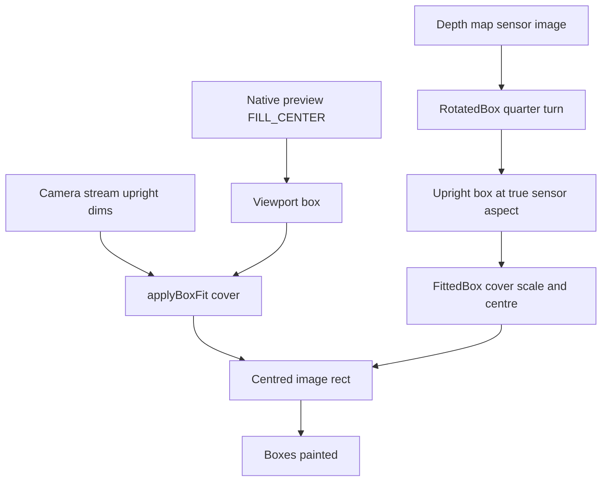

# Detection Alignment and Chart Readability — Design Specification

- **Date:** 2026-11-09
- **Feature slug:** `detection-alignment-charts`
- **Stage:** 2 of 4 (design-spec). Source-of-truth order for later stages: `{slug}-plan.md` → **this file** → `{slug}-analysis.md`.
- **Required input:** [`detection-alignment-charts-analysis.md`](detection-alignment-charts-analysis.md) (Stage 1). All five root causes are settled there and are **not** re-litigated here; this file resolves the design questions on top of them.
- **Task type:** UI alignment/readability fix. Visual output changes, so this stage is mandatory per [`.roo/rules/02-pipeline-stages.md`](../../.roo/rules/02-pipeline-stages.md).
- **Scope discipline:** no code was changed, no `flutter test`, `flutter analyze`, or build was run in this stage. Line numbers were re-read from the current working tree and are cited with the analysis's own citations where they still hold.
- **Settled user decisions (from analysis §7, not re-opened):** 16 dp Detection gutter; layout-aware heatmap rotation + bounding-box fit geometry; AUDIO ON keeps its touch target with a content-sized capsule; chart readability set (wrapping, precision, reserved space, contrast from the existing design system, title gap, no Y duplication); FPS chart loses the 15 FPS wording **and** the dashed 15 FPS line. Additional standing constraints: base on the current codebase, no screenshots, minimal scope, preserve accessibility behaviour and unrelated functionality.

---

## 1. Scope boundary

### 1.1 In scope — files that may be modified (all four are UI-owned per `.roo/rules/rules-frontend/01-scope.md`)

| File | Folder | Change |
|---|---|---|
| [`lib/screens/ultralytics_detection_screen.dart`](../../lib/screens/ultralytics_detection_screen.dart:1) | `lib/screens/` | Issue 1 (viewport gutter, action-row horizontal inset) and Issue 3 (`_AudioPill` restructure, [:1892](../../lib/screens/ultralytics_detection_screen.dart:1892)) |
| [`lib/widgets/depth_heatmap_view.dart`](../../lib/widgets/depth_heatmap_view.dart:1) | `lib/widgets/` | Issue 2 (layout-aware rotation + cover fit geometry) |
| [`lib/widgets/charts.dart`](../../lib/widgets/charts.dart:1) | `lib/widgets/` | Issues 4 and 5 (Y name removal, Y precision helper, tick reserve, axis colour, tick type style, FPS benchmark removal) |
| [`lib/screens/logs_reports_screen.dart`](../../lib/screens/logs_reports_screen.dart:1) | `lib/screens/` | Issues 4 and 5 (`_ChartCard` title gap [:1801](../../lib/screens/logs_reports_screen.dart:1801); FPS card title literal [:1305](../../lib/screens/logs_reports_screen.dart:1305)) |

### 1.2 Out of scope — must not be modified

| File | Why not |
|---|---|
| [`lib/widgets/bounding_box_painter.dart`](../../lib/widgets/bounding_box_painter.dart:1) | OQ4 decision: the heatmap does **not** reuse the painter's rect helper, so `_calculateImageRect` ([:89](../../lib/widgets/bounding_box_painter.dart:89)) is untouched. This is the geometry reference, not a change site. |
| [`lib/widgets/status_pill.dart`](../../lib/widgets/status_pill.dart:1) | OQ12 decision: the `fontSize: 13` / `width: 1.5` / `Colors.white` literals are deferred. The audio capsule matches the pill's height/padding, not the reverse. |
| [`lib/widgets/detection_information_overlay.dart`](../../lib/widgets/detection_information_overlay.dart:1) | OQ3 decision: its `kSpace16` in-viewport margin ([:70-73](../../lib/widgets/detection_information_overlay.dart:70)) is unchanged. |
| [`lib/widgets/detection_action_controls.dart`](../../lib/widgets/detection_action_controls.dart:1) | The `kSpace12` at [:343](../../lib/widgets/detection_action_controls.dart:343) is the gap **between** the two cards and stays. |
| `lib/theme/app_spacing.dart`, `lib/theme/app_colors.dart`, `lib/theme/app_radii.dart`, `lib/theme/app_home_theme.dart` | No new token is required (§4). Existing tokens are used as-is. |
| `lib/models/`, `lib/services/`, `lib/navigation/`, `lib/main.dart`, `plugins/`, `android/`, `pubspec.yaml`, `.roo/` | Outside the change set. `BoxTransform` is read-only reference (analysis §1). |

### 1.3 Test files — flagged exception (outside the four UI-owned folders)

Per analysis §3.5, `test/` is outside `lib/screens|widgets|navigation|theme`. The edits in §5 are an **explicitly flagged, approved consequence** of the visual fixes, not silent scope expansion: the FPS title string is being deleted, the Y-axis names are being deleted, and the heatmap structure is being replaced, so the assertions naming them cannot survive. `[inferred-from-codebase]`

---

## 2. Consolidated OQ1–OQ12 resolution table

Each row is a decision that the plan/implementation may proceed on. Tags: `[inferred-from-codebase]` = derived from the files, not an explicit user instruction; `[design-verified]` = value confirmed against the project's design-token/theme source; `[product-decision]` = already settled by the user (analysis §7).

| OQ | Decision | Tag |
|---|---|---|
| **OQ1** | The two non-live panels (`_buildPermissionDenied` [:1785](../../lib/screens/ultralytics_detection_screen.dart:1785), `_buildCameraPending` [:1821](../../lib/screens/ultralytics_detection_screen.dart:1821)) keep their raw `EdgeInsets.all(24)` and are **out of scope**. The settled gutter names header, camera viewport, and bottom action cards only; these panels are centred full-height states with no header/viewport/card relationship to align, and touching them would add diff with no alignment benefit. | `[inferred-from-codebase]` |
| **OQ2** | The action row's `kHomeSurfaceBase` band ([:1857-1858](../../lib/screens/ultralytics_detection_screen.dart:1857)) **stays edge-to-edge**. Only the row's content inset changes (12 → 16 dp). The band is a background surface, not a card, so insetting it would produce a floating strip that reads as an accidental new component; aligning the *cards* is what satisfies "one consistent gutter". | `[inferred-from-codebase]` |
| **OQ3** | The in-viewport overlay keeps `margin: symmetric(horizontal: kSpace16, vertical: kSpace12)` ([:70-73](../../lib/widgets/detection_information_overlay.dart:70)). Its content therefore sits **32 dp** from the screen edge. **Accepted and documented** as a consequence: the overlay is a card *inside* the dark viewport and must keep a visible gap from the viewport's rounded edge; reducing it to `kSpace0` would put dark-on-dark content flush to the clip boundary. Recorded in acceptance criteria as intended, not a defect. | `[inferred-from-codebase]` |
| **OQ4** | **Option C** — `FittedBox(fit: BoxFit.cover, alignment: Alignment.center, clipBehavior: Clip.hardEdge)` + `RotatedBox` + sensor-sized `SizedBox` + `RawImage(fit: BoxFit.fill)`. No helper promoted, no math duplicated, `bounding_box_painter.dart` untouched. The geometry equivalence is confirmed against the Flutter API docs (evidence in §3.2.4). | `[design-verified]` |
| **OQ5** | `DepthHeatmapView` does **not** gain a camera-upright-dims parameter. `BoxFit.cover`'s scale factor is a function of the **aspect ratio only**, and the depth map is produced from the same camera frame, so aspect parity holds by construction; a signature change would widen the test surface for no observed defect. The aspect-only assumption is recorded as Needs Verification (NV2/VN6). | `[inferred-from-codebase]` |
| **OQ6** | **Drop the rotated Y-axis name** (`'Latency (ms)'`, `'FPS'`, `'Detections'`) for all three charts; **keep** the X-axis name (`'Elapsed time (s)'`, `'Minute'`). This is the "unnecessary visual duplication" in the settled decision: the card title already states the metric and the unit. It removes the only rotated text in the card (the "reads naturally" requirement) and frees `axisNameSize: 24` ([:289](../../lib/widgets/charts.dart:289)) for plot width. | `[inferred-from-codebase]` |
| **OQ7** | Precision is reduced **on the Y axis only**, by a new private helper `_formatYAxisTick`: integers when the axis interval *and* the value are integral, otherwise **at most one decimal**, `.0` stripped, never thousands separators. The X axis keeps `_formatAxisTick` verbatim, so `0.5` / `1.5` at 200 % scale are preserved. | `[inferred-from-codebase]` |
| **OQ8** | Axis/border colour becomes **`kHomeInkMuted`** (`#667085`, [`app_colors.dart:85`](../../lib/theme/app_colors.dart:85)), replacing `_axisColor = Color(0xFFBDBDBD)` ([:10](../../lib/widgets/charts.dart:10)). One colour for axis stroke and tick glyphs removes the visual noise of two greys and reuses the token already in use for ticks. **No new colour, no new token.** | `[design-verified]` |
| **OQ9** | Tick text style becomes `theme.textTheme.labelSmall` with `copyWith(color: kHomeInkMuted)`, replacing `TextStyle(color: kHomeInkMuted, fontSize: 10)` ([:280](../../lib/widgets/charts.dart:280)). **Resolved value in this app: `labelSmall` is overridden by `buildHomeTheme()` to IBM Plex Sans 14 sp / w500 / `kHomeInk`** ([`app_home_theme.dart:89-93`](../../lib/theme/app_home_theme.dart:89)) — see the contradiction flagged in §3.4.1. No new typography token. | `[design-verified]` |
| **OQ10** | `_ChartCard` title-to-chart gap goes `kSpace8` → **`kSpace16`** ([:1801](../../lib/screens/logs_reports_screen.dart:1801)). The card title style (`titleSmall` + `w800`, [:1795-1800](../../lib/screens/logs_reports_screen.dart:1795)) is **unchanged** — the named defect is spacing, not title weight or size. `kChartHeight = 180` unchanged. | `[inferred-from-codebase]` |
| **OQ11** | Five test files change and one new file is added (§5). `test/` is outside the four UI-owned folders, so this is an explicitly flagged approved consequence. New assertions required in addition to edited ones: 16 dp gutter alignment, heatmap aspect/centring invariant, audio pill 64×56 target with content-sized capsule, FPS wording/line removal, chart tick no-wrap. | `[inferred-from-codebase]` |
| **OQ12** | **Deferred.** `status_pill.dart` keeps `fontSize: 13`, `border: Border.all(color: Colors.white, width: 1.5)`, and `Colors.white`. The audio-capsule content-sizing does not require it: after the wrapper change the two surfaces' heights differ by ~1–2 dp (different text roles), which the acceptance criterion tolerates at ≤ 2 dp. Tokenising `StatusPill` is a separate clean-up. | `[inferred-from-codebase]` |

---

## 3. Design resolution per issue

### 3.1 Issue 1 — one 16 dp horizontal Detection gutter

**Current state** (analysis §2, Issue 1; re-verified):

| Region | Current inset | Call site |
|---|---|---|
| Top bar | `fromLTRB(kSpace16, kSpace16, kSpace16, kSpace8)` | [:1547-1548](../../lib/screens/ultralytics_detection_screen.dart:1547) |
| Camera viewport | 0 dp horizontally — `Expanded(child: _buildMainArea(context))` with no padding | `Expanded` [:1531](../../lib/screens/ultralytics_detection_screen.dart:1531); viewport `Container` [:1655-1660](../../lib/screens/ultralytics_detection_screen.dart:1655) |
| Action cards row | `fromLTRB(kSpace12, kSpace8, kSpace12, kSpace12)` | [:1861-1867](../../lib/screens/ultralytics_detection_screen.dart:1861) |

**Target state**

| Region | Target inset | Exact edit |
|---|---|---|
| Top bar | unchanged `kSpace16` horizontal | no edit |
| Camera viewport | **`kSpace16` horizontal, 0 vertical** | insert `Padding(padding: EdgeInsets.symmetric(horizontal: kSpace16), child: viewport)` **inside** the `Semantics(container: true, label: 'Camera view')` and **inside** `GestureSurface`, i.e. `GestureSurface → Semantics(Camera view) → Padding(horizontal: kSpace16) → Container(viewport)` at [:1764-1777](../../lib/screens/ultralytics_detection_screen.dart:1764) |
| Action cards row | horizontal `kSpace12` → **`kSpace16`**, vertical `kSpace8`/`kSpace12` unchanged; band stays edge-to-edge (OQ2) | [:1862-1867](../../lib/screens/ultralytics_detection_screen.dart:1862) |

**Why the padding goes inside `GestureSurface`:** the shell-level gesture contract is "the whole flexible area between the top bar and the action-controls row" (comment at [:1521-1530](../../lib/screens/ultralytics_detection_screen.dart:1521)) and [`gesture_navigation_direction_test.dart:266`](../../test/screens/gesture_navigation_direction_test.dart:266) asserts `surface.width == 390`. Padding the `Expanded` itself would shrink the gesture region to 358 dp and change device-verified behaviour, so it is forbidden. Only the viewport's painted box shrinks.

**Why inside the `Semantics` node:** the `Camera view` node keeps its current bounds (the full flexible area), so the `Repeat last alert` custom action stays reachable exactly as it is today and the `explicitChildNodes` overlay rows keep their own nodes.

**Additional mechanical requirement (test support):** add `key: const ValueKey('detection-viewport')` to the viewport `Container` ([:1655](../../lib/screens/ultralytics_detection_screen.dart:1655)). Without a stable key the alignment invariant cannot be asserted, because the container has no other distinguishing property. A `ValueKey` adds no semantics, no paint, and no layout.

**Token decision (the "shared gutter"):** use **`kSpace16` directly at both call sites**; do **not** add a `kScreenHorizontalInset` alias. `kSpace16` is already documented as the "standard screen/card padding" token ([`app_spacing.dart:27-28`](../../lib/theme/app_spacing.dart:27)), the token rule requires a token rather than a literal, and a synonym token would create two names for one value with a single consumer. No token-file edit, therefore **no `docs/architecture.md` theme-section obligation**. `[inferred-from-codebase]`

**Acceptance criteria**

1. On a 390 dp-wide surface with a live session, `tester.getRect(find.byKey(const ValueKey('detection-viewport')))` has `left == kSpace16` and `right == 390 - kSpace16`.
2. `tester.getTopLeft(find.text('Detection Mode')).dx == kSpace16`.
3. `tester.getRect(find.byType(DetectionActionControls))` has `left == kSpace16` and `right == 390 - kSpace16`.
4. `tester.getRect(find.byType(GestureSurface)).width == 390` (region unchanged).
5. The action-row band still spans the full width (the `Container(color: kHomeSurfaceBase)` is not edited).
6. No `RenderFlex` overflow and `tester.takeException()` is null at 200 % text scale on the Detection screen.
7. No TTS, telemetry, lifecycle, gesture or semantics behaviour changes: the `Camera view` node label/flags/custom action, the `Detection` header node, and the audio pill node are identical.

**Preserved contracts**

| Contract | Invariant that protects it |
|---|---|
| Gesture region covers the whole flexible area | Padding is applied *inside* `GestureSurface`; its own size is untouched (assertion 4). |
| `Camera view` reachability + `Repeat last alert` | Padding is applied *inside* the `Semantics` wrapper; the node's bounds and flags are unchanged. |
| Overlay stays pointer-inert and non-live | `detection_information_overlay.dart` is not edited; only its parent's box narrows. |
| Two-card row layout | `detection_action_controls.dart` is not edited; the inter-card `kSpace12` is untouched. |
| Device-verified swipe behaviour | No `GestureSurface`, controller, or threshold change. |

---

### 3.2 Issue 2 — portrait heatmap geometry

#### 3.2.1 Current state (analysis §2 Issue 2, re-verified at [`depth_heatmap_view.dart:24-53`](../../lib/widgets/depth_heatmap_view.dart:24))

`FittedBox(cover)` → `SizedBox(uprightW × uprightH)` → `Transform.rotate` → `SizedBox(sensorW × sensorH)` → `RawImage(fit: fill)`.

Two confirmed defects: (a) the outer `SizedBox` passes **tight** constraints so the inner sensor box is forced to upright dimensions and `RawImage(fill)` stretches the sensor aspect **before** rotation; (b) `Transform.rotate` is paint-only, so the rotated content is laid out as if unrotated and then painted outside its measured bounds and clipped. Result: stretched, mis-scaled, off-centre.

#### 3.2.2 Target state — widget tree

```
IgnorePointer(                        // unchanged: decorative
  ExcludeSemantics(                   // unchanged: out of the a11y tree
    ClipRect(
      FittedBox(
        key: const ValueKey('depth-heatmap-fit'),
        fit: BoxFit.cover,
        alignment: Alignment.center,  // explicit, not the default-by-accident
        clipBehavior: Clip.hardEdge,
        child: RotatedBox(
          quarterTurns: rotation ~/ 90,               // 0,1,2,3 — layout-aware
          child: SizedBox(
            width: current.width.toDouble(),          // SENSOR dims, laid out exactly
            height: current.height.toDouble(),
            child: RawImage(image: current, fit: BoxFit.fill),
          ),
        ),
      ),
    ),
  ),
)
```

Exact values: `quarterTurns = ((rotationDegrees % 360) + 360) % 360 ~/ 90`; the `SizedBox` is `image.width × image.height` (sensor), never the upright dims; the `uprightWidth/uprightHeight` local computation ([:29-30](../../lib/widgets/depth_heatmap_view.dart:29)) is **deleted** because `RotatedBox` derives the upright extent by layout.

#### 3.2.3 Why this is the minimum-diff shape

- One file changes; `bounding_box_painter.dart`, `box_transform.dart` (out of scope), and the screen's call site ([:1722-1726](../../lib/screens/ultralytics_detection_screen.dart:1722)) are untouched.
- No geometry math is duplicated (analysis §5.2 option B rejected) and no private helper is promoted (option A rejected), so the painter's documented "do not modify" status is respected.
- `rotationDegrees` is already passed in ([:1725](../../lib/screens/ultralytics_detection_screen.dart:1725)), so no model/service signature changes.

#### 3.2.4 Confirmed geometry equivalence (Context7 / `api.flutter.dev`)

Evidence actually retrieved for this stage (`/websites/api_flutter_dev`, pages `FittedBox`, `RenderFittedBox`, `applyBoxFit`):

- `FittedBox`: *"Creates a widget that scales and positions its child within itself according to `fit`"*; constructor defaults `alignment = Alignment.center`, `clipBehavior = Clip.none`. `RenderFittedBox`: *"scales and positions its child within itself according to the given `fit` and `alignment`"*.
- `applyBoxFit(BoxFit.cover, inputSize, outputSize)` returns `destinationSize = outputSize` and a **cropped `sourceSize`** — i.e. cover = fill the output completely and crop the source.
- The `applyBoxFit` documentation example shows the canonical cover paint: `Alignment.center.inscribe(sizes.source, Offset.zero & imageSize)` for the source sub-rect and `Alignment.center.inscribe(sizes.destination, outputRect)` for the destination sub-rect.

Therefore `FittedBox(fit: cover, alignment: center)` and the painter's `applyBoxFit(cover, uprightDims, previewSize)` + centred offset ([`bounding_box_painter.dart:98-103`](../../lib/widgets/bounding_box_painter.dart:98), offsets `(preview - scaled) / 2`) describe the **same** scale-and-centre mapping of the same upright box into the same preview box. The claim in the settled decision ("same fit/centering geometry as the bounding-box mapping") is therefore satisfied without sharing code. This is the `[design-verified]` basis for OQ4 = Option C.

**Residual (must be tested, not assumed):** `RenderFittedBox` lays its child out with unbounded constraints and `RotatedBox` performs its constraint swap **prior to layout**; that combination is documented behaviour but is not exercised anywhere in this repo today. It is a hard requirement that a geometry test pins it (NV4).

**Remaining dimension nuance (OQ5):** the widget derives upright dims from the **depth map's own pixels**; the painter uses the **camera stream's** upright dims ([:1734-1737](../../lib/screens/ultralytics_detection_screen.dart:1734)). Because cover scaling depends only on aspect, this is invisible while the aspects agree. Recorded as NV2/NV6 rather than fixed.



#### 3.2.5 Acceptance criteria

1. For a `40 × 20` sensor image at `rotationDegrees: 90`, the tree contains **no** `Transform` widget (paint-only rotation must be gone) and contains exactly one `RotatedBox` with `quarterTurns == 1`.
2. `tester.getSize(find.byType(RotatedBox)) == const Size(20, 40)` — proof the rotation participates in layout.
3. The inner `SizedBox` under the `RotatedBox` is `40 × 20` — proof the sensor aspect is not stretched.
4. `FittedBox.fit == BoxFit.cover`, `alignment == Alignment.center`, `clipBehavior == Clip.hardEdge`.
5. **Centring invariant:** in a non-matching viewport aspect, the centre of `tester.getRect(find.byType(RotatedBox))` equals the centre of the `FittedBox`'s box within 0.5 dp on both axes, and the rotated child's size is ≥ the FittedBox box on the cropped axis (cover, not contain).
6. Aspect invariant: `getSize(RotatedBox).width / getSize(RotatedBox).height` equals `sensorHeight / sensorWidth` (quarter turn) within 0.01.
7. `rotationDegrees` of `0`, `90`, `180`, `270` map to `quarterTurns` `0, 1, 2, 3`; a negative or > 360 input normalises (`-90` → 3).
8. `IgnorePointer` and `ExcludeSemantics` are still in the tree; the widget remains decorative (pointer-inert, no semantics).
9. `image == null` still renders nothing and throws no exception.

#### 3.2.6 Preserved contracts

| Contract | Invariant |
|---|---|
| Decorative-only a11y posture | `IgnorePointer` + `ExcludeSemantics` kept verbatim; test at [`depth_heatmap_view_test.dart:49-57`](../../test/widgets/depth_heatmap_view_test.dart:49) and `depth_overlay_state_test` "pointer-inert and semantics-free" must still pass. |
| No animation | Rendering only; no `AnimatedSwitcher`/implicit animation introduced (`.roo/rules/rules-frontend/05-animation.md`). |
| `lib/models/` read-only | `BoxTransform.displayRotationDegrees`/`uprightDims` called nowhere new; the screen keeps passing `_rotationDegrees`. |
| Heatmap layer order | Screen call site unchanged: heatmap still sits above the native preview and below the box layer ([:1720-1728](../../lib/screens/ultralytics_detection_screen.dart:1720)). |
| Depth fallback policy | Presentation-only change; stale/geometry checks live in the service and are untouched. |

---

### 3.3 Issue 3 — AUDIO ON: content-sized capsule, preserved touch target

#### 3.3.1 Current state (analysis §2 Issue 3, re-verified at [`ultralytics_detection_screen.dart:1904-1969`](../../lib/screens/ultralytics_detection_screen.dart:1904))

`Semantics` → `Tooltip` → `ConstrainedBox(minWidth 64, minHeight 56)` → `Material(kHomeSurfaceCard)` → `InkWell` → `Container(padding 12/6, radius 20, shadow)` → `Row(dot, gap, text)`.

Because the `ConstrainedBox` wraps the `Material`, the **painted** capsule is forced to the 56 dp minimum height ([:1918-1926](../../lib/screens/ultralytics_detection_screen.dart:1918)). Padding is already identical to `StatusPill` ([:1931-1934](../../lib/screens/ultralytics_detection_screen.dart:1931) vs [`status_pill.dart:33-36`](../../lib/widgets/status_pill.dart:33)), so the height difference is entirely the missing separation between "hit area" and "painted capsule".

#### 3.3.2 Target widget tree

```
Semantics(                       // unchanged: one node, one label, one tap action
  container: true,
  excludeSemantics: true,        // the InkWell must not add a second node
  button: true,
  enabled: true,
  label: 'Audio guidance, ${on ? 'on' : 'off'}',
  onTap: onPressed,
  child: Tooltip(
    message: tooltip,            // unchanged strings: Mute audio guidance / Unmute audio guidance
    child: SizedBox(                                     // (1) deterministic hit height
      key: const ValueKey('audio-pill-target'),
      height: kMinTouchHeight,                           // 56
      child: ConstrainedBox(
        constraints: const BoxConstraints(minWidth: kMinTouchWidth),   // (2) 64 min width
        child: Material(
          type: MaterialType.transparency,               // (3) paints nothing at target level
          child: InkWell(
            onTap: onPressed,                            // (4) the ONLY tap handler
            borderRadius: BorderRadius.circular(kRadius20),
            child: Center(                               // (5) centres the capsule in the target
              child: Container(
                key: const ValueKey('audio-pill-capsule'),
                padding: const EdgeInsets.symmetric(
                  horizontal: kSpace12,
                  vertical: kSpace6,
                ),
                decoration: BoxDecoration(               // (6) the visible, content-sized capsule
                  color: kHomeSurfaceCard,
                  borderRadius: BorderRadius.circular(kRadius20),
                  boxShadow: kHomeShadowSoft,
                ),
                child: Row(mainAxisSize: MainAxisSize.min, children: [
                  /* unchanged 8 dp dot: kHomeAccentCyan when on, kHomeInkMuted when off */
                  /* unchanged kSpace8 gap */
                  /* unchanged Text('AUDIO ON' / 'AUDIO OFF', labelMedium + kHomeInk + letterSpacing 0.5) */
                ]),
              ),
            ),
          ),
        ),
      ),
    ),
  ),
)
```

**Structural consequences, stated explicitly:**

- The painted surface colour moves from the outer `Material` to the capsule's `BoxDecoration`; the outer `Material` becomes `MaterialType.transparency` so the ink layer still renders splashes.
- The capsule's height becomes content-driven (~30 dp with `labelMedium` at 100 % scale) while the tappable rectangle stays 56 dp tall and ≥ 64 dp wide.
- **Exactly one** `onTap` remains (`InkWell`); the `Semantics.onTap` is the screen-reader action, as today. No double-toggle path exists.
- **Accepted cosmetic consequence:** the ink splash spans the whole 64 × 56 hit box (clipped to `kRadius20`), so a tap paints a highlight slightly larger than the capsule for the duration of the ripple. This is recorded rather than hidden; the fallback (move the `InkWell` inside the capsule) is rejected because it would shrink the *touch* target to the capsule — exactly what the settled decision forbids.

#### 3.3.3 Secondary cosmetic diffs — in or out

| Diff | In/Out | Reason |
|---|---|---|
| 8 dp dot vs `StatusPill`'s 10 dp `Icon(Icons.circle)` ([:1943-1945](../../lib/screens/ultralytics_detection_screen.dart:1943) vs [`status_pill.dart:46`](../../lib/widgets/status_pill.dart:46)) | **OUT** | It is horizontal/inner-glyph detail, not height or padding. The capsule's height is driven by `labelMedium`'s line height, so changing the dot changes nothing about visual height and would introduce a `kSpace10`-as-icon-size misuse. |
| `kSpace8` glyph→text gap vs `StatusPill`'s `kSpace6` ([:1952](../../lib/screens/ultralytics_detection_screen.dart:1952) vs [`status_pill.dart:48`](../../lib/widgets/status_pill.dart:48)) | **OUT** | Horizontal only; no effect on height or padding. |
| Missing `Border.all(Colors.white, width: 1.5)` (vs [`status_pill.dart:40`](../../lib/widgets/status_pill.dart:40)) | **OUT** | The status pill's white border separates a saturated colour pill from the dark/ink surface. The audio capsule is a white card on the light `kHomeSurfaceBase`; a white border would be invisible and would not create visual consistency. Adding it would also add 3 dp of height — the opposite of the requirement. |
| Text role: `labelMedium` 14 sp vs `fontSize: 13` w700 | **OUT** | Type style is not height/padding; changing it risks truncation and width changes in a `Row` with a `Spacer`. Deferred with OQ12. |

Net effect: **the only change is the wrapper separation**. Height parity is achieved by content-sizing, not by restyling.

#### 3.3.4 Acceptance criteria

1. `tester.getSize(find.byKey(const ValueKey('audio-pill-target')))` has `height == kMinTouchHeight` (56) and `width >= kMinTouchWidth` (64).
2. `tester.getSize(find.byKey(const ValueKey('audio-pill-capsule'))).height < kMinTouchHeight` and `<= (StatusPill height + 2)` — i.e. content-sized and visually consistent with the status pill (± 2 dp).
3. Tapping a point **inside the target but outside the capsule** (e.g. 2 dp below the capsule's bottom edge, horizontally centred) toggles audio exactly once (assert the persisted `audioEnabled` flips once).
4. Tapping the capsule toggles exactly once (no double toggle).
5. Semantics unchanged: exactly one node with label `Audio guidance, on` / `Audio guidance, off`, `isButton == true`, a `tap` action, **zero** custom actions, and the only labelled custom action in the tree remains `Repeat last alert` on the `Camera view` node.
6. No `hint` and no gesture-teaching string is introduced (`test/architecture/talkback_no_gesture_hints_test.dart` stays green).
7. The visible text remains `Text('AUDIO ON')` / `'AUDIO OFF'` (asserted by the shared header contract).
8. Tooltip strings unchanged; no `onLongPress`, no `customSemanticsActions` added.
9. Header height does not grow (the pill was already 56 dp tall through the previous `ConstrainedBox`).
10. No animation is introduced.

#### 3.3.5 Preserved contracts

| Contract | Invariant |
|---|---|
| One mute-only node | Outer `Semantics(container, excludeSemantics, button, enabled, label, onTap)` kept verbatim; `InkWell` stays under `excludeSemantics`. |
| Repeat stays on the camera view | No `customSemanticsActions` on the pill; the screen node at [:1768-1777](../../lib/screens/ultralytics_detection_screen.dart:1768) is untouched. |
| ≥ 64 × 56 tappable | `SizedBox(height: 56)` + `minWidth: 64` at the target level, with the single `onTap` at that level. |
| Tooltip + enabled state | `Tooltip` and `enabled: true` retained; strings unchanged. |
| TalkBack "one stop per control" | `excludeSemantics: true` guarantees no descendant node (dot and text are already `ExcludeSemantics`). |
| Token rule | No new colour/radius/spacing literals: `kHomeSurfaceCard`, `kHomeShadowSoft`, `kRadius20`, `kSpace12`, `kSpace6`, `kSpace8`, `kMinTouchWidth/Height` only. |

---

### 3.4 Issue 4 — chart readability

#### 3.4.1 Contradiction found and resolved (must be recorded, not silently picked)

Analysis §4 states *"`buildHomeTheme()` does not override `labelSmall`/`titleSmall`"*. **That is wrong for `labelSmall`.** [`app_home_theme.dart:89-93`](../../lib/theme/app_home_theme.dart:89) overrides `labelSmall` to IBM Plex Sans **14 sp**, w500, `kHomeInk`. `titleSmall` is genuinely not overridden. Per `.roo/rules/01-verification-policy.md` this contradiction is flagged rather than resolved silently: **the code wins**, so OQ9's "use `labelSmall`" resolves to **14 sp**, not the Material default 11 sp. Consequences are quantified in 3.4.4 and gated by NV3.

#### 3.4.2 Target state of `_chartTitles` ([:273-321](../../lib/widgets/charts.dart:273))

| Element | Current | Target |
|---|---|---|
| `yName` parameter | required, rendered rotated | **removed** from the signature and from all three call sites ([:82](../../lib/widgets/charts.dart:82), [:172](../../lib/widgets/charts.dart:172), [:259](../../lib/widgets/charts.dart:259)) |
| `leftTitles.axisNameWidget` | `RotatedBox(quarterTurns: 3, Text(yName))` ([:285-288](../../lib/widgets/charts.dart:285)) | **removed** (`axisNameWidget: null`) |
| `leftTitles.axisNameSize` | `24` ([:289](../../lib/widgets/charts.dart:289)) | **`0`** |
| `leftTitles.sideTitles.reservedSize` | `38` ([:293](../../lib/widgets/charts.dart:293)) | **`56`** (local literal + comment: 4 glyphs at 14 sp × 200 % plus the 4 dp `space`) — a layout metric, **not** a design token (analysis §4 point 3) |
| Y tick text | `Text(_formatAxisTick(value, yInterval), tickStyle())` ([:297](../../lib/widgets/charts.dart:297)) | `Text(_formatYAxisTick(value, yInterval), style: tickStyle(), maxLines: 1, softWrap: false)` |
| `xName` | kept ([:302](../../lib/widgets/charts.dart:302)) | **kept**, same style, unchanged `axisNameSize: 22` |
| X tick text | `Text(_formatAxisTick(...))` ([:314](../../lib/widgets/charts.dart:314)) | unchanged formatter; add `maxLines: 1, softWrap: false` only |
| `tickStyle()` | `const TextStyle(color: kHomeInkMuted, fontSize: 10)` ([:280](../../lib/widgets/charts.dart:280)) | `theme.textTheme.labelSmall!.copyWith(color: kHomeInkMuted)` — resolved 14 sp / w500 with `kHomeInkMuted` colour, no literal size |
| `_axisColor` | `const Color(0xFFBDBDBD)` ([:10](../../lib/widgets/charts.dart:10)) | **constant deleted**; both `BorderSide`s ([:76-77](../../lib/widgets/charts.dart:76), [:166-167](../../lib/widgets/charts.dart:166), [:253-254](../../lib/widgets/charts.dart:253)) use `kHomeInkMuted` |
| `_lineColor` | `const Color(0xFFFFC107)` ([:11](../../lib/widgets/charts.dart:11)) | **unchanged** — series colour is not "text/axis contrast"; changing it would alter data encoding. Recorded as retained, not forgotten. |

Because `tickStyle()` now needs a `BuildContext`, it becomes a parameter of `_chartTitles` (`_chartTitles({required BuildContext context, ...})`) or is computed in each chart's `build` and passed in. Either shape is acceptable; the plan must pick one. It must **not** become a global/mutable.

#### 3.4.3 Y-axis numeric precision — the exact rule

New private top-level helper in `charts.dart`, applied **only** to the left axis:

```dart
/// Y ticks read at most one decimal. Integer axes stay integer; a fractional
/// interval keeps one decimal so the scale is still honest.
String _formatYAxisTick(double value, double interval) {
  final intervalIsIntegral = (interval - interval.roundToDouble()).abs() < 1e-6;
  final valueIsIntegral = (value - value.roundToDouble()).abs() < 1e-6;
  if (intervalIsIntegral && valueIsIntegral) return value.round().toString();
  final text = value.toStringAsFixed(1);
  return text.endsWith('.0') ? text.substring(0, text.length - 2) : text;
}
```

- `toStringAsFixed` never emits thousands separators, so "no separators" is satisfied by construction.
- The X axis keeps `_formatAxisTick` ([:323-339](../../lib/widgets/charts.dart:323)) **verbatim**, preserving `0.5` and `1.5` at 200 % scale.
- Worked examples at the current scales: latency `maxY = 58` → interval `14.5` → `0, 14.5, 29, 43.5, 58`; latency dataMax `25` → `maxY = 40` → interval `10` → `0, 10, 20, 30, 40`; FPS dataMax `40` → `maxY = 50` → `12.5` → `0, 12.5, 25, 37.5, 50`.

#### 3.4.4 Why "no wrap" is guaranteed, not hoped for

`softWrap: false` + `maxLines: 1` on every tick `Text` makes wrapping structurally impossible, which is the direct fix for the defect the user named. `reservedSize: 56` then makes the label actually *fit* at 200 % scale instead of overflowing its band. `reservedSize` remains the supported lever (analysis §3.4: fl_chart documents it as *"the maximum space that your titles need"*).

**Budget check (arithmetic, from verified paddings):** horizontal space per chart is `screenWidth − 32` (list) `− 32` (card) — 296 dp at 360 dp, 326 dp at 390 dp ([:1684-1685](../../lib/screens/logs_reports_screen.dart:1684), [:1706-1708](../../lib/screens/logs_reports_screen.dart:1706)). Today the left gutter costs `24 (axis name) + 38 (reserve) = 62`; the target costs `0 + 56 = 56`. **The plot gains ~6 dp** while gaining a wrapped text no longer possible and a larger, higher-contrast tick.

#### 3.4.5 Title-to-chart spacing

`_ChartCard` ([:1789-1806](../../lib/screens/logs_reports_screen.dart:1789)): `SizedBox(height: kSpace8)` → **`SizedBox(height: kSpace16)`**. Title style unchanged (`titleSmall` + `w800`). `kChartHeight = 180` unchanged. Each card grows 8 dp; all three live in a scrollable `ListView`, so the 200 %-overflow test is unaffected in kind.

#### 3.4.6 Acceptance criteria

1. No chart renders `'Latency (ms)'`, `'FPS'`, or `'Detections'` (`findsNothing`), while `'Elapsed time (s)'` and `'Minute'` still render exactly once each.
2. No Y tick text contains two or more decimals: `find.textContaining(RegExp(r'\.\d\d'))` is `findsNothing` on all three charts.
3. For `LatencyChart(samples: [25])` (`maxY = 40`, interval `10`) the ticks render as `'10'`, `'20'`, `'30'`, `'40'` and `'10.0'` is absent.
4. Every tick `Text` has `maxLines == 1` and `softWrap == false`.
5. The chart's left/bottom `BorderSide` colours equal `kHomeInkMuted`, and every tick `Text` style colour equals `kHomeInkMuted` and its `fontSize` equals `Theme.of(context).textTheme.labelSmall!.fontSize`.
6. At 200 % text scale and width 260, the X labels `0`, `0.5`, `1` (and `0`, `1.5`, `3`) are found and their rects do not overlap — the existing assertions in [`charts_test.dart:130-198`](../../test/widgets/charts_test.dart:130) still pass unchanged.
7. `_ChartCard` vertical gap between the title's bottom and the chart's top equals `kSpace16` (± 1 dp).
8. Logs & Reports Charts at 390 × 844 and 200 % text scale still raises no exception ([:1314-1326](../../test/screens/logs_reports_screen_test.dart:1314)).
9. Chart `Semantics` labels are byte-identical to today (`^Inference latency chart\. Latest 50\.0 milliseconds;` …, **including the `50.0` / `20.0` one-decimal summaries** — those are `_sampleSummary`, not the axis formatter).

#### 3.4.7 Preserved contracts

| Contract | Invariant |
|---|---|
| Chart `Semantics` labels/summaries | `_sampleSummary` / `_engineSummary` untouched ([:341-375](../../lib/widgets/charts.dart:341)); only `titlesData` and tick text change. |
| X domain and spots | Data binding untouched: `minX`, `maxX`, spot construction, `maxY` formulas all unchanged. |
| Empty-state text | `_NoData` text `'No data available yet'` untouched. |
| Fractional X ticks | X keeps `_formatAxisTick`; `0.5` / `1.5` preserved by construction. |
| Latency benchmark line | `_latencyBenchmarkMs` and its dashed `Colors.redAccent` line untouched. |
| No animation | Styling only; `fl_chart` bound animation is pre-existing. |
| Token rule | Only existing tokens used (`kHomeInkMuted`, `kSpace16`); `reservedSize`/`axisNameSize` stay local layout literals, as analysis §4 point 3 requires. |

---

### 3.5 Issue 5 — remove the 15 FPS wording and benchmark line

**Current state** (analysis §2 Issue 5, re-verified):

| Element | Location |
|---|---|
| Card title `'Frames Per Second$claim (15 FPS target)'` | [:1305](../../lib/screens/logs_reports_screen.dart:1305) |
| `const double _fpsBenchmark = 15.0;` | [:18](../../lib/widgets/charts.dart:18) |
| `final showBenchmark = maxY >= _fpsBenchmark;` | [:146](../../lib/widgets/charts.dart:146) |
| `HorizontalLine(y: _fpsBenchmark, color: Colors.greenAccent, dashArray: [6, 4])` | [:176-186](../../lib/widgets/charts.dart:176) |
| Doc comment "the 15 FPS target line is drawn only when it fits" | [:115-116](../../lib/widgets/charts.dart:115) |

**Target state**

1. Title literal becomes `'Frames Per Second$claim'` — the `claim` interpolation stays, so model-filtered titles still name the model.
2. `_fpsBenchmark` is deleted.
3. `FpsChart`'s `showBenchmark` local and its `extraLinesData` block are deleted entirely (the chart draws no extra lines).
4. The `FpsChart` doc comment is rewritten to describe dynamic Y scaling only — no reference to a target line.
5. **`_latencyBenchmarkMs` ([:17](../../lib/widgets/charts.dart:17)), its `showBenchmark` ([:56](../../lib/widgets/charts.dart:56)), its dashed `Colors.redAccent` line ([:86-96](../../lib/widgets/charts.dart:86)), and the `'Inference Latency$claim (300 ms benchmark)'` title ([:1300](../../lib/screens/logs_reports_screen.dart:1300)) are all untouched.** The settled decision names only the 15 FPS wording and line.

**Acceptance criteria**

1. `find.text('Frames Per Second')` is `findsOneWidget` unfiltered and `find.text('Frames Per Second — Obstacle Detector v2')` is `findsOneWidget` filtered.
2. `find.textContaining('15 FPS')` is `findsNothing` on the Charts tab.
3. `tester.widget<LineChart>(...).data.extraLinesData.horizontalLines` is empty for `FpsChart`.
4. For `LatencyChart` with data whose `maxY >= 300`, exactly one horizontal line remains, at `y == 300`, `color == Colors.redAccent`, `dashArray == [6, 4]`.
5. `find.text('Inference Latency (300 ms benchmark)')` still `findsOneWidget`.
6. No source reference to `_fpsBenchmark` or "15 FPS" remains in `lib/` (a source-grep guard is acceptable but optional).

**Preserved contracts:** FPS semantics label `'Frames per second chart. …'` unchanged; FPS `maxY` formula unchanged; the latency benchmark in 3.4.7 unchanged; no new dependency.

---

## 4. Token table

### 4.1 Existing tokens used (verified values)

| Token | Value | Location | Used by |
|---|---|---|---|
| `kSpace16` | 16 | [`app_spacing.dart:28`](../../lib/theme/app_spacing.dart:28) | Issue 1 viewport gutter + action-row horizontal inset; Issue 4 title gap |
| `kSpace12` | 12 | [`app_spacing.dart:22`](../../lib/theme/app_spacing.dart:22) | Issue 3 capsule horizontal padding (unchanged) |
| `kSpace8` | 8 | [`app_spacing.dart:16`](../../lib/theme/app_spacing.dart:16) | Issue 3 dot size + glyph gap (unchanged), action-row top inset (unchanged) |
| `kSpace6` | 6 | [`app_spacing.dart:13`](../../lib/theme/app_spacing.dart:13) | Issue 3 capsule vertical padding (unchanged) |
| `kMinTouchWidth` | 64 | [`app_spacing.dart:43`](../../lib/theme/app_spacing.dart:43) | Issue 3 target min width |
| `kMinTouchHeight` | 56 | [`app_spacing.dart:46`](../../lib/theme/app_spacing.dart:46) | Issue 3 target height |
| `kRadius20` | 20 | [`app_radii.dart:13`](../../lib/theme/app_radii.dart:13) | Issue 3 capsule + ink radius |
| `kHomeSurfaceCard` | `#FFFFFF` | [`app_colors.dart:76`](../../lib/theme/app_colors.dart:76) | Issue 3 capsule surface (moved from `Material` to `BoxDecoration`) |
| `kHomeSurfaceBase` | `#F5F5F5` | [`app_colors.dart:73`](../../lib/theme/app_colors.dart:73) | Issue 1 action-row band (unchanged) |
| `kHomeInk` | `#0A0A0A` | [`app_colors.dart:82`](../../lib/theme/app_colors.dart:82) | Issue 1 viewport fill; Issue 3 text (unchanged) |
| `kHomeInkMuted` | `#667085` | [`app_colors.dart:85`](../../lib/theme/app_colors.dart:85) | Issue 4 axis/border stroke **and** tick glyph colour |
| `kHomeAccentCyan` | `#22C7F2` | [`app_colors.dart:88`](../../lib/theme/app_colors.dart:88) | Issue 3 on-state dot (unchanged) |
| `kHomeShadowSoft` | `rgba(10,10,10,0.08)`, blur 18 | [`app_home_theme.dart:18-24`](../../lib/theme/app_home_theme.dart:18) | Issue 3 capsule shadow (unchanged) |
| `labelSmall` | IBM Plex Sans 14 sp / w500 / `kHomeInk` | [`app_home_theme.dart:89-93`](../../lib/theme/app_home_theme.dart:89) | Issue 4 tick type, recoloured with `kHomeInkMuted` |

### 4.2 Tokens to be added

**None.** No colour, spacing, radius or typography token is introduced by any of the five fixes. Therefore:

- `.roo/rules/rules-frontend/03-design-tokens.md` is satisfied by reference rather than by addition.
- `.roo/rules/rules-frontend/06-doc-update.md`'s "New token / theme change → `docs/architecture.md` (theme/design section)" obligation is **not** triggered.

### 4.3 Values explicitly NOT tokenised

| Value | Why not |
|---|---|
| `reservedSize: 56` (left axis) | Layout metric of one chart widget, not a design token; analysis §4 point 3 records the repo convention that only colour/spacing/radius/typography are tokens. Kept as a commented literal in `charts.dart`. |
| `axisNameSize: 0` / `0` for the removed Y name | Result of deletion, not a design value. |
| `space: 4` on `SideTitleWidget` | Pre-existing fl_chart spacing argument; unchanged. |
| `_lineColor = Color(0xFFFFC107)` | Series colour, not text/axis contrast; out of the settled decision. `kAccent` (`#FFC107`) matches the value but is a dark-theme token — migrating it would be a separate change (recorded as an Open Question, not done here). |
| `dashArray: [6, 4]`, `strokeWidth: 1.5` (latency benchmark) | Untouched by decision 5. |
| `Colors.redAccent` (latency benchmark line) | Untouched; deleting it is not authorised. |
| `StatusPill`'s `fontSize: 13`, `width: 1.5`, `Colors.white` | OQ12 deferral. |

---

## 5. Test-impact table

`test/` is outside the four UI-owned folders — this table is the explicit approval list for the plan stage. Line numbers are current as of this stage.

### 5.1 Assertions that must change

| File:line | Current | Required |
|---|---|---|
| [`test/screens/logs_reports_screen_test.dart:373`](../../test/screens/logs_reports_screen_test.dart:373) | `expect(find.text('Frames Per Second (15 FPS target)'), findsOneWidget);` | `expect(find.text('Frames Per Second'), findsOneWidget);` |
| [`test/screens/logs_reports_screen_test.dart:1584`](../../test/screens/logs_reports_screen_test.dart:1584) | `expect(find.text('Frames Per Second — Obstacle Detector v2 (15 FPS target)'), findsOneWidget);` | `expect(find.text('Frames Per Second — Obstacle Detector v2'), findsOneWidget);` |
| [`test/widgets/charts_test.dart:90`](../../test/widgets/charts_test.dart:90) | `expect(find.text('Latency (ms)'), findsOneWidget);` | `expect(find.text('Latency (ms)'), findsNothing);` |
| [`test/widgets/charts_test.dart:95`](../../test/widgets/charts_test.dart:95) | `expect(find.text('FPS'), findsOneWidget);` | `expect(find.text('FPS'), findsNothing);` |
| [`test/widgets/charts_test.dart:100`](../../test/widgets/charts_test.dart:100) | `expect(find.text('Detections'), findsOneWidget);` | `expect(find.text('Detections'), findsNothing);` |
| [`test/widgets/charts_test.dart:203-221`](../../test/widgets/charts_test.dart:203) | tuple list `(chart, xAxis, yAxis)` then `expect(find.text(yAxis), findsOneWidget)` at [:219](../../test/widgets/charts_test.dart:219) | drop the third tuple element; keep `expect(find.text(xAxis), findsOneWidget)` and the `takeException` check. Rename the test to reflect "axis labels" (X only). |
| [`test/widgets/depth_heatmap_view_test.dart:32-46`](../../test/widgets/depth_heatmap_view_test.dart:32) | `FittedBox.fit == cover`; first `SizedBox` under the `FittedBox` is `20 × 40` | keep the `FittedBox.fit` assertion and add `alignment`/`clipBehavior`; **replace** the `SizedBox` assertion with: inner `SizedBox` is `40 × 20` (sensor), `RotatedBox.quarterTurns == 1`, and `tester.getSize(find.byType(RotatedBox)) == const Size(20, 40)` (layout-aware upright extent). Also assert `find.byType(Transform)` is `findsNothing`. |

### 5.2 Assertions that must be added

| File | New test | Asserts |
|---|---|---|
| `test/widgets/charts_test.dart` (same file) | `Y ticks never wrap and never exceed one decimal` | every tick `Text` has `maxLines == 1` / `softWrap == false`; `find.textContaining(RegExp(r'\.\d\d'))` `findsNothing` on all three charts |
| `test/widgets/charts_test.dart` | `an integer Y interval renders integer ticks` | `LatencyChart(samples: [25])` (`maxY = 40`, interval `10`) shows `'10' '20' '30' '40'` and no `'10.0'` |
| `test/widgets/charts_test.dart` | `chart axis and ticks share the muted ink token` | left/bottom `BorderSide.color == kHomeInkMuted`; tick `Text` style colour `kHomeInkMuted`; tick `fontSize == theme.labelSmall.fontSize` |
| `test/widgets/charts_test.dart` | `the FPS chart draws no benchmark line and the latency chart still does` | `FpsChart` `extraLinesData.horizontalLines` empty; `LatencyChart` with `maxY >= 300` has exactly one at `y == 300` |
| `test/widgets/depth_heatmap_view_test.dart` | `cover fit centres the rotated image in the viewport` | child centre == `FittedBox` box centre (± 0.5 dp) both axes; child size ≥ box on the crop axis; aspect invariant; `quarterTurns` mapping for `0/90/180/270` and `-90 → 3` |
| **new** `test/screens/detection_screen_alignment_test.dart` | `header, viewport and action cards share one 16 dp gutter` | pumps the real `UltralyticsDetectionScreen` exactly as [`gesture_navigation_direction_test.dart:189-232`](../../test/screens/gesture_navigation_direction_test.dart:189) does (mock permission + camera channels, 390 × 844 @ 3.0), then asserts `Detection Mode` left `== 16`, `ValueKey('detection-viewport')` left/right `== 16 / 374`, `DetectionActionControls` left/right `== 16 / 374`, and `GestureSurface` width `== 390` |
| **new** `test/screens/detection_screen_alignment_test.dart` | `the audio pill keeps a 64 by 56 target with a content-sized capsule` | target size `56` tall / `>= 64` wide; capsule height `< 56` and `<= StatusPill height + 2`; tap in the target margin outside the capsule flips `audioEnabled` exactly once; tap on the capsule flips it exactly once |
| **new** `test/screens/detection_screen_alignment_test.dart` | `the audio pill stays one mute node` (may reuse the existing test instead) | no new node, no custom actions (duplicate of [`gesture_navigation_direction_test.dart:434-461`](../../test/screens/gesture_navigation_direction_test.dart:434) — **only** add if the restructure changes the tree enough to warrant an explicit guard) |

### 5.3 Assertions that must keep passing unchanged (do not edit)

| File:line | Why it constrains the fix |
|---|---|
| [`charts_test.dart:130-163`](../../test/widgets/charts_test.dart:130) | X labels `0`, `0.5`, `1` at 200 % scale, width 260 must be findable and non-overlapping → forbids blanket precision reduction. |
| [`charts_test.dart:165-198`](../../test/widgets/charts_test.dart:165) | Same for `0`, `1.5`, `3`. |
| [`charts_test.dart:104-128`](../../test/widgets/charts_test.dart:104) | Plot X domain `0..9`, spots `[0, 2, 9]`. |
| [`charts_test.dart:38-83`](../../test/widgets/charts_test.dart:38) | Empty/high/constant/single-value datasets do not throw; `'No data available yet'`. |
| [`charts_test.dart:224-280`](../../test/widgets/charts_test.dart:224) | `mixed-model data` and latest-name identity summaries. |
| [`test/accessibility/semantics_test.dart:342-401`](../../test/accessibility/semantics_test.dart:342) | Exact chart summary prefixes, including `Latest 50.0 milliseconds` and `Latest 20.0 frames per second`. |
| [`logs_reports_screen_test.dart:372-374`](../../test/screens/logs_reports_screen_test.dart:372) | Latency `(300 ms benchmark)` and `Detection Frequency` titles unchanged; three chart regions render. |
| [`logs_reports_screen_test.dart:1314-1326`](../../test/screens/logs_reports_screen_test.dart:1314) | Charts: no overflow/exception at 390 × 844, 200 % text scale. |
| [`logs_reports_screen_test.dart:1578-1590`](../../test/screens/logs_reports_screen_test.dart:1578) | Latency model-claim titles; mixed-model claim absent. |
| [`test/screens/gesture_navigation_direction_test.dart:250-268`](../../test/screens/gesture_navigation_direction_test.dart:250) | `GestureSurface.width == 390` — the direct guard against padding the `Expanded`. |
| [`test/screens/gesture_navigation_direction_test.dart:434-461`](../../test/screens/gesture_navigation_direction_test.dart:434) | One mute node, button role, tap action, zero custom actions, `Repeat last alert` on the camera view. |
| [`test/screens/gesture_navigation_direction_test.dart:463-479`](../../test/screens/gesture_navigation_direction_test.dart:463) | One `Detection` header node; visible `Detection Mode` unchanged. |
| [`test/screens/detection_redesign_parity_test.dart:69,94`](../../test/screens/detection_redesign_parity_test.dart:69) | Header contract still renders `AUDIO ON` (this test mirrors the header with its own `Text`, so it does not import the pill). |
| [`test/widgets/depth_heatmap_view_test.dart:14-21,49-57`](../../test/widgets/depth_heatmap_view_test.dart:14) | Null image renders nothing; decorative semantics exclusion. |
| `test/screens/depth_overlay_state_test.dart:188-189` | Heatmap pointer-inert and semantics-free. |
| `test/architecture/talkback_no_gesture_hints_test.dart` | No gesture-teaching `hint`/`value` strings anywhere. |
| `test/architecture/no_custom_engine_test.dart:11-21` | No removed Custom-engine symbols may reappear. |

### 5.4 Doc-update obligations (recorded, executed by the implementation stage)

| Change kind | Files |
|---|---|
| Any UI behaviour change (all five) | `docs/changelog.md`, `docs/session-log.md`, `docs/implementation-progress.md` (`.roo/rules/rules-frontend/06-doc-update.md`) |
| New token / theme change | **none** — no token is added (§4.2) |
| New screen / reusable component | **none** — no new component (the heatmap widget already exists) |
| Pre-existing drift (`detection_screen.dart` still listed in `docs/architecture.md:342`; `depth_heatmap_view.dart` absent from the architecture tables) | **not authorised by this feature** (analysis §6). Do not fix as collateral. |
| FPS benchmark removal beyond the changelog | Unconfirmed whether any doc names the 15 FPS target — see NV5. |

---

## 6. Risks and rollback — heatmap geometry (highest-risk change)

| Risk | Likelihood | Impact | Mitigation / rollback |
|---|---|---|---|
| `RotatedBox` under `RenderFittedBox`'s unbounded child constraints mis-sizes at 90°/270° | Low — documented behaviour, but untested here | Heatmap stretched or offset on device only | Mandatory geometry test (§3.2.5 items 1–6). If it fails, fall back to **duplicating** the 8-line fit math (analysis §5.2 option B) inside `depth_heatmap_view.dart` with a `LayoutBuilder` + `Positioned` — still one file, still no painter change. |
| Heatmap no longer aligns with the native preview on hardware | Medium — cannot be proven off-device | Visual only (decorative layer) | NV2 device check with MDE enabled. Rollback is a single-file revert of `depth_heatmap_view.dart`. |
| Depth-map aspect differs from camera-stream aspect | Low (same frame source) | Slight crop mismatch | OQ5 decision defers the signature change; recorded as NV6. |
| `depth_heatmap_view_test.dart` left stale → red suite | High if the change and test update are not in one commit | Pipeline red | The plan must list both files in the same step; `.roo/rules/rules-frontend/07-verification.md` requires `flutter test` after each change. |
| Widget rebuild cost changes (extra `RotatedBox` render object) | Very low | Per-frame cost on the depth path | The widget already rebuilds per depth frame; `RotatedBox` adds one render object, no per-frame allocation. Watch telemetry cadence on device; if it regresses, the custom-painter variant is the fallback. |

**Rollback unit:** each issue is independently revertible — Issue 2 is one file (`depth_heatmap_view.dart` + its test), Issue 3 is one class in one file, Issue 1 is two padding values + one key, Issues 4/5 are `charts.dart` + one literal + their tests.

---

## 7. Open Questions / Needs Verification

### 7.1 Decisions taken with an assumption the implementer may proceed on (re-stated, not silent)

- **OQ9 assumes `labelSmall` is the right role for chart ticks** even though it resolves to **14 sp** in this app (not the Material 11 sp). The analysis's "not overridden" claim is wrong (§3.4.1) — the code is authoritative. If the 200 %-scale gates (§3.4.6 items 6, 8) fail, the approved fallback is to keep the literal 10 sp with `kHomeInkMuted`, and the reason must be recorded. `[inferred-from-codebase]`
- **OQ4 assumes** `FittedBox(cover)` alone reproduces the painter's geometry. Confirmed from `api.flutter.dev` (`FittedBox`, `RenderFittedBox`, `applyBoxFit`), **not** from a runtime check. A geometry test is mandatory. `[design-verified]`
- **OQ5 assumes** the depth map and the camera stream always share an aspect ratio. `[inferred-from-codebase]`

### 7.2 Needs Verification — device only

- **NV1 — gutter look.** The 16 dp gutter's visual result on the physical Android device (Snapdragon 695 / API 33 per `.roo/rules/rules-frontend/07-verification.md`) is unverified; screenshots are excluded by the user, so this must be a live app check. `[product-decision]` (screenshots excluded)
- **NV2 — heatmap-to-preview pixel correspondence.** Only judgeable on a device with MDE enabled; no widget test can compare against a `PreviewView` texture. `[inferred-from-codebase]`
- **NV3 — `reservedSize` sufficiency at 200 % scale on device.** 56 dp is arithmetic, not measured. Wrapping is prevented by `softWrap: false` regardless, but *fitting* is only proven by the widget tests plus a device read. Also verify the X-axis name (`'Elapsed time (s)'` at 14 sp × 200 %) does not read as clipped; approved fallback is to raise the bottom `axisNameSize` from 22 to 36 (plot loses height, `kChartHeight` unchanged). `[inferred-from-codebase]`
- **NV4 — `RotatedBox` inside `FittedBox` geometry.** Documented but untested in this repo; requires the §5.2 test before any device claim. `[inferred-from-codebase]`
- **NV5 — documentation beyond the changelog for the FPS line.** No doc was found naming the 15 FPS target (analysis §2 Issue 5); confirm during implementation before claiming no further doc change is needed. `[product-decision]`
- **NV6 — depth-map vs camera-stream aspect.** Unproven in code; if a device run shows divergence, revisit OQ5 (pass the camera stream's upright dims into `DepthHeatmapView` as an optional parameter). `[inferred-from-codebase]`
- **NV7 — audio-pill ripple extent.** The full-target ripple (§3.3.2) is a deliberate, recorded consequence; whether it reads as acceptable is a device/TalkBack-visual judgement. `[product-decision]`

**Status (2026-11-09):** NV1–NV7 were all **confirmed on the target Android device**
in the device-verification pass — the gutter's visual result, heatmap-to-preview
pixel correspondence with MDE enabled, `reservedSize` sufficiency and
`Elapsed time (s)` legibility at 200 % text scale, `RotatedBox` with real depth
frames, the documentation question, and the full-target ink ripple (accepted).
NV8 remains a recorded token-duplication note and is **not** resolved.

### 7.3 Carried forward from the analysis, still unresolved

- **NV8 — `_lineColor` migration.** `Color(0xFFFFC107)` at [`charts.dart:11`](../../lib/widgets/charts.dart:11) duplicates `kAccent` (`#FFC107`, [`app_colors.dart:27`](../../lib/theme/app_colors.dart:27)), which is a dark-theme token. Migration is **not** part of the settled decision; it stays as a recorded token-duplication note. `[inferred-from-codebase]`

---

## 8. Next stage contract

Stage 3 (plan) must turn §3.1–3.5 into ordered, file-scoped steps and must:

1. List exactly the four UI-owned files in §1.1 and the test files in §1.3 as the change set, with `test/` flagged as the approved exception.
2. Not require a design-spec that does not exist (this file **is** the design-spec) and not re-open analysis §7.
3. Include, per issue, the acceptance criteria in §3.x so each step is verifiable.
4. End with its own "Open Questions / Needs Verification" section, carrying NV1–NV8 forward rather than dropping them.
