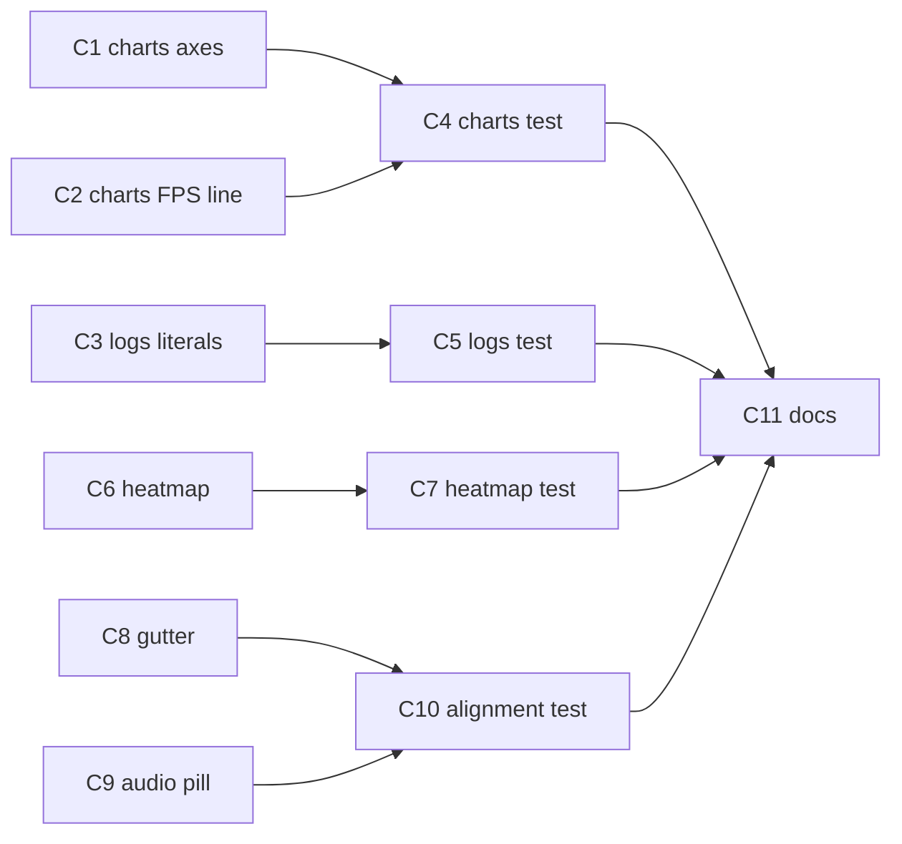

# Detection Alignment and Chart Readability — Implementation Plan

- **Date:** 2026-11-09
- **Feature slug:** `detection-alignment-charts`
- **Stage:** 3 of 4 (plan). Source-of-truth order for the implementation stage: **this file** → [`detection-alignment-charts-design-spec.md`](detection-alignment-charts-design-spec.md) → [`detection-alignment-charts-analysis.md`](detection-alignment-charts-analysis.md).
- **Required inputs:** [`detection-alignment-charts-analysis.md`](detection-alignment-charts-analysis.md) (Stage 1 — confirmed root causes, constraint surface, token inventory, tests that must keep passing) and [`detection-alignment-charts-design-spec.md`](detection-alignment-charts-design-spec.md) (Stage 2 — OQ1–OQ12 resolutions, target widget trees, acceptance criteria, test-impact table).
- **Task type:** UI alignment/readability fix. Visual output changes, so the design-spec stage applies; there is no logic, service, model, navigation or backend change.
- **Scope discipline:** no code was changed in this stage. No `flutter test`, `flutter analyze`, `dart format`, or build was run. Every snippet quoted below was read from the current working tree at the time of writing; line numbers are that tree's.

---

## 0. Change set

### 0.1 Files to modify (complete list)

| # | File | Folder | Why it is in scope |
|---|---|---|---|
| 1 | [`lib/widgets/charts.dart`](../../lib/widgets/charts.dart:1) | `lib/widgets/` | Issues 4 and 5 (§3.4/§3.5 of the design-spec) |
| 2 | [`lib/screens/logs_reports_screen.dart`](../../lib/screens/logs_reports_screen.dart:1) | `lib/screens/` | Issue 4 title gap, Issue 5 FPS title literal |
| 3 | [`lib/widgets/depth_heatmap_view.dart`](../../lib/widgets/depth_heatmap_view.dart:1) | `lib/widgets/` | Issue 2 |
| 4 | [`lib/screens/ultralytics_detection_screen.dart`](../../lib/screens/ultralytics_detection_screen.dart:1) | `lib/screens/` | Issue 1 (gutter) and Issue 3 (`_AudioPill`) |
| 5 | [`test/widgets/charts_test.dart`](../../test/widgets/charts_test.dart:1) | `test/` | Assertions naming the deleted Y names |
| 6 | [`test/screens/logs_reports_screen_test.dart`](../../test/screens/logs_reports_screen_test.dart:1) | `test/` | Assertions naming the deleted `(15 FPS target)` string |
| 7 | [`test/widgets/depth_heatmap_view_test.dart`](../../test/widgets/depth_heatmap_view_test.dart:1) | `test/` | Assertions encode the replaced heatmap tree |
| 8 | **new** `test/screens/detection_screen_alignment_test.dart` | `test/` | No existing test asserts the gutter or the 64×56 target |
| 9 | `docs/changelog.md`, `docs/session-log.md`, `docs/implementation-progress.md` | `docs/` | Mandatory per [`.roo/rules/rules-frontend/06-doc-update.md`](../../.roo/rules/rules-frontend/06-doc-update.md) |

`test/` is **outside** the four UI-owned folders ([`.roo/rules/rules-frontend/01-scope.md`](../../.roo/rules/rules-frontend/01-scope.md)). Items 5–8 are the explicitly flagged, approved consequence recorded in design-spec §1.3/§5: the strings and structures those assertions name are being deleted, so the assertions cannot survive. [inferred-from-codebase]

### 0.2 Forbidden — must not be touched by this feature

`lib/widgets/bounding_box_painter.dart` · `lib/widgets/status_pill.dart` · `lib/widgets/detection_information_overlay.dart` · `lib/widgets/detection_action_controls.dart` · `lib/theme/*` (no token is added) · `lib/models/*` · `lib/services/*` · `lib/navigation/*` · `lib/main.dart` · `plugins/*` · `android/*` · `pubspec.yaml` · `.roo/**` · any other doc · the two upstream pipeline docs in this folder.

Rationale per file: design-spec §1.2 (OQ3, OQ4, OQ12, and the inter-card `kSpace12` at [`detection_action_controls.dart:343`](../../lib/widgets/detection_action_controls.dart:343)).

---

## 1. Facts confirmed in the current tree before prescribing anything

These are the plan-stage validations; each one changes or constrains a step below.

### 1.1 `charts.dart` — per-axis configuration

- Left axis ([`:284-300`](../../lib/widgets/charts.dart:284)): `axisNameWidget: RotatedBox(quarterTurns: 3, Text(yName))`, `axisNameSize: 24`, `sideTitles.reservedSize: 38`, tick text `Text(_formatAxisTick(value, yInterval), style: tickStyle())` with **no** `maxLines` / `softWrap`.
- Bottom axis ([`:301-319`](../../lib/widgets/charts.dart:301)): `axisNameWidget: Text(xName)`, `axisNameSize: 22`, `sideTitles.reservedSize: 22`, tick text `minuteLabels ? '${value.round() + 1}' : _formatAxisTick(value, xInterval)`.
- `tickStyle()` ([`:280`](../../lib/widgets/charts.dart:280)) is `const TextStyle(color: kHomeInkMuted, fontSize: 10)`, declared **inside** `_chartTitles` and therefore usable from both axes. There is no `BuildContext` in that function today — adding the theme lookup is a signature change on a private function with exactly three call sites, all in this file.
- `_formatAxisTick` ([`:323-339`](../../lib/widgets/charts.dart:323)) is called by the **Y** axis at [:297](../../lib/widgets/charts.dart:297) and the **X** axis at [:314](../../lib/widgets/charts.dart:314); the minute labels bypass it. **A Y-only formatter therefore cannot touch X output.** Confirmed: the X tick positions are driven by `interval: xInterval` (unchanged) and the X *strings* stay `_formatAxisTick` verbatim, so `0.5` and `1.5` in [`charts_test.dart:148`](../../test/widgets/charts_test.dart:148) and [:183](../../test/widgets/charts_test.dart:183) are preserved by construction.
- Benchmark symbols: `_fpsBenchmark` occurs only at [:18](../../lib/widgets/charts.dart:18) (declaration) and inside `FpsChart` at [:146](../../lib/widgets/charts.dart:146), [:180](../../lib/widgets/charts.dart:180). `_latencyBenchmarkMs` occurs only at [:17](../../lib/widgets/charts.dart:17) and inside `LatencyChart` at [:56](../../lib/widgets/charts.dart:56), [:90](../../lib/widgets/charts.dart:90). **`showBenchmark` is a separate local in each chart class** (Latency [:56](../../lib/widgets/charts.dart:56), FPS [:146](../../lib/widgets/charts.dart:146)) — deleting the FPS one cannot affect the 300 ms line. Verified by a whole-repo grep: 9 hits, all in `charts.dart`, all accounted for above.
- `_axisColor` ([`:10`](../../lib/widgets/charts.dart:10)) is used in exactly three `Border`s: [:76-77](../../lib/widgets/charts.dart:76), [:166-167](../../lib/widgets/charts.dart:166), [:253-254](../../lib/widgets/charts.dart:253).
- `app_colors.dart` is already imported ([:7](../../lib/widgets/charts.dart:7)), so `kHomeInkMuted` needs no new import.

### 1.2 `buildHomeTheme()` — `labelSmall` is 14 sp (design-spec §3.4.1 is correct; analysis §4 was wrong)

[`app_home_theme.dart:89-93`](../../lib/theme/app_home_theme.dart:89) overrides `labelSmall` to `IBM Plex Sans, fontSize: 14, fontWeight: w500, color: kHomeInk`. `titleSmall` is genuinely not overridden.

**New finding the design-spec did not record:** the charts are reached under that theme in the app ([`logs_reports_screen.dart:95-96`](../../lib/screens/logs_reports_screen.dart:95) wraps `Theme(data: buildHomeTheme())`), but [`charts_test.dart`'s `wrap()` helper](../../test/widgets/charts_test.dart:22) uses a bare `MaterialApp` with **no theme**, so `labelSmall` there resolves to the Material default (not 14 sp). Consequence: the width-260 / 200 %-scale assertions at [:130-198](../../test/widgets/charts_test.dart:130) do **not** exercise the 14 sp tick, and the Logs & Reports 200 %-overflow test ([`logs_reports_screen_test.dart:1314`](../../test/screens/logs_reports_screen_test.dart:1314)) only asserts that no *exception* is thrown — fl_chart clips a too-wide tick silently instead of throwing. A themed fit assertion is therefore **added** (§3.1, new test **C1e**). [inferred-from-codebase]

### 1.3 `reservedSize: 56` in the design-spec is under-provisioned, not over-provisioned

Full arithmetic is in §5.1. Summary: wrapping is made structurally impossible by `maxLines: 1` + `softWrap: false` (so the *wrapping* requirement is met at any reserve), but the **fitting** requirement at 200 % text scale needs ~60–63 dp for the four-character ticks that the design-spec's own worked examples produce (`43.5`, `37.5`, `12.5`). The plan adopts **`reservedSize: 64`** and records the deviation. The design-spec's claim that "the plot gains ~6 dp" holds only for its own 56; at 64 the plot loses 2 dp relative to today's `24 + 38 = 62`. Both are recorded in §5.1 / §7.

### 1.4 `depth_heatmap_view.dart` — exact current structure

[`:24-53`](../../lib/widgets/depth_heatmap_view.dart:24) is `IgnorePointer → ExcludeSemantics → ClipRect → FittedBox(fit: cover, clipBehavior: hardEdge) → SizedBox(uprightW × uprightH) → Transform.rotate(angle) → SizedBox(sensorW × sensorH) → RawImage(fit: fill)`, with `uprightWidth/uprightHeight` computed at [:28-30](../../lib/widgets/depth_heatmap_view.dart:28) and `import 'dart:math' as math;` at [:1](../../lib/widgets/depth_heatmap_view.dart:1) used **only** for `math.pi` at [:42](../../lib/widgets/depth_heatmap_view.dart:42). Removing `Transform.rotate` therefore makes that import unused — it must be deleted in the same step or `flutter analyze` is not clean.

Current test assertions ([`depth_heatmap_view_test.dart:23-47`](../../test/widgets/depth_heatmap_view_test.dart:23)): `FittedBox.fit == BoxFit.cover` and *"the first `SizedBox` descendant of the `FittedBox` is `20 × 40` for a `40 × 20` image at 90°"* — that second assertion encodes the buggy upright-sizing and must be replaced. The harness is `Center` in `Scaffold.body` ([`:8-12`](../../test/widgets/depth_heatmap_view_test.dart:8)) with **loose** constraints, so `FittedBox` currently sizes to its child and nothing is scaled; any new cover/centring assertion must pump inside an explicitly sized box (§3.3).

### 1.5 `_AudioPill` — exact current structure and the paths that must survive

[`:1904-1970`](../../lib/screens/ultralytics_detection_screen.dart:1904): `Semantics(container: true, excludeSemantics: true, button: true, enabled: true, label: 'Audio guidance, …', onTap: onPressed)` → `Tooltip(message: tooltip)` → `ConstrainedBox(minWidth: kMinTouchWidth, minHeight: kMinTouchHeight)` → `Material(color: kHomeSurfaceCard, elevation: 0, borderRadius: kRadius20)` → `InkWell(onTap: onPressed, borderRadius: kRadius20)` → `Container(padding 12/6, decoration: radius + kHomeShadowSoft)` → `Row(dot 8 dp, gap 8 dp, ExcludeSemantics(Text('AUDIO ON'/'AUDIO OFF')))`.

Constraint surface: [`gesture_navigation_direction_test.dart:434-461`](../../test/screens/gesture_navigation_direction_test.dart:434) requires one node, `isButton == true`, a `tap` action, zero custom actions, and `labelledCustomActions(tester) == ['Repeat last alert']`; [:564-576](../../test/screens/gesture_navigation_direction_test.dart:564) drives the *semantics* tap action twice and expects `Audio on` speech. [`detection_redesign_parity_test.dart:69,94`](../../test/screens/detection_redesign_parity_test.dart:69) renders its **own** `Text('AUDIO ON')` in a hand-built header, so it does not import the pill at all and cannot break.

`_toggleAudio` ([`:1339-1344`](../../lib/screens/ultralytics_detection_screen.dart:1339)) flips `settings.audioEnabled`, mirrors it to TTS, and speaks `Audio on` when enabling. It emits **no haptic**, so a "not a gesture" assertion can safely require an empty haptic list.

### 1.6 `ValueKey('detection-viewport')` is new, and adding it is safe

A whole-repo grep for `detection-viewport`, `audio-pill-target`, `audio-pill-capsule`, `depth-heatmap-fit` returns **0 matches** in `lib/` and `test/`. No existing finder can be shadowed or duplicated by adding these keys.

### 1.7 Gesture region and semantics wrapper — why the gutter goes where it does

`GestureSurface` ([`gesture_surface.dart:32-42`](../../lib/widgets/gesture_surface.dart:32)) is a `Listener` with `HitTestBehavior.translucent` that forwards `e.localPosition`. Padding **inside** it changes neither the `Listener`'s own box nor the coordinate space it reports, so [`gesture_navigation_direction_test.dart:266`](../../test/screens/gesture_navigation_direction_test.dart:266) (`surface.width == 390`) and the swipe-position tests keep their geometry. Inserting `Padding` between `Semantics` and the viewport `Container` likewise leaves the `Camera view` node's bounds unchanged.

### 1.8 Contradictions found — resolved here, not silently

| # | Where | What | Resolution |
|---|---|---|---|
| X1 | analysis §4 vs code | Analysis says `buildHomeTheme()` does not override `labelSmall`; it does (14 sp). | Code wins (already corrected in design-spec §3.4.1; re-confirmed here). |
| X2 | design-spec §3.4.2/§3.4.4 vs its own example ticks | `reservedSize: 56` is justified as "4 glyphs at 14 sp × 200 % plus the 4 dp space", but that combination needs ≈60–63 dp. | Plan adopts **64**; §5.1 shows the arithmetic; deviation flagged in §7. |
| X3 | design-spec §3.4.4 arithmetic | "The plot gains ~6 dp" is true for 56, false for 64 (loses 2 dp). | Stated explicitly in §5.1 so no later stage repeats the 6 dp claim. |
| X4 | design-spec §5.3 vs test reality | `charts_test.dart:130-198` is listed as the guard for tick fitting, but that harness has no Home theme (11 sp default), so it does not guard the 14 sp case. | New themed assertion **C1e**; recorded in §7. |
| X5 | design-spec §3.3.2 tree vs `Material` API | The target tree puts `MaterialType.transparency` on the outer `Material` yet keeps a `borderRadius` in the same region. | Plan specifies **no** `color` / `borderRadius` on the transparent `Material`; radius lives on the `InkWell` and the capsule. Avoids a `Material` construction assert risk. |

---

## 2. Change list (implementation order)

**Order and why.** Grouped by file, source before the tests that assert it, chart work first and Detection work last:

1. `charts.dart` (C1, C2) — a self-contained widget whose ownership is proven by its own test file; no other screen changes at the same time, so any fallout is attributable to one file.
2. `logs_reports_screen.dart` (C3) — two literals in the chart host, immediately after the chart widget so the Charts tab is coherent at one point in time.
3. `charts_test.dart` (C4) and `logs_reports_screen_test.dart` (C5) — the assertions those two source steps invalidate, in the same commit as the source change (`.roo/rules/rules-frontend/07-verification.md` requires the suite to be green after each change).
4. `depth_heatmap_view.dart` (C6) + `depth_heatmap_view_test.dart` (C7) — source and its rewritten test **as one step**; this is the highest-risk edit and design-spec §6 flags a stale test as "high likelihood → red suite".
5. `ultralytics_detection_screen.dart` gutter (C8), then its `_AudioPill` (C9) — two separate, small steps in the same file so each is independently revertible; this screen is pumped by several existing suites, so landing it last keeps earlier steps' test results clean.
6. `test/screens/detection_screen_alignment_test.dart` (C10) — the new assertions, after the behaviour exists.
7. Docs (C11).

Each numbered step is independently compilable: no step references a symbol introduced by a later one.



### C1 — `charts.dart`: axis colour token, theme tick style, no Y name, Y formatter, no-wrap flags

**File:** [`lib/widgets/charts.dart`](../../lib/widgets/charts.dart:1)
**Trace:** design-spec §3.4.2 (OQ6/OQ7/OQ8/OQ9), analysis §2 Issue 4. **Acceptance:** design-spec §3.4.6 items 1–6.
**Proves:** C4 (edited + new tests).

**C1.1 Delete the axis colour constant.** Current ([`:9-11`](../../lib/widgets/charts.dart:9)):

```dart
/// Shared chart styling so all charts stay high-contrast and consistent.
const Color _axisColor = Color(0xFFBDBDBD);
const Color _lineColor = Color(0xFFFFC107);
```

Replace with:

```dart
/// Shared chart styling so all charts stay high-contrast and consistent.
///
/// Axis strokes reuse the muted ink token that the tick glyphs already use:
/// one grey instead of two, and no raw hex. `_lineColor` is the series colour,
/// not text/axis contrast, so it is deliberately unchanged.
const Color _lineColor = Color(0xFFFFC107);
```

**C1.2 Point both borders at the token — three identical sites.** Current, at [:75-78](../../lib/widgets/charts.dart:75), [:165-168](../../lib/widgets/charts.dart:165), [:252-255](../../lib/widgets/charts.dart:252):

```dart
              border: const Border(
                left: BorderSide(color: _axisColor),
                bottom: BorderSide(color: _axisColor),
              ),
```

Replace each of the three with:

```dart
              border: const Border(
                left: BorderSide(color: kHomeInkMuted),
                bottom: BorderSide(color: kHomeInkMuted),
              ),
```

(`kHomeInkMuted` is a `const Color`, so the `const Border` stays valid.)

**C1.3 Update the three `_chartTitles` call sites — add `context`, drop `yName`.** Latency ([`:80-85`](../../lib/widgets/charts.dart:80)):

```dart
            titlesData: _chartTitles(
              xName: 'Elapsed time (s)',
              yName: 'Latency (ms)',
              xInterval: maxX / 2,
              yInterval: maxY / 4,
            ),
```

→

```dart
            titlesData: _chartTitles(
              context: context,
              xName: 'Elapsed time (s)',
              xInterval: maxX / 2,
              yInterval: maxY / 4,
            ),
```

FPS ([`:170-175`](../../lib/widgets/charts.dart:170)): same shape, deleting `yName: 'FPS',`.
Detection frequency ([`:257-263`](../../lib/widgets/charts.dart:257)): same shape, deleting `yName: 'Detections',` and keeping `minuteLabels: true`.

**C1.4 Replace the `_chartTitles` signature and tick style.** Current ([`:273-280`](../../lib/widgets/charts.dart:273)):

```dart
FlTitlesData _chartTitles({
  required String xName,
  required String yName,
  required double xInterval,
  required double yInterval,
  bool minuteLabels = false,
}) {
  TextStyle tickStyle() => const TextStyle(color: kHomeInkMuted, fontSize: 10);
```

Replace with:

```dart
/// Builds the shared axis titles for every chart.
///
/// The Y axis deliberately carries **no** name: each card title already names
/// the metric (for example `Inference Latency`), so a rotated `Latency (ms)`
/// label was pure duplication and it consumed 24 dp of an already narrow left
/// gutter. Only the X axis keeps a name, because the X unit is not implied.
FlTitlesData _chartTitles({
  required BuildContext context,
  required String xName,
  required double xInterval,
  required double yInterval,
  bool minuteLabels = false,
}) {
  // Theme-derived so the tick type scales with the app typography instead of a
  // hardcoded 10 sp; recoloured to the muted ink the axis stroke now shares.
  final TextStyle tickStyle =
      (Theme.of(context).textTheme.labelSmall ?? const TextStyle()).copyWith(
        color: kHomeInkMuted,
      );
```

**C1.5 Replace the left axis.** Current ([`:284-300`](../../lib/widgets/charts.dart:284)):

```dart
    leftTitles: AxisTitles(
      axisNameWidget: RotatedBox(
        quarterTurns: 3,
        child: Text(yName, style: tickStyle(), maxLines: 1),
      ),
      axisNameSize: 24,
      sideTitles: SideTitles(
        showTitles: true,
        interval: yInterval,
        reservedSize: 38,
        getTitlesWidget: (value, meta) => SideTitleWidget(
          meta: meta,
          space: 4,
          child: Text(_formatAxisTick(value, yInterval), style: tickStyle()),
        ),
      ),
    ),
```

Replace with:

```dart
    leftTitles: AxisTitles(
      // No `axisNameWidget` / `axisNameSize`: the card title names the metric.
      sideTitles: SideTitles(
        showTitles: true,
        interval: yInterval,
        // Layout metric, not a design token. Budget: the widest Y tick this app
        // produces is four glyphs with one decimal (for example `43.5`); at
        // labelSmall (14 sp) x 2.0 text scale that is roughly 57 dp, plus
        // SideTitleWidget's 4 dp `space`, so 64 dp fits with slack. See the
        // plan's arithmetic table before changing this number.
        reservedSize: 64,
        getTitlesWidget: (value, meta) => SideTitleWidget(
          meta: meta,
          space: 4,
          child: Text(
            _formatYAxisTick(value, yInterval),
            style: tickStyle,
            // Structurally prevents the two-line wrap the old reserve allowed.
            maxLines: 1,
            softWrap: false,
          ),
        ),
      ),
    ),
```

**C1.6 Bottom axis — only the style reference changes, plus the same no-wrap flags.** In the current bottom block ([`:301-319`](../../lib/widgets/charts.dart:301)): change `style: tickStyle()` in `axisNameWidget` to `style: tickStyle`, and `style: tickStyle()` in the tick `Text` to `style: tickStyle, maxLines: 1, softWrap: false`. **Keep** `xName`, `axisNameSize: 22`, `interval: xInterval`, `reservedSize: 22`, `space: 4`, and the `minuteLabels ? … : _formatAxisTick(value, xInterval)` expression byte-identical.

**C1.7 Add the Y formatter** immediately after `_formatAxisTick` (which ends at [:339](../../lib/widgets/charts.dart:339)):

```dart
/// Y ticks read at most one decimal.
///
/// An integral value on an integral interval prints as an integer; anything
/// else keeps exactly one decimal so the scale stays honest and `.0` is
/// stripped. `toStringAsFixed` never emits thousands separators.
/// The X axis deliberately keeps [_formatAxisTick]: fractional elapsed-time
/// ticks (`0.5`, `1.5`) carry meaning and are asserted at 200% text scale.
String _formatYAxisTick(double value, double interval) {
  final intervalIsIntegral = (interval - interval.roundToDouble()).abs() < 1e-6;
  final valueIsIntegral = (value - value.roundToDouble()).abs() < 1e-6;
  if (intervalIsIntegral && valueIsIntegral) return value.round().toString();
  final text = value.toStringAsFixed(1);
  return text.endsWith('.0') ? text.substring(0, text.length - 2) : text;
}
```

### C2 — `charts.dart`: remove the 15 FPS benchmark, keep the 300 ms one

**File:** [`lib/widgets/charts.dart`](../../lib/widgets/charts.dart:1)
**Trace:** design-spec §3.5 (settled decision 5), analysis §2 Issue 5. **Acceptance:** design-spec §3.5 items 1–6.

**C2.1** Delete [:18](../../lib/widgets/charts.dart:18) `const double _fpsBenchmark = 15.0;`. **Leave** [:17](../../lib/widgets/charts.dart:17) `const double _latencyBenchmarkMs = 300.0;` and its doc comment [:13-16](../../lib/widgets/charts.dart:13) untouched.

**C2.2** Replace the `FpsChart` doc comment ([`:115-116`](../../lib/widgets/charts.dart:115)):

```dart
/// Effective inference FPS over time. Same dynamic-scaling approach; the
/// 15 FPS target line is drawn only when it fits the computed scale.
```

→

```dart
/// Effective inference FPS over time. The Y scale adapts to the actual data
/// (with headroom, never clamped above) so every point stays inside the
/// allocated chart. No benchmark line is drawn: a fixed FPS target is not a
/// property of this build's measured throughput.
```

**C2.3** Inside `FpsChart.build`, delete the local at [:146](../../lib/widgets/charts.dart:146):

```dart
    final showBenchmark = maxY >= _fpsBenchmark;
```

and delete the whole `extraLinesData` argument at [:176-187](../../lib/widgets/charts.dart:176):

```dart
            extraLinesData: ExtraLinesData(
              horizontalLines: showBenchmark
                  ? [
                      HorizontalLine(
                        y: _fpsBenchmark,
                        color: Colors.greenAccent,
                        strokeWidth: 1.5,
                        dashArray: [6, 4],
                      ),
                    ]
                  : const [],
            ),
```

`LineChartData.extraLinesData` is optional, so no replacement is needed. **Do not** touch `LatencyChart`'s `showBenchmark` ([:56](../../lib/widgets/charts.dart:56)) or its `extraLinesData` ([:86-97](../../lib/widgets/charts.dart:86)).

### C3 — `logs_reports_screen.dart`: chart-card gap and FPS title

**File:** [`lib/screens/logs_reports_screen.dart`](../../lib/screens/logs_reports_screen.dart:1)
**Trace:** design-spec §3.4.5 (OQ10) and §3.5 item 1. **Acceptance:** §3.4.6 item 7, §3.5 items 1–2.
**Proves:** C5.

**C3.1 Title-to-chart gap.** Current `_ChartCard.build` ([`:1795-1802`](../../lib/screens/logs_reports_screen.dart:1795)):

```dart
          Text(
            title,
            style: theme.textTheme.titleSmall?.copyWith(
              fontWeight: FontWeight.w800,
            ),
          ),
          const SizedBox(height: kSpace8),
          SizedBox(height: kChartHeight, child: child),
```

→

```dart
          Text(
            title,
            style: theme.textTheme.titleSmall?.copyWith(
              fontWeight: FontWeight.w800,
            ),
          ),
          // Breathing room between the card title and the plot; the title style
          // and kChartHeight are unchanged.
          const SizedBox(height: kSpace16),
          SizedBox(height: kChartHeight, child: child),
```

Anchor on all five lines above, not the bare `const SizedBox(height: kSpace8),` line — other `kSpace8` gaps exist in this file. Leave the class doc comment at [:1779-1781](../../lib/screens/logs_reports_screen.dart:1779) unchanged (its "benchmark lines" phrasing remains true for the latency chart).

**C3.2 FPS card title.** Current ([`:1305`](../../lib/screens/logs_reports_screen.dart:1305)):

```dart
              title: 'Frames Per Second$claim (15 FPS target)',
```

→

```dart
              title: 'Frames Per Second$claim',
```

`$claim` stays so the model-filtered title still names the model. **Do not** touch [:1300](../../lib/screens/logs_reports_screen.dart:1300) (`Inference Latency$claim (300 ms benchmark)`) or [:1313](../../lib/screens/logs_reports_screen.dart:1313) (`Detection Frequency$claim`).

### C4 — `test/widgets/charts_test.dart`: changed and new assertions

**File:** [`test/widgets/charts_test.dart`](../../test/widgets/charts_test.dart:1) — full detail in §3.1.

### C5 — `test/screens/logs_reports_screen_test.dart`: two FPS title strings

**File:** [`test/screens/logs_reports_screen_test.dart`](../../test/screens/logs_reports_screen_test.dart:1) — full detail in §3.2.

### C6 — `depth_heatmap_view.dart`: layout-aware rotation + cover geometry

**File:** [`lib/widgets/depth_heatmap_view.dart`](../../lib/widgets/depth_heatmap_view.dart:1)
**Trace:** design-spec §3.2 (OQ4 = Option C, OQ5 = no signature change), analysis §2 Issue 2 and §5.3. **Acceptance:** design-spec §3.2.5 items 1–9.
**Proves:** C7.

**C6.1** Delete the now-unused import at [:1](../../lib/widgets/depth_heatmap_view.dart:1): `import 'dart:math' as math;`.

**C6.2** Replace [:27-53](../../lib/widgets/depth_heatmap_view.dart:27) (from `final rotation = …` through the closing `);` of the `IgnorePointer`). Current:

```dart
    final rotation = ((rotationDegrees % 360) + 360) % 360;
    final swapped = rotation == 90 || rotation == 270;
    final uprightWidth = (swapped ? current.height : current.width).toDouble();
    final uprightHeight = (swapped ? current.width : current.height).toDouble();

    return IgnorePointer(
      child: ExcludeSemantics(
        child: ClipRect(
          child: FittedBox(
            fit: BoxFit.cover,
            clipBehavior: Clip.hardEdge,
            child: SizedBox(
              width: uprightWidth,
              height: uprightHeight,
              child: Transform.rotate(
                angle: rotation * math.pi / 180,
                child: SizedBox(
                  width: current.width.toDouble(),
                  height: current.height.toDouble(),
                  child: RawImage(image: current, fit: BoxFit.fill),
                ),
              ),
            ),
          ),
        ),
      ),
    );
```

Replace with:

```dart
    final rotation = ((rotationDegrees % 360) + 360) % 360;

    return IgnorePointer(
      child: ExcludeSemantics(
        child: ClipRect(
          child: FittedBox(
            // `BoxFit.cover` scaled and centred is the same mapping
            // `BoundingBoxPainter` applies with
            // `applyBoxFit(BoxFit.cover, uprightDims, previewSize)`, and the
            // native preview is `PreviewView.ScaleType.FILL_CENTER` (cover).
            // Alignment is stated explicitly rather than defaulted.
            fit: BoxFit.cover,
            alignment: Alignment.center,
            clipBehavior: Clip.hardEdge,
            child: RotatedBox(
              // Layout-aware rotation: the quarter turn happens BEFORE layout,
              // so the sensor-sized child keeps its true aspect instead of
              // being stretched into an upright box and then painted outside
              // its measured bounds (`Transform.rotate` did exactly that).
              quarterTurns: rotation ~/ 90,
              child: SizedBox(
                // Sensor dimensions, laid out exactly: never the upright dims.
                width: current.width.toDouble(),
                height: current.height.toDouble(),
                child: RawImage(image: current, fit: BoxFit.fill),
              ),
            ),
          ),
        ),
      ),
    );
```

`IgnorePointer` and `ExcludeSemantics` are kept verbatim (design-spec §3.2.6; [`depth_heatmap_view_test.dart:49-57`](../../test/widgets/depth_heatmap_view_test.dart:49) and [`depth_overlay_state_test.dart:188-189`](../../test/screens/depth_overlay_state_test.dart:188) depend on them).

### C7 — `test/widgets/depth_heatmap_view_test.dart`: rewrite + geometry invariants

**File:** [`test/widgets/depth_heatmap_view_test.dart`](../../test/widgets/depth_heatmap_view_test.dart:1) — full detail in §3.3. **Must land in the same commit as C6.**

### C8 — `ultralytics_detection_screen.dart`: one 16 dp horizontal gutter

**File:** [`lib/screens/ultralytics_detection_screen.dart`](../../lib/screens/ultralytics_detection_screen.dart:1)
**Trace:** design-spec §3.1 (settled decision 1; OQ1/OQ2/OQ3 close the adjacent questions), analysis §2 Issue 1. **Acceptance:** design-spec §3.1 criteria 1–7.
**Proves:** C10 case A1; invariants at [`gesture_navigation_direction_test.dart:266`](../../test/screens/gesture_navigation_direction_test.dart:266).

**C8.1 Action-row horizontal inset 12 → 16.** Current ([`:1861-1867`](../../lib/screens/ultralytics_detection_screen.dart:1861)):

```dart
          padding: const EdgeInsets.fromLTRB(
            kSpace12,
            kSpace8,
            kSpace12,
            kSpace12,
          ),
```

→

```dart
          // One shared screen gutter: the cards line up with the header and the
          // viewport. The band behind them stays edge-to-edge (its Container
          // colour is unchanged) and the vertical insets are untouched.
          padding: const EdgeInsets.fromLTRB(
            kSpace16,
            kSpace8,
            kSpace16,
            kSpace12,
          ),
```

**C8.2 Give the viewport a stable key.** Current ([`:1655-1657`](../../lib/screens/ultralytics_detection_screen.dart:1655)):

```dart
    final viewport = Container(
      decoration: BoxDecoration(
```

→

```dart
    final viewport = Container(
      // Stable, semantics-free anchor for the shared-gutter invariant.
      key: const ValueKey('detection-viewport'),
      decoration: BoxDecoration(
```

**C8.3** Wrap the viewport in the gutter **inside** the `Semantics` node. Current ([`:1764-1778`](../../lib/screens/ultralytics_detection_screen.dart:1764)):

```dart
    return GestureSurface(
      controller: _gestureController,
      // The camera view owns the `Repeat last alert` semantic action; the
      // overlay rows stay separate, non-live child nodes.
      child: Semantics(
        container: true,
        explicitChildNodes: true,
        label: 'Camera view',
        customSemanticsActions: {
          const CustomSemanticsAction(label: 'Repeat last alert'):
              _repeatAlertFromSemantics,
        },
        child: viewport,
      ),
    );
```

→

```dart
    return GestureSurface(
      controller: _gestureController,
      // The camera view owns the `Repeat last alert` semantic action; the
      // overlay rows stay separate, non-live child nodes.
      child: Semantics(
        container: true,
        explicitChildNodes: true,
        label: 'Camera view',
        customSemanticsActions: {
          const CustomSemanticsAction(label: 'Repeat last alert'):
              _repeatAlertFromSemantics,
        },
        // The gutter lives here, inside `Semantics` and inside `GestureSurface`:
        // the gesture region stays the whole flexible area (this narrows the
        // painted viewport only) and the `Camera view` node keeps its bounds, so
        // `Repeat last alert` stays reachable.
        child: Padding(
          padding: const EdgeInsets.symmetric(horizontal: kSpace16),
          child: viewport,
        ),
      ),
    );
```

**Do not** pad the `Expanded` at [:1531](../../lib/screens/ultralytics_detection_screen.dart:1531) — that would shrink the gesture region and break `surface.width == 390`. **Do not** touch the non-live panels' `EdgeInsets.all(24)` ([:1785](../../lib/screens/ultralytics_detection_screen.dart:1785), [:1821](../../lib/screens/ultralytics_detection_screen.dart:1821)) — OQ1 puts them out of scope.

### C9 — `ultralytics_detection_screen.dart`: `_AudioPill` target/capsule separation

**File:** [`lib/screens/ultralytics_detection_screen.dart`](../../lib/screens/ultralytics_detection_screen.dart:1)
**Trace:** design-spec §3.3 (settled decision 3; OQ12 defers the `StatusPill` token clean-up), analysis §2 Issue 3. **Acceptance:** design-spec §3.3.4 items 1–10.
**Proves:** C10 cases A2/A3; must not disturb [`gesture_navigation_direction_test.dart:434-461`](../../test/screens/gesture_navigation_direction_test.dart:434) or [:564-576](../../test/screens/gesture_navigation_direction_test.dart:564).

Replace the `Tooltip` subtree at [:1916-1968](../../lib/screens/ultralytics_detection_screen.dart:1916). Current:

```dart
      child: Tooltip(
        message: tooltip,
        child: ConstrainedBox(
          constraints: const BoxConstraints(
            minWidth: kMinTouchWidth,
            minHeight: kMinTouchHeight,
          ),
          child: Material(
            color: kHomeSurfaceCard,
            elevation: 0,
            borderRadius: BorderRadius.circular(kRadius20),
            child: InkWell(
              onTap: onPressed,
              borderRadius: BorderRadius.circular(kRadius20),
              child: Container(
                padding: const EdgeInsets.symmetric(
                  horizontal: kSpace12,
                  vertical: kSpace6,
                ),
                decoration: BoxDecoration(
                  borderRadius: BorderRadius.circular(kRadius20),
                  boxShadow: kHomeShadowSoft,
                ),
                child: Row(
                  mainAxisSize: MainAxisSize.min,
                  children: [ /* dot, gap, text — unchanged */ ],
                ),
              ),
            ),
          ),
        ),
      ),
```

Target shape (the `Row` body — 8 dp dot, `kSpace8` gap, `Text('AUDIO ON'/'AUDIO OFF', labelMedium + kHomeInk + letterSpacing 0.5)` — is copied across **unchanged**, still wrapped in `ExcludeSemantics`):

```dart
      child: Tooltip(
        message: tooltip,
        child: SizedBox(
          // (1) The hit area: a fixed 56 dp tall, >= 64 dp wide rectangle.
          key: const ValueKey('audio-pill-target'),
          height: kMinTouchHeight,
          child: ConstrainedBox(
            constraints: const BoxConstraints(minWidth: kMinTouchWidth),
            child: Material(
              // (3) Transparent at target level: the ink layer still paints the
              // splash, but no surface is forced to the 56 dp height.
              // Deliberately no `color` and no `borderRadius` here.
              type: MaterialType.transparency,
              child: InkWell(
                // (4) The only tap handler besides the semantics action.
                onTap: onPressed,
                borderRadius: BorderRadius.circular(kRadius20),
                child: Center(
                  // (5) Centres the content-sized capsule inside the target.
                  child: Container(
                    key: const ValueKey('audio-pill-capsule'),
                    padding: const EdgeInsets.symmetric(
                      horizontal: kSpace12,
                      vertical: kSpace6,
                    ),
                    decoration: BoxDecoration(
                      // (6) The visible capsule: content-sized, same padding and
                      // radius as StatusPill, so its height matches the pill's.
                      color: kHomeSurfaceCard,
                      borderRadius: BorderRadius.circular(kRadius20),
                      boxShadow: kHomeShadowSoft,
                    ),
                    child: Row(
                      mainAxisSize: MainAxisSize.min,
                      children: [
                        /* unchanged 8 dp dot: kHomeAccentCyan when on, */
                        /* kHomeInkMuted when off, inside ExcludeSemantics */
                        const SizedBox(width: kSpace8),
                        /* unchanged ExcludeSemantics(Text('AUDIO ON'/'AUDIO OFF',
                           labelMedium + kHomeInk + letterSpacing 0.5)) */
                      ],
                    ),
                  ),
                ),
              ),
            ),
          ),
        ),
      ),
```

The outer `Semantics` ([:1906-1915](../../lib/screens/ultralytics_detection_screen.dart:1906)) is **unchanged**: `container: true, excludeSemantics: true, button: true, enabled: true, label: 'Audio guidance, …', onTap: onPressed`. The tooltip strings at the call site ([:1586-1588](../../lib/screens/ultralytics_detection_screen.dart:1586)) are unchanged. No `hint`, no `customSemanticsActions`, no `onLongPress` is added.

### C10 — new `test/screens/detection_screen_alignment_test.dart`

Full case list in §3.4. Harness: replicate the pumping setup from [`gesture_navigation_direction_test.dart:26-232`](../../test/screens/gesture_navigation_direction_test.dart:26) (the private `_FakeTtsEngine`, `mockPlatformChannels`, `pumpScreen`, `startSession`). Duplication is required because those helpers are file-private; do **not** edit the existing file to share them.

### C11 — documentation

Full checklist in §6.

---

## 3. Test plan

### 3.1 `test/widgets/charts_test.dart`

#### Edits to existing assertions

| Line | Current (quoted) | Required |
|---|---|---|
| [:90](../../test/widgets/charts_test.dart:90) | `expect(find.text('Latency (ms)'), findsOneWidget);` | `expect(find.text('Latency (ms)'), findsNothing);` |
| [:95](../../test/widgets/charts_test.dart:95) | `expect(find.text('FPS'), findsOneWidget);` | `expect(find.text('FPS'), findsNothing);` |
| [:100](../../test/widgets/charts_test.dart:100) | `expect(find.text('Detections'), findsOneWidget);` | `expect(find.text('Detections'), findsNothing);` |
| [:203-221](../../test/widgets/charts_test.dart:203) | tuple list `(chart, xAxis, yAxis)` then `expect(find.text(yAxis), findsOneWidget);` at [:219](../../test/widgets/charts_test.dart:219) | Drop the third tuple element and the `yAxis` expectation; keep `expect(find.text(xAxis), findsOneWidget);` and `expect(tester.takeException(), isNull);`. Rename the test to `X axis names fit at narrow width and 200% text scale` (there is no Y name left to fit). |

Keep [:89](../../test/widgets/charts_test.dart:89), [:94](../../test/widgets/charts_test.dart:94), [:99](../../test/widgets/charts_test.dart:99) (the X names) untouched.

#### New assertions

Add a themed helper next to the existing `wrap()` (do **not** modify `wrap()` — six existing tests depend on its exact metrics):

```dart
/// Same surface as [wrap], but under the real app theme so `labelSmall`
/// resolves to the 14 sp the charts actually render with. `wrap()` alone
/// uses a bare MaterialApp (Material's default tick size), which cannot guard
/// the shipped tick size.
Widget wrapThemed(Widget child, {double textScale = 1, double width = 360}) =>
    MaterialApp(
      theme: buildHomeTheme(),
      home: MediaQuery(
        data: MediaQueryData(textScaler: TextScaler.linear(textScale)),
        child: Scaffold(
          body: Center(
            child: SizedBox(width: width, height: 180, child: child),
          ),
        ),
      ),
    );
```

New imports: `package:eyecue_flutter/theme/app_home_theme.dart`, `package:eyecue_flutter/theme/app_colors.dart`.

| ID | Test name | Assertions |
|---|---|---|
| **C1b** | `Y ticks are single line and never carry two decimals` | For all three charts (latency `samples([30, 58])`, FPS `samples([30, 40])`, frequency `buckets: [0, 4, 1]`): every `Text` whose `data` matches `RegExp(r'^\d')` has `maxLines == 1` and `softWrap == false`; `find.textContaining(RegExp(r'\.\d\d'))` is `findsNothing`; `takeException()` is null. |
| **C1c** | `an integer Y interval renders integer ticks` | `LatencyChart(samples: samples([25]))` → `maxY = max(25*1.2+10, 40) = 40`, `yInterval = 10`: `find.text('10')`, `'20'`, `'30'`, `'40'` each `findsOneWidget`; `find.text('10.0')` is `findsNothing`. (X ticks in this case are `0`, `0.5`, `1`, so no collision.) |
| **C1d** | `a fractional Y interval keeps exactly one decimal` | `LatencyChart(samples: samples([30, 58]))` → `maxY = 79.6`, `yInterval = 19.9`: `find.text('39.8')` is `findsOneWidget`; `find.textContaining(RegExp(r'\.\d\d'))` `findsNothing`. |
| **C1e** | `the widest Y tick fits the reserved gutter at 200 percent text scale` | Under `wrapThemed(…, textScale: 2, width: 320)` with `LatencyChart(samples: samples([30, 58]))`: let `w = tester.getRect(find.text('39.8')).width`; expect `w + 4 <= 64` (`4` = `SideTitleWidget.space`, `64` = the left `reservedSize`). Also `expect(tester.takeException(), isNull)`. **This is the assertion that fails if the reserve is too small**; it measures the real glyph advance instead of assuming one. |
| **C1f** | `chart axes and ticks share the muted ink token` | Under `wrapThemed`: `tester.widget<LineChart>(find.byType(LineChart)).data.borderData.border!.left.color == kHomeInkMuted` and `.bottom.color == kHomeInkMuted`; for the same chart, the `Text` style of a rendered tick (e.g. `find.text('Elapsed time (s)')` is the axis name — use a tick such as the first numeric `Text`) has `color == kHomeInkMuted` and `fontSize == Theme.of(context).textTheme.labelSmall!.fontSize` (14 under `buildHomeTheme()`). |
| **C2b** | `the FPS chart draws no benchmark line and the latency chart keeps its 300 ms line` | `tester.widget<LineChart>(find.byType(LineChart)).data.extraLinesData.horizontalLines` is `isEmpty` for `FpsChart(samples: samples([30, 40]))`. For `LatencyChart(samples: samples([400, 420]))` (`dataMax 420 → maxY 514 ≥ 300`): `hasLength(1)`, `single.y == 300`, `single.color == Colors.redAccent`, `single.dashArray` equals `[6, 4]`. |

### 3.2 `test/screens/logs_reports_screen_test.dart`

| Line | Current (quoted) | Required |
|---|---|---|
| [:373](../../test/screens/logs_reports_screen_test.dart:373) | `expect(find.text('Frames Per Second (15 FPS target)'), findsOneWidget);` | `expect(find.text('Frames Per Second'), findsOneWidget);` |
| [:1584](../../test/screens/logs_reports_screen_test.dart:1584) | `expect(find.text('Frames Per Second — Obstacle Detector v2 (15 FPS target)'), findsOneWidget);` | `expect(find.text('Frames Per Second — Obstacle Detector v2'), findsOneWidget);` |

Unchanged and load-bearing: [:372](../../test/screens/logs_reports_screen_test.dart:372) (`Inference Latency (300 ms benchmark)`), [:374](../../test/screens/logs_reports_screen_test.dart:374) (`Detection Frequency`), [:1314-1326](../../test/screens/logs_reports_screen_test.dart:1314) (200 % Charts, no exception), [:1558-1591](../../test/screens/logs_reports_screen_test.dart:1558) (latency model claims). The `find.textContaining('frames —')` guards at [:1556](../../test/screens/logs_reports_screen_test.dart:1556) / [:1604](../../test/screens/logs_reports_screen_test.dart:1604) are unaffected by the FPS title change.

Optional (not required by any acceptance criterion, add only if cheap): a `findsNothing` guard for `find.textContaining('15 FPS')` on the Charts tab, which is the direct expression of settled decision 5.

### 3.3 `test/widgets/depth_heatmap_view_test.dart`

#### Replace [:23-47](../../test/widgets/depth_heatmap_view_test.dart:23)

Current second half that must go:

```dart
    // A quarter turn transposes the upright box the image is fitted into.
    final sized = tester.widget<SizedBox>(
      find
          .descendant(
            of: find.byType(FittedBox),
            matching: find.byType(SizedBox),
          )
          .first,
    );
    expect(sized.width, 20);
    expect(sized.height, 40);
```

Required shape of the rewritten test (name unchanged, `rotates and centre-crops the depth image`):

```dart
    final fitted = tester.widget<FittedBox>(find.byType(FittedBox).first);
    expect(fitted.fit, BoxFit.cover);
    expect(fitted.alignment, Alignment.center);
    expect(fitted.clipBehavior, Clip.hardEdge);

    // The paint-only rotation is gone; the rotation now happens in layout.
    expect(find.byType(Transform), findsNothing);
    final rotated = tester.widget<RotatedBox>(find.byType(RotatedBox));
    expect(rotated.quarterTurns, 1);
    // Layout size of the rotated box: transposed, upright.
    expect(tester.getSize(find.byType(RotatedBox)), const Size(20, 40));
    // The child keeps the true SENSOR aspect: no stretch before rotation.
    final inner = tester.widget<SizedBox>(
      find.descendant(
        of: find.byType(RotatedBox),
        matching: find.byType(SizedBox),
      ).first,
    );
    expect(inner.width, 40);
    expect(inner.height, 20);
    expect(tester.takeException(), isNull);
```

#### New test — `cover fit centres the rotated image and crops the overflow`

The current harness ([`:8-12`](../../test/widgets/depth_heatmap_view_test.dart:8)) centres under loose constraints, so `FittedBox` sizes to its child and nothing is scaled. This test therefore pumps inside a fixed box with a non-matching aspect:

```dart
testWidgets('cover fit centres the rotated image and crops the overflow', (tester) async {
  final ui.Image image = (await tester.runAsync(
    () => createTestImage(width: 40, height: 20),
  ))!;
  await tester.pumpWidget(
    MaterialApp(
      home: Scaffold(
        body: Center(
          child: SizedBox(
            width: 100,
            height: 100,
            child: DepthHeatmapView(image: image, rotationDegrees: 90),
          ),
        ),
      ),
    ),
  );

  final box = tester.getRect(find.byType(FittedBox).first);   // 100 x 100, painted
  final child = tester.getRect(find.byType(RotatedBox));      // scaled + centred
  // Cover: the child fills the box and overflows the cropped axis.
  expect(child.width, greaterThanOrEqualTo(box.width - 0.5));
  expect(child.height, greaterThanOrEqualTo(box.height - 0.5));
  expect(child.width > box.width + 0.5 || child.height > box.height + 0.5, isTrue);
  // Centred on both axes.
  expect(child.center.dx, closeTo(box.center.dx, 0.5));
  expect(child.center.dy, closeTo(box.center.dy, 0.5));
  // Aspect preserved: 20 x 40 upright, scaled.
  expect(child.width / child.height, closeTo(20 / 40, 0.01));
  expect(tester.takeException(), isNull);
});
```

(`getRect` returns the *painted* rect because `RenderFittedBox.applyPaintTransform` is included in `localToGlobal`; `getSize` returns the unscaled layout size. Both are used deliberately above.)

#### New test — `quarter turns map every rotation including negatives`

Pump `rotationDegrees` of `0, 90, 180, 270, -90` and assert `tester.widget<RotatedBox>(find.byType(RotatedBox)).quarterTurns` is `0, 1, 2, 3, 3` respectively; `find.byType(Transform)` is `findsNothing` in every case.

#### Keep unchanged

[:14-21](../../test/widgets/depth_heatmap_view_test.dart:14) (`renders nothing without a depth image`) and [:49-57](../../test/widgets/depth_heatmap_view_test.dart:49) (`is excluded from semantics`).

### 3.4 New `test/screens/detection_screen_alignment_test.dart`

Harness (copied from the gesture suite, which is the only existing file that pumps the real screen): `_FakeTtsEngine`, `mockPlatformChannels`, `pumpScreen` (390 × 844 @ 3.0, `tester.view.physicalSize = Size(390*3, 844*3)`), `startSession`. Group setup mirrors [`gesture_navigation_direction_test.dart:141-156`](../../test/screens/gesture_navigation_direction_test.dart:141): `SettingsService(store: InMemorySettingsStore())`, `TtsService(engine: fake)`, `HapticsService` recording `light/medium/heavy`, `EngineCoordinator(preferredEngine: InferenceEngine.ultralytics)`, `directions` list for `onNavigateRelative`.

| ID | Test name | Assertions |
|---|---|---|
| **A1** | `header, viewport and action cards share one 16 dp gutter` | After `startSession`: `tester.getTopLeft(find.text('Detection Mode')).dx == 16`; viewport rect from `find.byKey(const ValueKey('detection-viewport'))` has `left == 16` and `right == 374`; `tester.getRect(find.byType(DetectionActionControls))` has `left == 16` and `right == 374`; `tester.getRect(find.byType(GestureSurface)).width == 390` (unchanged region); the band is still painted: `find.byWidgetPredicate((w) => w is Container && w.color == kHomeSurfaceBase)` is `findsWidgets`; `tester.takeException()` is null. |
| **A2** | `the audio pill keeps a 64 by 56 target with a content-sized capsule` | `tester.getSize(find.byKey(const ValueKey('audio-pill-target')))` has `height == 56` and `width >= 64`; `capsule = tester.getSize(find.byKey(const ValueKey('audio-pill-capsule')))`; `capsule.height < 56`; with `pill = tester.getSize(find.byType(StatusPill))`, `(capsule.height - pill.height).abs() <= 2`; `tester.takeException()` is null. |
| **A3** | `a tap in the target margin toggles mute exactly once and is not a gesture` | `settings.audioEnabled` is `true` initially. Compute `capsuleRect` and `targetRect`; assert `targetRect.bottom - capsuleRect.bottom >= 2` (the margin exists by construction), then `tester.tapAt(Offset(capsuleRect.center.dx, capsuleRect.bottom + 4))`; pump; `settings.audioEnabled` is `false`; `directions` is empty; `hapticCalls` is empty (a `singleTap` classification would have produced a wayfinding haptic and/or a pause). Then `tester.tapAt(capsuleRect.center)`; pump; `settings.audioEnabled` is `true` and `ttsEngine.spoken` contains `'Audio on'` — proving the capsule tap also toggles exactly once (no double toggle). |

Deliberately **not** duplicated here: "the audio pill is one mute node with no custom action". It already exists at [`gesture_navigation_direction_test.dart:434-461`](../../test/screens/gesture_navigation_direction_test.dart:434) and exercises the same tree; duplicating it would double-maintain one contract. A2/A3 cover only what it does not: the target/capsule geometry and the target-margin tap.

### 3.5 Invariant tests that must keep passing unchanged, and why each fix cannot break them

| Test | Why it constrains | Why these changes are safe |
|---|---|---|
| [`charts_test.dart:130-163`](../../test/widgets/charts_test.dart:130) — X labels `0`, `0.5`, `1` at 200 %, width 260 | Forbids blanket precision reduction | X keeps `_formatAxisTick` and `interval: xInterval` verbatim; only the Y formatter and Y reserve change. X tick *strings* are byte-identical. |
| [`charts_test.dart:165-198`](../../test/widgets/charts_test.dart:165) — `0`, `1.5`, `3` | Same | Same. |
| [`charts_test.dart:104-128`](../../test/widgets/charts_test.dart:104) — `minX 0`, `maxX 9`, spots `[0,2,9]` | Plot domain | No data binding, `maxX`, `maxY` formula or spot construction is edited. |
| [`charts_test.dart:38-83`](../../test/widgets/charts_test.dart:38) — empty/high/constant/single datasets | No throw; `'No data available yet'` | `_NoData` and the empty branches are untouched. `softWrap: false` cannot throw. |
| [`charts_test.dart:224-280`](../../test/widgets/charts_test.dart:224) — `mixed-model data`, latest-name identity | Semantics must not change | `_sampleSummary` / `_engineSummary` are untouched; only `titlesData` and tick text change. |
| [`semantics_test.dart:342-401`](../../test/accessibility/semantics_test.dart:342) — exact chart summary prefixes incl. `Latest 50.0 milliseconds` | Semantics byte-identical | Those values come from `_sampleSummary`'s `toStringAsFixed(1)`, not from the axis formatter. |
| [`logs_reports_screen_test.dart:1314-1326`](../../test/screens/logs_reports_screen_test.dart:1314) — Charts at 390 × 844, 200 % | No exception/overflow | A wider left reserve narrows the plot inside a fixed `kChartHeight`; `+8 dp` of title gap grows a card inside a scrollable list. Neither introduces an unbounded axis. Must be re-run, not assumed. |
| [`logs_reports_screen_test.dart:366-375`](../../test/screens/logs_reports_screen_test.dart:366) — three chart regions, 300 ms title | Latency benchmark preserved | The latency title and the 300 ms line are untouched. |
| [`logs_reports_screen_test.dart:1558-1591`](../../test/screens/logs_reports_screen_test.dart:1558) — latency model claims | Latency titles unchanged | Only the FPS literal changed. |
| [`gesture_navigation_direction_test.dart:250-268`](../../test/screens/gesture_navigation_direction_test.dart:250) — `surface.width == 390`, region vs control row | Direct guard against padding the `Expanded` | The gutter is inserted **inside** `GestureSurface`/`Semantics`, so the `Listener`'s box is untouched. |
| [`gesture_navigation_direction_test.dart:270-292`](../../test/screens/gesture_navigation_direction_test.dart:270) — no button/tappable inside the live subtree | Gesture region stays inert | `Padding` is not interactive; nothing new is added inside the surface. |
| [`gesture_navigation_direction_test.dart:434-461`](../../test/screens/gesture_navigation_direction_test.dart:434) and [:564-576](../../test/screens/gesture_navigation_direction_test.dart:564) — one mute node, button, tap action, zero custom actions, `Audio on` speech | Pill semantics contract | The outer `Semantics` is copied verbatim; `excludeSemantics: true` still suppresses the `InkWell`/`Center`/`Container` nodes; no custom action is added. |
| [`gesture_navigation_direction_test.dart:463-480`](../../test/screens/gesture_navigation_direction_test.dart:463) — one `Detection` header node | Header identity | `_buildTopBar`'s padding and `Semantics` are untouched. |
| [`detection_redesign_parity_test.dart:69,94`](../../test/screens/detection_redesign_parity_test.dart:69) — `AUDIO ON` from a hand-built header | Header contract | That test renders its own `Text`, not the pill. |
| [`depth_heatmap_view_test.dart:14-21,49-57`](../../test/widgets/depth_heatmap_view_test.dart:14), [`depth_overlay_state_test.dart:188-189`](../../test/screens/depth_overlay_state_test.dart:188) — null renders nothing; pointer-inert and semantics-free | Decorative posture | `IgnorePointer` + `ExcludeSemantics` are kept verbatim. |
| [`talkback_no_gesture_hints_test.dart`](../../test/architecture/talkback_no_gesture_hints_test.dart) — no gesture-teaching `hint`/`value` | Source guard | No `hint`, `onTapHint`, `onLongPressHint` or gesture wording is introduced anywhere. |
| [`no_custom_engine_test.dart:11-21`](../../test/architecture/no_custom_engine_test.dart:11) — removed Custom-engine symbols | Source guard | Nothing removed-engine-related is reintroduced. |

---

## 4. Verification steps

### 4.1 Baseline to capture **before** the first edit

Run and record verbatim (numbers only; do not interpret them as proof of the fix):

```text
flutter analyze --no-pub
flutter test --no-pub
```

Record the pass/fail totals and any pre-existing failures so a post-change delta is attributable. The last recorded state in the docs is `flutter analyze` 0 issues and `flutter test` 865 passing / 0 failing ([`docs/implementation-progress.md:31`](../implementation-progress.md:31)) — treat that as a historical reference, **not** as a substitute for the fresh baseline.

### 4.2 After each step

```text
dart format lib/widgets/charts.dart lib/widgets/depth_heatmap_view.dart lib/screens/logs_reports_screen.dart lib/screens/ultralytics_detection_screen.dart test/widgets/charts_test.dart test/widgets/depth_heatmap_view_test.dart test/screens/logs_reports_screen_test.dart test/screens/detection_screen_alignment_test.dart
flutter analyze --no-pub
flutter test --no-pub test/widgets/charts_test.dart
flutter test --no-pub test/widgets/depth_heatmap_view_test.dart
flutter test --no-pub test/screens/logs_reports_screen_test.dart
flutter test --no-pub test/screens/detection_screen_alignment_test.dart
flutter test --no-pub test/screens/gesture_navigation_direction_test.dart
flutter test --no-pub test/accessibility/semantics_test.dart
```

(`dart format --output=none --set-exit-if-changed <files>` is the repo's check form; either is acceptable, but formatting must be clean — the repository records it as part of verification.)

### 4.3 Final gate

```text
flutter analyze --no-pub      # must be 0 issues
flutter test --no-pub         # full suite, 0 failures
```

A debug build (`flutter build apk --debug`) is **only** needed if a physical-device check of the visual results is being done; it is not required by any acceptance criterion that a widget test covers.

### 4.4 Device-only gates — record as Needs Verification, never as passed

| Gate | Why it cannot be closed here |
|---|---|
| NV1 — the 16 dp gutter's actual appearance on the physical Android device | Screenshots are excluded by the user; the only honest check is a live app run on the Snapdragon 695 / API 33 device. |
| NV2 — heatmap-to-preview correspondence with MDE enabled | No widget test can compare against a `PreviewView` texture. |
| NV3 — `reservedSize` sufficiency and the X axis name at 200 % on device | Arithmetic plus widget tests bound it; the device read is the proof. Approved fallback if the bottom name reads clipped: raise bottom `axisNameSize` 22 → 36 (plot loses height, `kChartHeight` unchanged). |
| NV4 — `RotatedBox` inside `FittedBox` on a real device | The geometry *test* proves the layout contract off-device; the device run (NV2) is what proves it against real depth frames. |
| NV7 — audio-pill ripple extent (the splash spans the full 64 × 56 target) | A visual/TalkBack judgement. |

---

## 5. Risks and rollback

### 5.1 `reservedSize` — the arithmetic, and why 64 rather than the design-spec's 56

Per-glyph advance assumptions (no measurement was possible in this stage, so two are shown):

- Real font, IBM Plex Sans: digits ≈ `0.60 em`, period ≈ `0.25 em`.
- Conservative bound used for the decision: digits ≈ `0.62 em`, period ≈ `0.26 em`.
- `flutter_test`'s default test font (what `wrap()` renders with): **each glyph ≈ `0.5 em`**, line height `1.0 em`.

Required reserve = widest tick text + `SideTitleWidget.space` (4 dp).

| Tick format | Chars | 14 sp × 100 % (0.62 em) | 14 sp × 200 % (0.62 em) | + 4 dp space | Verdict |
|---|---|---|---|---|---|
| `40` (2 chars) | 2 | 2·8.68 = 17.4 | 34.7 | 38.7 | 40 would do |
| `0.5` (3 chars) | 3 | 2·8.68 + 3.64 = 21.0 | 34.7 + 7.3 = 42.0 | **46.0** | **48 is the smallest reserve that fits a 3-character tick at 200 %** |
| `43.5` (4 chars) | 4 | 3·8.68 + 3.64 = 29.7 | 52.1 + 7.3 = 59.4 | **63.4** | **64** |
| `1502.5` (6 chars) | 6 | 5·8.68 + 3.64 = 47.0 | 86.8 + 7.3 = 94.1 | 98.1 | out of scope (see §7 OQ-P3) |

Answering the review question directly: **the smallest `reservedSize` that prevents wrapping for 3-character ticks at 14 sp is 48** — but wrapping is already structurally impossible once `maxLines: 1` + `softWrap: false` are added, so "prevents wrapping" alone is a weak bar; below the fitting width the number is *clipped* instead, which is worse than wrapping for a researcher reading a scale. The design-spec's own worked examples produce **4-character** ticks (`43.5`, `37.5`, `12.5`, `29`, `58`), which need ≈63 dp at 200 %. Therefore:

- **Adopted: `reservedSize: 64`.** It is the smallest round value that fits the widest tick this app actually renders at 200 % under the conservative metric assumption, and it leaves ~0.6 dp under the *nominal* 0.60 em assumption and ~0.6 dp over the conservative one at 63.4 — i.e. 62 is razor-thin and 64 is not.
- **56 (design-spec): rejected** — ~6 dp short for the 4-character case at 200 %; it would clip `43.5` for a user at 200 % text scale, which is exactly the population this fix serves.
- **48: rejected** — fits only 3-character ticks; the spec's examples are 4.

Plot-width cost, using the verified paddings (`_BoundedScrollView` horizontal `kSpace16` at [`logs_reports_screen.dart:1684-1685`](../../lib/screens/logs_reports_screen.dart:1684) and `_LightCard` `EdgeInsets.all(kSpace16)` at [:1706-1708](../../lib/screens/logs_reports_screen.dart:1706)):

| Screen width | Chart card width | Left gutter today (`24 + 38`) | Plot today | Left gutter at 64 | Plot at 64 | Δ |
|---|---|---|---|---|---|---|
| 320 dp | 320 − 32 − 32 = 256 | 62 | **194** | 64 | **192** | −2 dp |
| 360 dp | 296 | 62 | **234** | 64 | **232** | −2 dp |
| 390 dp | 326 | 62 | **264** | 64 | **262** | −2 dp |

So the plot is 2 dp narrower than today, while the rotated Y name (24 dp of vertical text the user asked to remove) is gone and the tick no longer wraps. The design-spec's "gains ~6 dp" figure is true only for its own 56; it is superseded here (X3 in §1.8).

**Adjustment rule for the implementer:** run C1e. If it passes with 64, keep 64 — do **not** pre-emptively raise it. If the measured fit shows 64 is more than needed *and* the 4-character case still fits, 62 is the only permitted reduction. Any value **above** 64 requires re-planning, because it starts to compromise the plot on a 320 dp device.

### 5.2 Per-change risk and rollback

| Change | Risk | Likelihood / impact | Mitigation | Rollback |
|---|---|---|---|---|
| C6/C7 heatmap (highest) | `RotatedBox` under `RenderFittedBox`'s unbounded child constraints mis-sizes at 90°/270° | Low likelihood (documented behaviour, untested here) / stretched or offset heatmap | C7's geometry test pins layout size, painted rect, centring and aspect **before** any device claim | Revert the two files as a unit; fallback shape = duplicate the 8-line `applyBoxFit` math from [`bounding_box_painter.dart:89-106`](../../lib/widgets/bounding_box_painter.dart:89) into the heatmap behind a `LayoutBuilder` (analysis §5.2 option B) — still one file, painter untouched |
| C6/C7 | Heatmap stops matching the native preview on hardware | Medium likelihood / decorative-layer visual defect | NV2 device check with MDE on | Same single-file revert |
| C6 | Unused `dart:math` import left behind → `flutter analyze` not clean | Certain if forgotten / zero visual impact | C6.1 explicitly deletes it | — |
| C1 | A themed 14 sp tick makes an existing 200 % assertion fail | Low / red suite | X ticks are untouched (`_formatAxisTick` verbatim); C1e measures rather than assumes | Revert `tickStyle` to `const TextStyle(color: kHomeInkMuted, fontSize: 10)` and record the reason (design-spec §7.1 approved fallback) |
| C1 | `reservedSize: 64` clips a 6-character high-value tick at 200 % | Low / only for absurd latency values | Documented in §7 OQ-P3; the `LatencyChart` "very high values" test asserts only non-throwing | Reduce `reservedSize` |
| C2 | The latency benchmark is removed as collateral | Very low / loses a research signal | `_latencyBenchmarkMs`, its local and its line are explicitly out of the edit; C2b asserts the 300 ms line survives | Restore the four deleted lines |
| C3 | 200 % Charts overflow test fails as cards grow 8 dp | Low (scrollable list) / red suite | Re-run that test immediately after C3 | Revert to `kSpace8` |
| C8 | Padding applied at the wrong nesting level shrinks the gesture region | Low / silently changes device-verified swipe behaviour | The edit is applied inside `Semantics`; `surface.width == 390` is asserted by both the existing suite and A1 | Remove the `Padding` wrapper only |
| C9 | Pill restructure adds a second semantic node or breaks the tap path | Low / accessibility regression | Outer `Semantics` copied verbatim; `excludeSemantics: true` retained; the existing pill tests are re-run | Revert `_AudioPill` to the `ConstrainedBox → Material(color)` shape |
| C9 | Transparent `Material` with `borderRadius`/`color` hits a `Material` assert | Low / exception at build | The step forbids both on that `Material` | — |
| C8–C10 | Several suites pump this screen; a geometry change could surface elsewhere | Medium likelihood of needing a re-run / red suite | Order puts this last; the gesture/parity/semantics suites are on the per-step command list | Revert C8 and C9 independently (they are separate steps) |

**Rollback unit:** each issue is independently revertible — Issue 1 = two padding values plus one key, Issue 2 = one widget file + its test, Issue 3 = one private class, Issues 4/5 = `charts.dart` + two literals in its host + their tests.

---

## 6. Doc-update checklist

Per [`.roo/rules/rules-frontend/06-doc-update.md`](../../.roo/rules/rules-frontend/06-doc-update.md): *"Any UI behavior change → `docs/changelog.md`; `docs/session-log.md`; `docs/implementation-progress.md`"*. No token, screen or reusable component is added (design-spec §4.2), so the theme/widget table obligation is not triggered.

| Doc | Action | Exact place |
|---|---|---|
| [`docs/changelog.md`](../changelog.md:1) | **Add** one `## Unreleased — Detection alignment and chart readability (2026-11-09)` section directly under the `---` at line 6, above the existing TalkBack entry, with `### Changed` bullets: 16 dp Detection gutter; heatmap `RotatedBox` + cover; `AUDIO ON` content-sized capsule with a preserved 64 × 56 target; chart Y name removed, Y ticks at most one decimal and single-line, axis/tick contrast unified on `kHomeInkMuted`, tick type now `labelSmall`, `reservedSize` 38 → 64, title gap `kSpace8` → `kSpace16`; FPS `(15 FPS target)` wording **and** its dashed line removed while the 300 ms latency benchmark is retained. State explicitly: no new token. | top of file |
| [`docs/session-log.md`](../session-log.md:1) | **Add** a dated entry at the top (after the `---` at line 6) with Context, Objective, Changed, Verification (the exact commands run and their results), and a `Needs physical-device verification` list naming NV1/NV2/NV3/NV7 verbatim. | top of file |
| [`docs/implementation-progress.md`](../implementation-progress.md:1) | **Add** a `## Current Unreleased Candidate (2026-11-09) — Detection Alignment and Chart Readability` section above the existing `## Implemented (2026-11-09) — TalkBack …` block (line 23), with one `- ✅` bullet per issue and one `- ✅ Current validation:` bullet carrying the real command output. Do **not** restate or edit historical totals. | above line 23 |
| [`docs/architecture.md`](../architecture.md:1) | **No change required.** Verified: there is no chart component row and no `depth_heatmap_view.dart` row in the component table ([:334-374](../architecture.md:334)); the folder tree's single mention ([:313](../architecture.md:313)) — `charts.dart # fl_chart latency/FPS/frequency charts` — stays accurate; no token is added, so the theme/design section is untouched. | — |
| `.roo/rules/docs/**` | **No re-copy required**, because no allow-listed mirror source changes (`.roo/rules/docs/architecture.md` mirrors `architecture.md`, which is not edited). Editing `.roo/rules` is forbidden by this stage's scope. | — |
| [`docs/project-status.md`](../project-status.md:1), [`docs/known-issues.md`](../known-issues.md:1), [`docs/testing-plan.md`](../testing-plan.md:1), [`docs/component-inventory.md`](../component-inventory.md:1), [`docs/ui-conventions.md`](../ui-conventions.md:1) | **Must not be touched.** Not required by the doc-update rule for a UI behaviour change, and `project-status.md`/`known-issues.md` are allow-listed mirrors — editing them would force a `.roo/rules/docs/` re-copy that this stage forbids. The pre-existing `detection_screen.dart` drift recorded in analysis §6 is **not** authorised by this feature. | — |
| The two upstream pipeline docs | **Must not be touched** (source of truth, read-only for this stage). | — |

---

## 7. Open Questions / Needs Verification

### 7.1 Assumptions the implementation may proceed on, restated so they are not silent

- **OQ-P1** — `reservedSize: 64` is derived from font-metric arithmetic (§5.1), not a measurement. Two independent assumptions are in play (real IBM Plex digit advance, and `flutter_test`'s 0.5 em test font). Assertion C1e measures the real rendered width in the test environment and is the guard; the device read is NV3. **[inferred-from-codebase]**
- **OQ-P2** — `Theme.of(context).textTheme.labelSmall` resolves to 14 sp inside `LogsReportsScreen` and to the Material default inside `charts_test.dart`'s `wrap()`. The charts are only ever mounted under `buildHomeTheme()` in the app, so 14 sp is the shipped value; the new `wrapThemed()` helper is what makes that testable. **[inferred-from-codebase]**
- **OQ-P3** — a 6-character Y tick (for example `1502.5`, reachable only from an extreme latency spike) needs ≈98 dp at 200 % and will be clipped inside a 64 dp reserve. This is a pre-existing class of defect (today's 38 dp reserve clips it at 200 % too), it is not one of the five settled decisions, and it is deliberately **not** solved here. **[inferred-from-codebase]**
- **OQ-P4** — the heatmap derives its upright extent from the **depth map's** own pixels; `BoundingBoxPainter` uses the **camera stream's** upright dims. Cover scaling depends only on aspect, so this is invisible while the aspects agree (design-spec OQ5 kept, NV6 stands). **[inferred-from-codebase]**
- **OQ-P5** — the new alignment test duplicates ~200 lines of harness from `gesture_navigation_direction_test.dart` because its helpers are file-private. Sharing them would mean editing an existing test file (out of its narrow change reason) or adding a `test/support/` file (a new scope item). Duplication is the lower-risk choice and is recorded so a reviewer does not read it as copy-paste sloppiness. **[inferred-from-codebase]**

### 7.2 Needs Verification — device only (carried forward, none closed by this stage)

- **NV1** — the 16 dp gutter's visual result on the physical Android device (Snapdragon 695 / API 33). Screenshots are excluded, so it must be a live app check. `[product-decision]`
- **NV2** — heatmap-to-preview pixel correspondence with MDE enabled. No widget test can compare against a `PreviewView` texture. `[inferred-from-codebase]`
- **NV3** — `reservedSize: 64` sufficiency and the X-axis name (`Elapsed time (s)`) legibility at 200 % text scale on device. Approved fallback: raise the bottom `axisNameSize` from 22 to 36. `[inferred-from-codebase]`
- **NV4** — `RotatedBox` inside `FittedBox` under real depth frames; the layout contract is test-pinned, the device behaviour is not. `[inferred-from-codebase]`
- **NV5** — whether any doc beyond `docs/changelog.md` names the removed 15 FPS target. The implementation must grep `15 FPS` / `fpsBenchmark` across `docs/` before claiming no further doc change is needed. `[product-decision]`
- **NV6** — depth-map vs camera-stream aspect divergence; if a device run shows it, revisit OQ5 (pass the camera stream's upright dims into `DepthHeatmapView` as an optional parameter) — that would be a **new** plan. `[inferred-from-codebase]`
- **NV7** — the audio-pill ripple now spans the whole 64 × 56 target, not just the capsule. Accepted as a recorded consequence of keeping the touch target; whether it reads acceptably is a device/TalkBack-visual judgement. `[product-decision]`
- **NV8** — `_lineColor = Color(0xFFFFC107)` duplicates `kAccent` (`#FFC107`, a **dark**-theme token). Migration is **not** part of the settled decisions; recorded only. `[inferred-from-codebase]`

**Status (2026-11-09):** NV1–NV7 were all **confirmed on the target Android
device** in the device-verification pass (NV3 was settled with the 36 dp bottom
band from the follow-up phase; NV5 resolved to "documentation did name the FPS
target" — those sites are historical records, and the current chart description
states the line is gone). NV8 stays an open recorded note.

### 7.3 Files an implementer might suspect need touching, and why they do not

| File | Why it looks necessary | Why it is out of scope |
|---|---|---|
| [`lib/widgets/detection_information_overlay.dart`](../../lib/widgets/detection_information_overlay.dart:70) | After the gutter its card sits 32 dp from the screen edge while the action cards sit at 16 dp | OQ3 **accepted** the 32 dp relationship: the overlay is a card *inside* the dark viewport and must keep a gap from the viewport's rounded clip. Changing it is not authorised and no test pins its margin. |
| [`lib/widgets/status_pill.dart`](../../lib/widgets/status_pill.dart:1) | The audio capsule is matched against it and it holds `fontSize: 13`, `width: 1.5`, `Colors.white` literals | OQ12 defers the token clean-up. If A2's ±2 dp tolerance fails, the answer is to **record** the delta, not to restyle the pill — restyling would change a device-verified status pill for a cosmetic tolerance. |
| [`lib/widgets/bounding_box_painter.dart`](../../lib/widgets/bounding_box_painter.dart:89) | Its `applyBoxFit` + centring math is the geometry the heatmap must match | OQ4 = Option C: reuse the *behaviour* via `FittedBox(cover)`, not the code. The painter is the reference, not a change site. |
| [`lib/theme/app_home_theme.dart`](../../lib/theme/app_home_theme.dart:89) | Chart ticks now come from `labelSmall` (14 sp) | Reading a theme role is not editing a theme. No token is added or changed; `labelSmall` is consumed as-is. |
| [`lib/theme/app_spacing.dart`](../../lib/theme/app_spacing.dart:1) | A "shared gutter" token (`kScreenHorizontalInset`) is tempting | Design-spec §3.1 rejects the alias: `kSpace16` is already documented as the screen/card padding token, and two names for one value with one consumer is worse. |
| `lib/screens/detection_screen.dart` | Historically the Detection screen | **It does not exist.** The only Detection screen is [`ultralytics_detection_screen.dart`](../../lib/screens/ultralytics_detection_screen.dart:231); [`no_custom_engine_test.dart`](../../test/architecture/no_custom_engine_test.dart:11) fails the suite if the Custom engine returns. The stale `architecture.md` row is pre-existing drift (analysis §6) and is not authorised here. |
| `test/screens/gesture_navigation_direction_test.dart` | It asserts the audio pill and the gesture region | Its assertions must **keep passing unchanged**; it is not a change site. The new file covers only the geometry it does not. |
| [`test/screens/detection_redesign_parity_test.dart`](../../test/screens/detection_redesign_parity_test.dart:69) | It mentions `AUDIO ON` | It renders its own `Text`; it does not import `_AudioPill` (private) and cannot be affected. |
