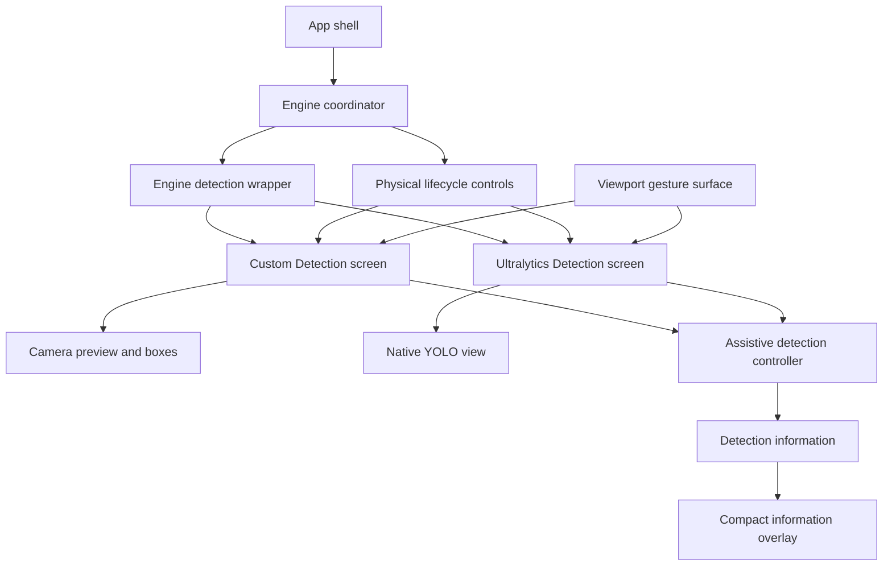

# Detection Redesign Plan — PD1–PD3

**Task type:** visual and interaction redesign; no inference-engine merge and no backend behavior change.

**Authority:** The locked PD1–PD3 product decisions in the task request override earlier Detection workflow documents wherever they conflict. This document is planning-only and identifies the minimal implementation scope after the repository audit.

## 1. Executive Summary

The locked redesign consolidates the normal Detection experience into one visual pattern while retaining two independent engine implementations. Both engine screens will render a coordinator-owned lifecycle status, a retained viewport shell, a compact current-detection overlay, and two physical controls. Engine-specific camera, inference, and native-controller mechanics remain private to their existing screens.

The implementation must be limited to the presentation and interaction surfaces justified below. It must not merge the Custom camera/isolate path with the native Ultralytics path, alter the existing bounding-box geometry, remove assistive behavior, or change the app-shell lifecycle policy. Normal cards, warning content, gesture hints, developer metrics, correction/report actions, and the visible Repeat action will be removed from the normal layout; their underlying systems remain available where required by existing gestures, assistive behavior, telemetry, or recovery handling.

The intended normal layout is:

1. A compact header containing Detection Mode, coordinator-derived status, and the existing audio pill.
2. A dominant flexible viewport with the existing preview and boxes, followed by a compact lower informational overlay, then the existing viewport gesture surface as the top-most layer.
3. A single non-scrolling, side-by-side physical-control row containing one consolidated lifecycle control and Quick Scan.

The principal technical boundary is [`EngineCoordinator`](../../lib/services/engine_coordinator.dart): visible lifecycle state must continue to derive from [`detectionStatusOutcomeFor()`](../../lib/services/engine_coordinator.dart:22), not from either screen's local booleans. The principal implementation risk is PD3's strict no-stale-result requirement: current result callbacks deliver detections without a screen/session epoch, so UI clearing alone cannot prove that a delayed pre-transition result will never be shown after a later Ready transition. This plan therefore separates what current code can guarantee from the minimal product/architecture decision that still needs verification.

## 2. Locked Product Decisions

PD1, PD2, and PD3 are fixed product requirements. Earlier recommendations in [`detection-screen-analysis.md`](detection-screen-analysis.md) and [`detection-screen-design-spec.md`](detection-screen-design-spec.md) are superseded wherever they retain normal detection cards, five visible actions, GestureHint, warning banners, correction actions, or Ultralytics developer metrics.

### PD1 — unified, engine-parity composition

- Custom and Ultralytics must have visual parity without merging their camera, inference, or controller internals.
- The normal screen contains only the compact header, dominant viewport, compact in-viewport information, and two side-by-side physical controls. It must not normally scroll.
- The normal UI must remove [`DetectionCard`](../../lib/widgets/detection_card.dart:14) content, empty-detection copy, [`WarningBanner`](../../lib/widgets/warning_banner.dart:8), GestureHint, visible Repeat, separate Start/Stop/Pause/Resume actions, visible correction/report actions, and Ultralytics developer metrics.
- Underlying Quick Scan, Repeat, correction capture, TTS, haptics, telemetry, assistive analysis, and existing bounding-box behavior remain in scope to preserve. Only their normal visible presentation changes.
- Recoverable failure, permission, retry, and fallback surfaces are exceptional UI. Their existing action affordances remain permitted and are not part of the two-control normal-state restriction.
- Stopped must retain a viewport shell and [`GestureSurface`](../../lib/widgets/gesture_surface.dart:11). The Custom screen is the presentation reference. Ultralytics may stop its native controller internally, but must retain the shell and gesture layer.

### PD2 — one coordinator-driven physical lifecycle control

The left control is governed only by the coordinator's mapped outcome:

| Coordinator outcome | Primary label | Secondary label | Tap | Completed three-second hold | Physical Quick Scan |
| --- | --- | --- | --- | --- | --- |
| Ready, including healthy fallback | `PAUSE` | `HOLD 3 SEC TO STOP` | Pause | Stop | Enabled |
| Paused | `RESUME` | `HOLD 3 SEC TO STOP` | Resume | Stop | Disabled |
| Stopped | `START` | `HOLD 3 SEC` | No operation | Start | Disabled |
| Preparing | `PREPARING` | None | Disabled | Disabled | Disabled |
| Unavailable | `UNAVAILABLE` | None | Disabled | Disabled | Disabled |

- On eligible primary-control pointer down, local hold tracking starts and visible horizontal progress begins at 0%, advancing continuously across the full exactly three-second physical hold. Before Flutter's standard [`kLongPressTimeout`](https://api.flutter.dev/flutter/gestures/kLongPressTimeout-constant.html), the normal secondary instruction may remain and no lifecycle action, haptic, or TTS occurs.
- At [`kLongPressTimeout`](https://api.flutter.dev/flutter/gestures/kLongPressTimeout-constant.html), if the pointer is still held, classify the interaction as a hold attempt and change the secondary label to `KEEP HOLDING`; do not restart or reset progress. `kLongPressTimeout` only distinguishes an eligible normal tap from an abandoned-hold candidate; it is not the progress start time or a progress reset point.
- At three seconds total while the interaction remains valid and held, progress reaches 100% and dispatches exactly one existing Stop action for Ready/Paused or Start action for Stopped. The completed physical hold displays horizontal progress and `KEEP HOLDING`; it must not present a countdown, percentage, spinner, or repeated vibration.
- Existing completed start, stop, pause, resume, and scan methods remain the only owners of their completed TTS and haptic feedback. The new control must not duplicate those effects.
- The physical Quick Scan button is tap-only and enabled only for Ready, including healthy fallback; it is disabled for Paused, Stopped, Preparing, and Unavailable and while a physical lifecycle hold is active. The existing three-finger Quick Scan gesture is independently available only for Ready, including healthy fallback; it does nothing for Paused, Stopped, Preparing, and Unavailable. Two-finger double-tap remains the immediate Start/Stop gesture.

### PD3 — compact, current-information overlay

- Display at most two informational rows. The repository does **not** already priority-sort [`DetectionInfo`](../../lib/models/detection_info.dart:27): [`SpatialAnalysisService.analyzeAll()`](../../lib/services/spatial_analysis_service.dart:110) maps the incoming normalized-detection sequence without sorting. The overlay therefore stably promotes High-priority entries, preserves their relative source order, then fills any remaining row from the original remaining `DetectionInfo` order. It must not introduce Medium-over-Low ranking.
- Each row may use only label plus qualitative existing position/proximity fields. It must not add confidence, debug data, metric distance, or correction affordances.
- Place the rows in a dark translucent lower viewport container. Normal rows use the existing cyan/neutral visual language; High priority uses amber, not the existing red warning treatment. No animation, UI debounce, or smoothing is permitted.
- Required stack order is preview, existing boxes unchanged, compact overlay, then [`GestureSurface`](../../lib/widgets/gesture_surface.dart:11). The overlay must not consume viewport gestures.
- The overlay is eligible only for Ready, including healthy fallback, and fresh current results. It must immediately hide for every other visible lifecycle outcome and must not re-show pre-transition results.
- Overlay semantics are informational and manual, not a live region. It must not create competing per-frame accessibility announcements because existing TTS owns those announcements.

## 3. Current-State Audit

### Dependency and impact map



### Ownership boundaries confirmed by the audit

- [`AppShellState`](../../lib/navigation/app_shell.dart:154) constructs one long-lived [`EngineCoordinator`](../../lib/services/engine_coordinator.dart:77), preserves pages in an indexed stack, applies Auto-start through launch intent, and emits intentional-entry starts only while the coordinator is idle. It also suppresses the shell horizontal drag recognizer while Detection is selected because the viewport owns Detection navigation gestures.
- [`EngineDetectionScreen`](../../lib/screens/engine_detection_screen.dart:18) selects the active engine child, assigns mount generations, forwards child lifecycle/failure reports to the coordinator, and retains an exceptional fallback notice with retry and temporary-Custom actions. The fallback notice is not normal Detection content and must remain.
- [`DetectionScreen`](../../lib/screens/detection_screen.dart:68) owns Custom camera setup, image streaming, inference subscriptions, local camera/inference mechanics, and the Custom preview plus [`BoundingBoxPainter`](../../lib/widgets/bounding_box_painter.dart:26). [`UltralyticsDetectionScreen`](../../lib/screens/ultralytics_detection_screen.dart:45) owns the native [`YOLOView`](../../lib/screens/ultralytics_detection_screen.dart:1), native controller actions, labels, and native result/metric callbacks.
- Each engine screen already maps coordinator state through [`detectionStatusOutcomeFor()`](../../lib/services/engine_coordinator.dart:22), but both still render normal lower cards and five physical actions from their own duplicated layout code. Local flags such as detection active and paused must remain mechanics-only and must not become the new visible lifecycle source.
- [`AssistiveDetectionController`](../../lib/services/assistive_detection_controller.dart:20) turns engine-normalized detections into [`DetectionInfo`](../../lib/models/detection_info.dart:27), records telemetry, updates tracking, and sends existing TTS announcements. It is the correct source for PD3 data, but its output must not be re-analysed or reordered by proximity.

### Current normal UI and direct removals

- The Custom screen builds header, main area, and a fixed lower panel in [`build()`](../../lib/screens/detection_screen.dart:912); the Ultralytics screen follows the same structure in [`build()`](../../lib/screens/ultralytics_detection_screen.dart:475). Both lower panels include warning content, a bounded detection list, five visible actions, and gesture instructions.
- Custom's viewport stack currently contains preview, unchanged painter output, a GestureHint, and [`GestureSurface`](../../lib/widgets/gesture_surface.dart:11) in [`_buildViewport()`](../../lib/screens/detection_screen.dart:1087). Ultralytics similarly contains [`YOLOView`](../../lib/screens/ultralytics_detection_screen.dart:1), a GestureHint, and the gesture surface in [`_buildMainArea()`](../../lib/screens/ultralytics_detection_screen.dart:568). PD3 changes only the presentation layers around the existing preview and box layers.
- Ultralytics currently exposes FPS, inference latency, and native processing metrics in [`_buildTopBar()`](../../lib/screens/ultralytics_detection_screen.dart:506). PD1 removes their visible rendering only; metric collection in [`_handleMetrics()`](../../lib/screens/ultralytics_detection_screen.dart:317) must remain because telemetry depends on it.
- Custom already meets the normal stopped-shell reference behavior: [`_stopDetection()`](../../lib/screens/detection_screen.dart:419) stops the image stream and clears result state but leaves `_isCameraInitialized` intact; [`_buildMainArea()`](../../lib/screens/detection_screen.dart:988) continues to call [`_buildViewport()`](../../lib/screens/detection_screen.dart:1087) whenever camera initialization remains true. Its existing viewport and [`GestureSurface`](../../lib/widgets/gesture_surface.dart:11) therefore remain mounted after a normal manual stop.
- Ultralytics differs: [`_stopDetection()`](../../lib/screens/ultralytics_detection_screen.dart:255) sets `_detectionActive` false, and [`_buildMainArea()`](../../lib/screens/ultralytics_detection_screen.dart:568) immediately substitutes [`_buildCameraPending()`](../../lib/screens/ultralytics_detection_screen.dart:672). PD1's stopped-shell presentation change is required for Ultralytics, not Custom.

### State, data, and feedback facts

- [`DetectionRuntimeState`](../../lib/models/detection_runtime_state.dart:9) distinguishes ready, paused, stopped, fallback, failed, busy preparation states, idle, and disposed. The coordinator maps fallback to Ready and stopped to its own visible outcome. This directly supports PD2 without adding a new user-facing lifecycle model.
- Existing Custom lifecycle methods [`_startDetection()`](../../lib/screens/detection_screen.dart:389), [`_stopDetection()`](../../lib/screens/detection_screen.dart:419), [`_pauseDetection()`](../../lib/screens/detection_screen.dart:448), [`_resumeDetection()`](../../lib/screens/detection_screen.dart:456), and [`_quickScan()`](../../lib/screens/detection_screen.dart:477) already produce completed feedback. Ultralytics has equivalent methods in [`_startDetection()`](../../lib/screens/ultralytics_detection_screen.dart:236), [`_stopDetection()`](../../lib/screens/ultralytics_detection_screen.dart:255), [`_pauseDetection()`](../../lib/screens/ultralytics_detection_screen.dart:281), [`_resumeDetection()`](../../lib/screens/ultralytics_detection_screen.dart:290), and [`_quickScan()`](../../lib/screens/ultralytics_detection_screen.dart:332).
- [`GestureController`](../../lib/services/gesture_controller.dart:30) receives raw viewport pointer events from [`GestureSurface`](../../lib/widgets/gesture_surface.dart:11) and continues to own single tap, two-finger double-tap, three-finger tap, swipe-down Repeat, and directional navigation arbitration. The redesign does not alter that service.
- [`DetectionInfo`](../../lib/models/detection_info.dart:27) exposes label, qualitative position, qualitative proximity, and priority. [`SpatialAnalysisService`](../../lib/services/spatial_analysis_service.dart:17) is the canonical source for those values. [`AssistiveDetectionController.updateDetections()`](../../lib/services/assistive_detection_controller.dart:45) stores [`SpatialAnalysisService.analyzeAll()`](../../lib/services/spatial_analysis_service.dart:110) output directly; this preserves the normalized input order and does not establish High → Medium → Low ordering. [`spatial_analysis_service_test.dart`](../../test/services/spatial_analysis_service_test.dart) confirms mapping but contains no priority-ordering guarantee.
- TTS has a separate primary-announcement ranking in [`_selectPrimary()`](../../lib/services/tts_service.dart:238): High priority then proximity. It is not the canonical list order and must not be reused for PD3.

## 4. Feasibility Assessment

### Confirmed feasible from the current implementation

| Requirement | Assessment | Evidence and implementation boundary |
| --- | --- | --- |
| One visual structure across two engines | Feasible | Both engine screens already expose comparable header, viewport, control-panel, lifecycle, gesture, TTS, haptic, and assistive seams. Keep their preview/controller internals separate in [`detection_screen.dart`](../../lib/screens/detection_screen.dart) and [`ultralytics_detection_screen.dart`](../../lib/screens/ultralytics_detection_screen.dart). |
| Coordinator-only visible lifecycle | Feasible | The current mapping in [`detectionStatusOutcomeFor()`](../../lib/services/engine_coordinator.dart:22) already maps Ready, fallback, Paused, Stopped, preparation, and failure into the needed visible outcomes. |
| Consolidated physical primary control | Feasible | Existing engine-private action methods already own completed state changes and feedback. A shared physical-control widget can receive callbacks selected by coordinator outcome without changing those methods. |
| Compact priority-first information | Feasible | [`DetectionInfo`](../../lib/models/detection_info.dart:27) already has label, priority, position, and proximity. Stable filtering and grouping are presentation-only and must not modify [`SpatialAnalysisService`](../../lib/services/spatial_analysis_service.dart:17). |
| Preserve underlying gestures and assistive systems | Feasible | The current viewport [`GestureSurface`](../../lib/widgets/gesture_surface.dart:11), [`GestureController`](../../lib/services/gesture_controller.dart:30), [`TtsService`](../../lib/services/tts_service.dart:64), [`HapticsService`](../../lib/services/haptics_service.dart:9), telemetry, and correction capture can remain connected to existing engine methods. |
| Preserve Custom box geometry | Feasible | The Custom painter's [`applyBoxFit()`](../../lib/widgets/bounding_box_painter.dart:116) layout contract stays unchanged; the new overlay is inserted above that paint layer only. |
| Non-scrolling dominant viewport and two-card row | Feasible with physical validation | Both screens already have a header, an expanded main region, and a bounded lower region. The current lower region uses a 32 percent constraint in [`build()`](../../lib/screens/detection_screen.dart:912). The redesigned row must be tested with bottom navigation, safe-area insets, minimum touch targets, and 200 percent text scale. **Needs Verification [device-layout].** |

### Constraints requiring an explicit design decision or physical validation

| Requirement | Constraint | Plan response |
| --- | --- | --- |
| PD3 never shows stale results after a transition | Result callbacks do not currently carry a screen/session epoch. Clearing the displayed snapshot on every non-Ready transition prevents immediately visible stale rows, but a late pre-transition callback cannot be distinguished from a valid new Ready callback after a later transition. | First prove a presentation-local result association. If that is insufficient, identify the narrowest cross-layer result-envelope/provenance change and obtain explicit approval before implementing it; do not change [`EngineCoordinator`](../../lib/services/engine_coordinator.dart:77) or [`DetectionInfo`](../../lib/models/detection_info.dart:27) unless proven necessary. Without that decision, the strict claim is **Needs Verification [missing-result-generation].** |
| PD2 early release after a hold attempt | The product behavior is locked but the recognition boundary is an implementation detail. The repository does not currently use a long-press control convention. | Begin progress at 0% on pointer down and advance it continuously for the entire three-second hold. Use Flutter's standard [`kLongPressTimeout`](https://api.flutter.dev/flutter/gestures/kLongPressTimeout-constant.html) only as the deterministic tap-versus-abandoned-hold boundary; it changes the label to `KEEP HOLDING` without restarting progress. The current `GestureController` only establishes 300 ms/350 ms tap windows, not a competing hold policy. Test the boundary and validate it with TalkBack on the target device. **Needs Verification [device-accessibility].** |
| Ultralytics stopped shell | Local package source verifies controller stop, pause, and resume methods, but the app currently replaces the native view with camera-pending content when `_detectionActive` becomes false. | Retain the native viewport shell and [`GestureSurface`](../../lib/widgets/gesture_surface.dart:11) in [`_buildMainArea()`](../../lib/screens/ultralytics_detection_screen.dart:568) after native stop, then validate target-device texture behavior. **Needs Verification [external-runtime].** |
| Exact translucent overlay token treatment | [`kOverlayBlack`](../../lib/theme/app_colors.dart:51) already exists as the approved semi-transparent black overlay token and is used by the current GestureHint. | Reuse `kOverlayBlack` for the lower overlay container; use existing [`kHomeAccentCyan`](../../lib/theme/app_colors.dart:133), [`kHomeInkMuted`](../../lib/theme/app_colors.dart:127), and [`kHomeWarningAmber`](../../lib/theme/app_colors.dart:142) or existing theme-derived foreground colors for row treatment. No dedicated scrim token is required. |

The plan must not treat native source inspection as proof of device behavior, and it must not weaken the coordinator's generation guards while adding a presentation-level freshness guard.

## 5. Reuse Inventory

### Reuse without behavior changes

| Existing unit | Reuse decision | Reason |
| --- | --- | --- |
| [`EngineCoordinator`](../../lib/services/engine_coordinator.dart:77) and [`detectionStatusOutcomeFor()`](../../lib/services/engine_coordinator.dart:22) | Reuse as sole normal visible-lifecycle source | It already distinguishes preparing, ready including healthy fallback, paused, stopped, and unavailable. |
| [`StartIntent`](../../lib/services/engine_coordinator.dart:51), app-shell launch policy, and entry-start policy | Preserve | PD2 does not alter Auto-start or intentional entry behavior. |
| [`EngineDetectionScreen`](../../lib/screens/engine_detection_screen.dart:18) mount generation forwarding and fallback notice | Preserve | The wrapper owns engine selection and exceptional fallback recovery; it is not a normal control row. |
| Custom action methods in [`_DetectionScreenState`](../../lib/screens/detection_screen.dart:121) | Reuse as effect callbacks | They keep completed state mutations plus existing TTS/haptic feedback centralized. |
| Ultralytics action methods in [`_UltralyticsDetectionScreenState`](../../lib/screens/ultralytics_detection_screen.dart:97) | Reuse as effect callbacks | They preserve native-controller interaction, shared lifecycle reports, and completed feedback. |
| [`AssistiveDetectionController.updateDetections()`](../../lib/services/assistive_detection_controller.dart:45) | Preserve | It remains the source of shared analysis, TTS, tracking, correction context, and telemetry. |
| [`DetectionInfo`](../../lib/models/detection_info.dart:27) | Reuse as overlay input | Its existing label, position, proximity, and priority satisfy PD3 without a model change. Its list sequence remains source order, so the overlay performs only the locked stable High promotion when necessary. |
| [`BoundingBoxPainter`](../../lib/widgets/bounding_box_painter.dart:26) | Preserve unchanged | PD1 explicitly keeps existing Custom bounding-box geometry and visual box behavior. |
| Native [`YOLOView`](../../lib/screens/ultralytics_detection_screen.dart:1) | Preserve unchanged | PD1 does not authorize replacing or merging native overlay internals. |
| [`GestureSurface`](../../lib/widgets/gesture_surface.dart:11) and [`GestureController`](../../lib/services/gesture_controller.dart:30) | Preserve | Gestures remain in the viewport and the overlay must be layered below their raw pointer listener. |
| [`DetectionStatePanel`](../../lib/widgets/detection_state_panel.dart:16), permission surface, and fallback notice | Preserve as exceptional UI | PD1's normal-UI removal does not remove recovery actions or failure communication. |
| [`TtsService.repeatLast()`](../../lib/services/tts_service.dart:270) and engine [`_repeatAlert()`](../../lib/screens/detection_screen.dart:482) implementations | Preserve behind swipe-down gesture | PD1 removes only the visible Repeat control. |
| Existing correction service/sheet path | Preserve without normal visible trigger | PD1 removes visible correction/report actions but does not authorize deleting correction infrastructure. |

### Components that must not be extended for PD2

Do not extend [`AccessibleButton`](../../lib/widgets/accessible_button.dart:8). It is used by normal Detection screens, exceptional recovery UI, the engine fallback notice, Home, Logs & Reports, and correction flows. Its API provides only one press callback and simple button semantics; it cannot express physical hold progress, cancellation, state-specific secondary text, or Quick Scan gating without widening unrelated regression scope.

### Proposed new UI-only reusable components

| New file | Public widget | Contract | Ownership |
| --- | --- | --- | --- |
| [`detection_action_controls.dart`](../../lib/widgets/detection_action_controls.dart) | `DetectionActionControls` | Receives mapped lifecycle outcome, action callbacks, and an explicit cancellation/reset signal; owns local physical-pointer tracking and horizontal progress from 0% at pointer down through the full three-second hold, then renders the left lifecycle control plus the physical Quick Scan button. It must not import camera, inference, native, or service internals. | Shared UI in `lib/widgets/` |
| [`detection_information_overlay.dart`](../../lib/widgets/detection_information_overlay.dart) | `DetectionInformationOverlay` | Receives already current `List<DetectionInfo>` plus an eligibility flag; stably promotes High entries, fills remaining slots from original source order, limits to two rows, exposes manual non-live semantics, and ignores pointer input. | Shared UI in `lib/widgets/` |

New widget names and files follow the existing UI naming rules. The overlay reuses [`kOverlayBlack`](../../lib/theme/app_colors.dart:51), the existing semi-transparent black overlay token, rather than creating a new scrim token.

## 6. Proposed UI Architecture

Both engine screens will compose the following shared presentation regions around their existing preview implementation:

```text
SafeArea and existing Detection light theme
├── compact header
│   ├── Detection Mode
│   ├── coordinator-derived StatusPill
│   └── existing Audio pill
├── Expanded viewport shell
│   └── Stack
│       ├── existing Custom preview or native YOLOView
│       ├── existing Custom bounding boxes or native overlay unchanged
│       ├── DetectionInformationOverlay
│       └── existing GestureSurface
└── DetectionActionControls
    ├── coordinator-driven physical lifecycle control
    └── Quick Scan physical control
```

### Shared presentation input boundary

Each engine screen remains responsible for:

- passing its active preview child into the viewport shell;
- receiving engine results and forwarding them to [`AssistiveDetectionController.updateDetections()`](../../lib/services/assistive_detection_controller.dart:45);
- owning stateful local data needed to call the existing start, stop, pause, resume, and scan methods;
- clearing its displayed information snapshot whenever coordinator-visible state leaves Ready;
- cancelling an in-progress hold when disposal, remount, engine switch, fallback, or mapped lifecycle change invalidates the pending action.

The shared widgets are responsible only for:

- visual mapping from a supplied [`DetectionStatusOutcome`](../../lib/services/engine_coordinator.dart:22) to PD2 labels and enabled states;
- pointer timing/progress presentation that starts at 0% on pointer down and advances continuously through three total seconds; [`kLongPressTimeout`](https://api.flutter.dev/flutter/gestures/kLongPressTimeout-constant.html) only distinguishes a tap from a hold attempt and changes the secondary label without restarting that timeline;
- stable High promotion and original-order fill of up to two supplied [`DetectionInfo`](../../lib/models/detection_info.dart:27) rows;
- semantics and hit-test behavior that preserve the existing viewport gesture layer.

### Layout decision

Replace each duplicated lower list/control region with one side-by-side row outside the viewport stack. The viewport remains the only flexible region. The control row's final height must derive from its content, minimum target dimensions in [`app_spacing.dart`](../../lib/theme/app_spacing.dart), and safe-area constraints rather than preserving the current fixed 32 percent allocation blindly. This avoids reserving card-list space that no longer exists while protecting the dominant viewport goal.

No normal [`ListView`](https://api.flutter.dev/flutter/widgets/ListView-class.html) or scrolling region is introduced. If a short device height or 200 percent text scale cannot fit the header, viewport, and two controls while meeting touch-target requirements, the implementation must expose the precise constraint failure rather than silently reducing required targets. This is a runtime verification item, not undefined product behavior. **Needs Verification [device-layout].**

## 7. State and Interaction Mapping

### Single mapping source

At each build, both engine screens must map [`EngineCoordinator.state`](../../lib/services/engine_coordinator.dart:77) through [`detectionStatusOutcomeFor()`](../../lib/services/engine_coordinator.dart:22). The resulting `DetectionStatusOutcome`, rather than local `_detectionActive`, `_paused`, `_starting`, or camera-ready flags, selects normal control labels, enabled state, and overlay eligibility.

| Mapped outcome | Normal primary surface | Tap dispatch | Hold-completion dispatch | Physical Quick Scan | Overlay |
| --- | --- | --- | --- | --- | --- |
| Preparing | Disabled `PREPARING` | None | None | Disabled | Hidden and snapshot cleared |
| Ready | `PAUSE` with `HOLD 3 SEC TO STOP` | Existing engine pause | Existing engine stop | Enabled unless a hold is active | Eligible for current data |
| Paused | `RESUME` with `HOLD 3 SEC TO STOP` | Existing engine resume | Existing engine stop | Disabled | Hidden and snapshot cleared |
| Stopped | `START` with `HOLD 3 SEC` | No operation | Existing engine start | Disabled | Hidden and snapshot cleared |
| Unavailable | Disabled `UNAVAILABLE` | None | None | Disabled | Hidden and snapshot cleared |

`fallback` is not an extra presentation branch: [`detectionStatusOutcomeFor()`](../../lib/services/engine_coordinator.dart:22) maps it to Ready. The normal primary control therefore pauses/stops the active fallback engine; the wrapper's exceptional fallback notice stays responsible for recovery decisions.

### Physical pointer interaction contract

1. On eligible primary-control pointer down, begin local visual hold tracking and render horizontal progress at 0%. Advance that same progress timeline continuously across the full exactly three-second physical hold. Do not call a lifecycle action, haptic, or TTS, and leave the normal secondary instruction in place before [`kLongPressTimeout`](https://api.flutter.dev/flutter/gestures/kLongPressTimeout-constant.html).
2. At Flutter's standard [`kLongPressTimeout`](https://api.flutter.dev/flutter/gestures/kLongPressTimeout-constant.html), if the pointer is still pressed, classify the interaction as a hold attempt and change the secondary label to `KEEP HOLDING`. Do not expose a numerical countdown or percentage, and do not begin, restart, or reset progress at this threshold: it only distinguishes an eligible normal tap from an abandoned-hold candidate.
3. On pointer up before [`kLongPressTimeout`](https://api.flutter.dev/flutter/gestures/kLongPressTimeout-constant.html), apply the mapped tap behavior, then reset/cancel progress: Ready pauses, Paused resumes, and Stopped does nothing. On pointer up at or after [`kLongPressTimeout`](https://api.flutter.dev/flutter/gestures/kLongPressTimeout-constant.html) but before three seconds total, treat the interaction as an abandoned hold: reset progress, perform no lifecycle action, and do not fall back to a tap.
4. At three seconds total, while the interaction remains valid and held, progress reaches 100%; mark the interaction consumed, keep the physical Quick Scan button disabled, and invoke exactly one existing Stop method for Ready/Paused or Start method for Stopped. Lock the control against duplicate dispatch until the coordinator outcome or awaited engine action changes. The invoked method owns its existing completed TTS and one-shot haptic feedback.
5. On pointer cancel, disposal, engine child remount, lifecycle outcome change, fallback transition, app lifecycle interruption, gesture Start/Stop dispatch, or disabled state, cancel tracking with no action, feedback, or retained progress.

The widget must handle physical pointer events only within the external control row. It must not be placed inside the viewport [`GestureSurface`](../../lib/widgets/gesture_surface.dart:11), and it must not alter the immediate two-finger double-tap behavior dispatched through [`_onGesture()`](../../lib/screens/detection_screen.dart:545) and [`_onGesture()`](../../lib/screens/ultralytics_detection_screen.dart:430).

### PD3 result-selection mapping

For an eligible current snapshot, the information overlay must:

1. Preserve the input sequence supplied by [`AssistiveDetectionController.updateDetections()`](../../lib/services/assistive_detection_controller.dart:45) as the canonical source order.
2. Select High-priority entries in their existing relative order.
3. If fewer than two entries were selected, make one stable pass through the original source order and append only entries not already selected until two rows are selected.
4. Render each as a concise label plus the already-derived qualitative position/proximity fields.

For example, source order `Low A, Medium B, High C` yields `High C, Low A`, not `High C, Medium B`. This is intentionally not a call to the private primary-detection ranking in [`TtsService`](../../lib/services/tts_service.dart:238), because that logic applies High-plus-proximity announcement ranking and would violate PD3's original-order fill rule.

## 8. Custom Engine Changes

Modify only [`detection_screen.dart`](../../lib/screens/detection_screen.dart) for Custom engine composition and presentation state.

1. In [`build()`](../../lib/screens/detection_screen.dart:912), replace the normal card/list and five-button lower region with the shared `DetectionActionControls` row. Keep the existing home theme, header structure, `SafeArea`, coordinator listener, and exceptional-state branching.
2. Preserve Custom's existing stopped-shell reference behavior. [`_stopDetection()`](../../lib/screens/detection_screen.dart:419) leaves camera initialization intact, and [`_buildMainArea()`](../../lib/screens/detection_screen.dart:988) already retains [`_buildViewport()`](../../lib/screens/detection_screen.dart:1087) after a normal manual stop. Do not add alternate stopped-shell mechanics unless a regression test proves the current behavior is lost during the layout change.
3. In [`_buildViewport()`](../../lib/screens/detection_screen.dart:1087), remove `_GestureHint`; retain the existing preview and [`BoundingBoxPainter`](../../lib/widgets/bounding_box_painter.dart:26) unchanged; place `DetectionInformationOverlay` after the painter; keep [`GestureSurface`](../../lib/widgets/gesture_surface.dart:11) last in the stack.
4. In the existing inference listener setup in [`_setupInferenceListener()`](../../lib/screens/detection_screen.dart:567), retain the call to [`AssistiveDetectionController.updateDetections()`](../../lib/services/assistive_detection_controller.dart:45) and all TTS/telemetry behavior. Split the presentation snapshot from the underlying assistive/correction state so normal layout removal does not discard existing services.
5. At state changes through [`_setRuntimeState()`](../../lib/screens/detection_screen.dart:665) and all coordinator-driven rebuild paths, clear the displayed overlay snapshot immediately whenever the mapped outcome is not Ready. Result acceptance for the overlay must additionally check current mapped Ready state before storing it. Do not claim this UI-only gate proves strict delayed-result freshness; follow the approved provenance solution in §13 before making that guarantee.
6. Wire `DetectionActionControls` callbacks to existing [`_pauseDetection()`](../../lib/screens/detection_screen.dart:448), [`_resumeDetection()`](../../lib/screens/detection_screen.dart:456), [`_stopDetection()`](../../lib/screens/detection_screen.dart:419), [`_startDetection()`](../../lib/screens/detection_screen.dart:389), and [`_quickScan()`](../../lib/screens/detection_screen.dart:477). Do not recreate their TTS/haptic logic in the widget or layout methods.
7. Remove normal presentation use of [`_warningMessage`](../../lib/screens/detection_screen.dart:896), [`_buildControlsPanel()`](../../lib/screens/detection_screen.dart:1171), [`_buildDetectionList()`](../../lib/screens/detection_screen.dart:1261), `_GestureHint`, and the normal correction action call site. Retain [`_reportCorrection()`](../../lib/screens/detection_screen.dart:487), [`_repeatAlert()`](../../lib/screens/detection_screen.dart:482), and gesture dispatch because PD1 removes visible affordances, not their supporting systems.

The Custom path must not modify [`BoundingBoxPainter`](../../lib/widgets/bounding_box_painter.dart:26), camera frame dispatch in [`_processCameraImage()`](../../lib/screens/detection_screen.dart:713), inference-worker lifecycle handling in [`_handleInferenceLifecycle()`](../../lib/screens/detection_screen.dart:607), or app-shell/coordinator ownership.

## 9. Ultralytics Engine Changes

Modify only [`ultralytics_detection_screen.dart`](../../lib/screens/ultralytics_detection_screen.dart) for Ultralytics composition and presentation state.

1. In [`build()`](../../lib/screens/ultralytics_detection_screen.dart:475), replace the normal lower detection list and five-button panel with the same shared `DetectionActionControls` row used by Custom.
2. In [`_buildTopBar()`](../../lib/screens/ultralytics_detection_screen.dart:506), remove only visual developer metrics such as FPS, inference latency, and native total time. Preserve Detection Mode, coordinator-derived status, and the existing audio pill.
3. In [`_buildMainArea()`](../../lib/screens/ultralytics_detection_screen.dart:568), remove `_GestureHint`, insert `DetectionInformationOverlay` above the native view/overlay and below [`GestureSurface`](../../lib/widgets/gesture_surface.dart:11), and retain the native viewport shell plus gesture layer for the mapped Stopped outcome rather than defaulting to [`_buildCameraPending()`](../../lib/screens/ultralytics_detection_screen.dart:672).
4. Keep the existing [`YOLOView`](../../lib/screens/ultralytics_detection_screen.dart:1) and `YOLOViewController` integration. [`_stopDetection()`](../../lib/screens/ultralytics_detection_screen.dart:255) may still invoke native stop; the view shell remains mounted so the screen preserves layout and gesture ownership. Confirm the actual stopped visual result on the physical target device. **Needs Verification [external-runtime].**
5. In [`_handleResults()`](../../lib/screens/ultralytics_detection_screen.dart:307), retain adapter conversion and shared assistive updates, while adding the same Ready-only display-snapshot gate and non-Ready immediate clearing used by Custom. Do not assert strict delayed-result freshness until the minimal approved provenance solution in §13 is in place.
6. Preserve [`_handleMetrics()`](../../lib/screens/ultralytics_detection_screen.dart:317) and its telemetry recording. PD1 removes metrics from the UI, not from research data collection.
7. Wire shared control callbacks to existing [`_pauseDetection()`](../../lib/screens/ultralytics_detection_screen.dart:281), [`_resumeDetection()`](../../lib/screens/ultralytics_detection_screen.dart:290), [`_stopDetection()`](../../lib/screens/ultralytics_detection_screen.dart:255), [`_startDetection()`](../../lib/screens/ultralytics_detection_screen.dart:236), and [`_quickScan()`](../../lib/screens/ultralytics_detection_screen.dart:332). Preserve their completed feedback ownership.
8. Remove normal presentation use of [`_warningMessage`](../../lib/screens/ultralytics_detection_screen.dart:449), [`_buildControlsPanel()`](../../lib/screens/ultralytics_detection_screen.dart:705), [`_buildDetectionList()`](../../lib/screens/ultralytics_detection_screen.dart:782), `_GestureHint`, and the normal correction action call site. Retain [`_reportCorrection()`](../../lib/screens/ultralytics_detection_screen.dart:342), [`_repeatAlert()`](../../lib/screens/ultralytics_detection_screen.dart:337), and existing gesture dispatch.

The plan does not authorize changes to [`UltralyticsDetectionAdapter`](../../lib/services/ultralytics_detection_adapter.dart:7), native package implementation, model configuration, engine fallback policy, or the shared assistive pipeline.

## 10. Shared/Wrapper Changes

### New widget scope

Create the two UI-only widgets identified in the reuse inventory:

- [`detection_action_controls.dart`](../../lib/widgets/detection_action_controls.dart) must implement PD2 state labels, disabled state, local pointer hold timing/progress from 0% at pointer down through the full three-second timeline, [`kLongPressTimeout`](https://api.flutter.dev/flutter/gestures/kLongPressTimeout-constant.html) hold-attempt classification without progress restart, cancellation, physical Quick Scan gating, and semantic state. It receives callbacks from each screen; it must not own a coordinator, camera controller, native controller, TTS service, haptics service, or app setting.
- [`detection_information_overlay.dart`](../../lib/widgets/detection_information_overlay.dart) must implement PD3 stable selection, at-most-two rendering, token-driven visual treatment, manual semantic labels, and pointer transparency. It receives `DetectionInfo` values already produced by existing analysis.

Use a screen-private adapter value or local mapping in each engine screen only if the two screens cannot pass the widget's callback contract directly. Do not introduce a shared service, repository, view model, or data-model change solely to remove small presentation duplication: the current application deliberately uses screen state plus `ChangeNotifier` services, and a broad state-management refactor is outside the locked redesign.

### Wrapper scope

[`EngineDetectionScreen`](../../lib/screens/engine_detection_screen.dart:18) and [`AppShellState`](../../lib/navigation/app_shell.dart:154) require no planned behavior change. Preserve:

- active/preferred engine selection and mount-generation filtering;
- temporary fallback notice, retry, and temporary-Custom recovery actions;
- Auto-start launch intent and explicit-entry intent rules;
- cached Detection page lifecycle;
- shell-level suppression of horizontal dragging while Detection is selected;
- navigation callback injection into both engine screens.

If implementation discovers that a strict PD3 freshness token requires changing [`EngineCoordinator`](../../lib/services/engine_coordinator.dart:77), result stream contracts, or [`DetectionInfo`](../../lib/models/detection_info.dart:27), stop and obtain scope approval before modifying them. Those paths are service/model owned and lie outside the UI-only redesign boundary.

## 11. Accessibility Analysis

### Primary physical control semantics

`DetectionActionControls` must expose one coherent primary button semantic node with:

- role: button;
- state: mapped lifecycle outcome and whether a hold is in progress;
- value: the active primary label plus secondary hold instruction where applicable;
- hint: tap behavior and hold behavior when enabled, or the unavailable/preparing reason when disabled;
- enabled state: false for Preparing and Unavailable, true for Ready/Paused/Stopped even though stopped tap is intentionally a no-operation;
- progress state during a hold without turning every progress frame into a live announcement.

The stopped button must remain semantically actionable because the required three-second physical hold starts Detection, even though its normal tap does nothing. The semantics wording must make this distinction explicit. Exact TalkBack phrasing is **Needs Verification [device-accessibility]** and must be manually tested on Android TalkBack.

The physical Quick Scan button must expose button role, enabled state, and an explanation that it is available only in Ready/healthy fallback and disabled for Paused, Stopped, Preparing, Unavailable, or an active physical lifecycle hold. Its visual disabled state must not be the sole indication that scan is unavailable.

### Overlay semantics and input behavior

`DetectionInformationOverlay` must expose exactly one manual informational semantic node per visible row. Its label contains only the visual row content: label plus qualitative position/proximity, for example `Person, ahead, near`. It must not set `liveRegion`, behave as a button, provide row actions, duplicate the painter's labels, include confidence, or add spoken priority wording. High priority is a visual amber distinction in this overlay; existing assistive/TTS behavior remains the automatic hazard-guidance channel.

Wrap the overlay in pointer-ignoring behavior so it cannot consume raw pointers intended for [`GestureSurface`](../../lib/widgets/gesture_surface.dart:11). Decorative presentation elements, including background/scrim treatment, must be excluded from semantics.

### Layout, tokens, and scale

- Use existing token files under [`lib/theme/`](../../lib/theme) for spacing, radii, typography, colors, and minimum touch targets. Do not hardcode new visual literals in screen or widget files.
- Preserve at least the minimum dimensions declared in [`app_spacing.dart`](../../lib/theme/app_spacing.dart), then verify both side-by-side controls at 200 percent text scale with no overflow.
- The current app's accessibility tests already verify semantics and scaled layouts in [`semantics_test.dart`](../../test/accessibility/semantics_test.dart). Extend those tests rather than adding untested bespoke semantics behavior.
- Do not make per-frame overlay updates, progress updates, or color changes live announcements. Existing [`TtsService`](../../lib/services/tts_service.dart:64) remains the deliberate detection-feedback channel.

## 12. Gesture Impact

The redesign must preserve the existing gesture model in [`GestureController`](../../lib/services/gesture_controller.dart:30) and the raw-pointer forwarding in [`GestureSurface`](../../lib/widgets/gesture_surface.dart:11).

| Existing gesture | Required redesign behavior |
| --- | --- |
| Single tap | Retain existing pause/resume behavior through the engine screen gesture dispatch. It is independent of the physical primary-control tap. |
| Two-finger double-tap | Retain immediate Start/Stop behavior. It must not wait for or share the new three-second physical hold timer. |
| Three-finger tap | Retain the existing Quick Scan gesture and gate its screen-level dispatch by the shared mapped outcome: Quick Scan only for Ready, including healthy fallback; no action for Paused, Stopped, Preparing, or Unavailable. [`GestureController`](../../lib/services/gesture_controller.dart:30) need not change because the screen-level dispatch already provides this gate. |
| Swipe down | Retain existing Repeat behavior through [`_repeatAlert()`](../../lib/screens/detection_screen.dart:482) and [`_repeatAlert()`](../../lib/screens/ultralytics_detection_screen.dart:337), despite removal of the visible Repeat action. |
| Horizontal swipe | Preserve Detection-owned directional arbitration and navigation callback behavior. |

The overlay must be below the gesture surface and pointer-inert. The physical controls are outside the viewport and therefore intentionally do not participate in viewport gesture recognition. The full locked lifecycle matrix is:

| Gesture | Ready / healthy fallback | Paused | Stopped | Preparing | Unavailable |
| --- | --- | --- | --- | --- | --- |
| Single tap | Pause | Resume | No action | No action | No action |
| Two-finger double-tap | Stop | Stop | Start | No action | No action |
| Three-finger tap | Quick Scan | No action | No action | No action | No action |
| Swipe down | Repeat | Repeat | Repeat | Repeat | Repeat |
| Horizontal swipe | Navigate | Navigate | Navigate | Navigate | Navigate |

Current engine dispatch methods gate single and two-finger actions through local mechanics, while preparing/failure panels can replace the viewport and therefore prevent raw gesture delivery. If that hierarchy prevents the locked Repeat or horizontal-navigation behavior in Preparing/Unavailable, document and implement only the smallest exceptional-surface routing adjustment necessary; do not redesign [`GestureController`](../../lib/services/gesture_controller.dart:30). **Needs Verification [exceptional-gesture-routing].**

Known device-observed primary-navigation issues in [`known-issues.md`](../known-issues.md) remain out of scope: unintended Detection navigation on long/fast swipe, viewport-only Detection horizontal navigation, and multi-pointer safety on other primary screens. This redesign must not claim to fix them or change gesture-controller thresholds opportunistically.

## 13. Lifecycle / Race-Condition Analysis

### Existing protections to preserve

- [`EngineDetectionScreen`](../../lib/screens/engine_detection_screen.dart:18) uses mount generations when forwarding child lifecycle reports.
- [`EngineCoordinator`](../../lib/services/engine_coordinator.dart:77) rejects stale mounted-child and worker-generation updates through its internal generation acceptance rules.
- Custom inference lifecycle events are handled through [`_handleInferenceLifecycle()`](../../lib/screens/detection_screen.dart:607); Ultralytics lifecycle reports flow through its existing screen methods and wrapper callbacks.
- The coordinator's explicit stopped state prevents automatic restart on cached-page navigation. Auto-start and deliberate-entry intent remain app-shell concerns.

### New presentation-race rules

1. Store a separate local overlay snapshot rather than reading a historical list directly in the build method.
2. Clear that snapshot synchronously before rendering whenever the mapped coordinator outcome leaves Ready, including Paused, Stopped, Preparing, Unavailable, failed/recovering transitions, disposal, engine switch, and fallback remount.
3. Accept a new snapshot only when the currently observed mapped outcome is Ready. A healthy fallback is accepted because it maps to Ready.
4. Reset/cancel local hold state on every coordinator outcome change, widget update, screen disposal, engine remount, fallback transition, and control disablement. Do not let a pointer-up from an old mounted child dispatch a lifecycle action in a new child.
5. After hold completion, lock the local control against a second pointer/action until coordinator output or the awaited engine action resolves. The existing lifecycle methods remain the only locations that trigger completed TTS/haptics.

### Strict stale-result limitation and minimal provenance investigation

The proposed local snapshot clearing prevents known historical values from remaining visible after a non-Ready transition. It does not prove the stronger requirement that an asynchronous result produced before a transition cannot arrive after a later Ready state and be mistaken for a current result.

Custom has partial provenance that is currently discarded before the screen: isolate messages contain a worker `generation` and a `frameNumber`, and [`InferenceService._handleWorkerMessage()`](../../lib/services/inference_isolate.dart:281) rejects stale worker generations before publishing. However, [`resultsStream`](../../lib/services/inference_isolate.dart:72) publishes only `List<Detection>`, so [`_setupInferenceListener()`](../../lib/screens/detection_screen.dart:567) cannot associate an accepted list with a screen lifecycle session or the coordinator transition that invalidated it.

Ultralytics also receives only a bare `List<YOLOResult>` in [`_handleResults()`](../../lib/screens/ultralytics_detection_screen.dart:307). The installed native widget can emit streaming payloads containing frame/timestamp metadata, but the current app uses `onResult`, not that metadata callback; no app-level session provenance reaches the screen. **Needs Verification [native-event-contract].**

#### Preferred investigation order

1. **Presentation-local solution:** determine whether each screen can establish a result-production boundary before dispatching a new frame/native start and reliably bind every incoming result to that boundary. A local counter alone is insufficient unless callbacks are attributable to it. Current evidence does not prove that association for either engine.
2. **Smallest cross-layer contract:** if a local association cannot be proved, add a narrow normalized result envelope containing at least engine/session provenance plus detections. For Custom, the minimal candidate is to preserve existing worker generation and frame number through [`InferenceService`](../../lib/services/inference_isolate.dart:72) rather than changing [`DetectionInfo`](../../lib/models/detection_info.dart:27) or [`EngineCoordinator`](../../lib/services/engine_coordinator.dart:77). For Ultralytics, investigate whether the existing `onStreamingData` frame metadata can be safely correlated with converted results; otherwise add the smallest screen-to-native/session bridge required. Do not assume the two native callbacks are correlated without verification.

If the strict guarantee cannot be proven with a presentation-local association, the required envelope/metadata path is a **minimal scope expansion** beyond UI files. It must be approved before implementation touches [`inference_isolate.dart`](../../lib/services/inference_isolate.dart), [`ultralytics_detection_adapter.dart`](../../lib/services/ultralytics_detection_adapter.dart), native integration, or a new shared result wrapper. The redesign must not weaken PD3 just to preserve a UI-only scope. **Needs Verification [missing-result-generation].**

## 14. Regression / Side-Effect Analysis

| Area | Required preservation | Redesign-specific risk and mitigation |
| --- | --- | --- |
| Auto-start and entry start | Keep [`AppShellState`](../../lib/navigation/app_shell.dart:154) launch and idle-entry policy unchanged. | A stopped viewport shell must not be misread as an idle/uninitialized screen and trigger a new start intent. Use coordinator outcome only. |
| Engine fallback | Keep coordinator preferred/active engine separation and wrapper recovery notice. | Fallback maps to Ready, so controls/overlay follow the active healthy fallback state; cancel any active hold on remount. |
| Cached tabs and system navigation | Keep indexed-page retention and Detection-owned horizontal routing. | Avoid adding a scrollable lower region or a pointer-intercepting overlay that changes gesture arbitration. |
| TTS and haptics | Preserve existing completed feedback calls in engine methods. | New hold UI must not announce ticks/progress or emit duplicate action feedback. |
| Telemetry and metrics | Preserve assistive updates and Ultralytics metric recording. | Removing UI metrics must not remove [`_handleMetrics()`](../../lib/screens/ultralytics_detection_screen.dart:317) telemetry calls. |
| Corrections | Preserve correction data/service code. | Remove only normal visible report actions; do not remove service code or correction sheet types as unrelated cleanup. |
| Repeat and gesture gating | Preserve swipe-down Repeat in every locked lifecycle outcome; gate three-finger Quick Scan to Ready/healthy fallback only. | Put the Quick Scan state check in existing screen gesture dispatch, not [`GestureController`](../../lib/services/gesture_controller.dart:30); inspect exceptional panel routing before claiming Repeat/navigation parity while Preparing/Unavailable. **Needs Verification [exceptional-gesture-routing].** |
| Custom boxes | Preserve [`BoundingBoxPainter`](../../lib/widgets/bounding_box_painter.dart:26) and preview-fit geometry. | Overlay insertion must not change `FittedBox`, `BoxFit.contain`, painter input size, or camera aspect handling. |
| Native view | Preserve native view/controller ownership. | Retained stopped shell may show an inactive, frozen, or cleared native texture; validate actual device behavior rather than assuming it. **Needs Verification [external-runtime].** |
| Theme and small screens | Preserve existing light Detection subtree. | Two side-by-side controls can overflow under large text or constrained height; use tokenized flexible layout and verify on device. **Needs Verification [device-layout].** |

No model, inference, camera, Android packaging, confidence, NMS, engine-selection, settings-persistence, or broad service refactor is justified by PD1–PD3. The strict PD3 provenance contract in §13 is the sole potential minimal cross-layer exception.

## 15. Test Plan

### Automated unit tests

| Test target | Required cases | Planned test location |
| --- | --- | --- |
| `DetectionActionControls` state mapper | Ready, fallback-as-Ready, Paused, Stopped, Preparing, and Unavailable labels, secondary text, enabled state, and physical Quick Scan gate | [`test/widgets/detection_action_controls_test.dart`](../../test/widgets/detection_action_controls_test.dart) |
| Physical hold logic | Pointer-down progress starts visibly at 0% and advances continuously over the entire three seconds, not merely after [`kLongPressTimeout`](https://api.flutter.dev/flutter/gestures/kLongPressTimeout-constant.html); before that timeout the normal secondary instruction may remain; at that timeout `KEEP HOLDING` appears without progress restart/reset; three-second completion dispatches once; early release before the timeout follows the mapped tap rule; abandoned hold at/after the timeout suppresses tap; pointer cancel has no action; state/remount/dispose/app-lifecycle reset cancels; competing gesture Start/Stop cancels; duplicate action prevention; physical Quick Scan is disabled during active hold | [`test/widgets/detection_action_controls_test.dart`](../../test/widgets/detection_action_controls_test.dart) using fake elapsed time/timers |
| Overlay selection | at most two rows; stable High promotion; source-order fill after High; explicit `Low A, Medium B, High C → High C, Low A` regression; no independently invented Medium-over-Low ranking; no eligible rows when hidden | [`test/widgets/detection_information_overlay_test.dart`](../../test/widgets/detection_information_overlay_test.dart) |
| Overlay semantic content | one semantic node per visible row; label plus qualitative position/proximity only; no confidence, priority wording, metric distance, correction action, live-region flag, or pointer action | [`test/widgets/detection_information_overlay_test.dart`](../../test/widgets/detection_information_overlay_test.dart) and [`semantics_test.dart`](../../test/accessibility/semantics_test.dart) |
| Screen-local display state | visible snapshot clears on mapped non-Ready outcome and only updates when currently Ready | Screen-level test seam or extracted UI-only state helper, only if achievable without widening model/service scope. **Needs Verification [testability-seam].** |

### Existing regression tests to preserve or update

- Keep and extend [`engine_coordinator_test.dart`](../../test/services/engine_coordinator_test.dart) assertions for status mapping, stopped semantics, fallback state, start-intent behavior, and stale generation rejection. The redesign must not alter their production source.
- Keep [`gesture_controller_test.dart`](../../test/services/gesture_controller_test.dart) unchanged except for new regression assertions only if the control-row integration exposes a real conflict. Do not retune gesture thresholds to accommodate PD2. Add screen-dispatch coverage for the locked state matrix: single tap, two-finger immediate Start/Stop, existing three-finger Quick Scan gated Ready/healthy fallback only, Repeat, and horizontal navigation; no `GestureController` change is needed where that screen-level gate already applies.
- Keep [`app_shell_test.dart`](../../test/navigation/app_shell_test.dart) coverage for Auto-start, deliberate entry, cached Detection state, stopped no-auto-restart, and shell gesture suppression on Detection.
- Replace old visible-control expectations in [`widget_test.dart`](../../test/widget_test.dart) that assert five normal buttons, warning/list content, or GestureHint. Assert exactly two normal physical controls in one row, no normal `WarningBanner`, no GestureHint, no visible Repeat/report entry point, no old `DetectionCard` list, and no Ultralytics developer metrics. The current test note that full engine screens require camera/permission mocks remains valid; new shared widgets should provide deterministic component-level coverage.
- Extend [`semantics_test.dart`](../../test/accessibility/semantics_test.dart) for disabled/active physical controls, stopped hold-only semantics, one non-live informational node per overlay row without priority wording, Quick Scan disabled semantics, 200 percent text scale, and removal of normal warning/report actions.
- Preserve [`spatial_analysis_service_test.dart`](../../test/services/spatial_analysis_service_test.dart) as the source of truth for spatial/priority derivation. PD3 overlay tests verify ordering/presentation only, not a duplicate spatial algorithm.

### Native and physical Android validation

Run the standard repository validation gate after implementation:

1. [`flutter analyze`](../../pubspec.yaml) with zero issues.
2. [`flutter test`](../../test) with all existing and new tests passing.
3. Debug APK build and physical Android verification, following [`testing-plan.md`](../testing-plan.md) and [`ui-conventions.md`](../ui-conventions.md).

On the physical Android device, test Custom and Ultralytics separately for:

- Ready, Paused, Stopped, Preparing, Unavailable, and healthy fallback presentation.
- Header parity, normal removal of cards/warnings/GestureHint/visible Repeat/report actions, and no Ultralytics developer metrics.
- Pointer-down progress at 0% advancing over the complete three-second hold, the [`kLongPressTimeout`](https://api.flutter.dev/flutter/gestures/kLongPressTimeout-constant.html) tap-versus-abandoned-hold boundary and `KEEP HOLDING` transition without timeline reset, no repeated vibration, and no duplicated TTS.
- Physical Quick Scan button gating while Ready/healthy fallback, Paused, Stopped, Preparing, Unavailable, and active physical hold; separately verify existing three-finger Quick Scan only runs for Ready/healthy fallback.
- Preserved and correctly gated two-finger double-tap, single-tap, three-finger, swipe-down Repeat, and Detection-owned directional gestures.
- Custom bounding-box alignment and native overlay behavior with the compact overlay above it.
- Stopped viewport shell and gesture availability for both engines; specifically observe Ultralytics after native stop.
- 200 percent text scale, TalkBack semantics, short available height, bottom navigation, safe-area insets, and no render overflow or exceptions.
- Auto-start ON background preparation and Auto-start OFF entry start; these retain pre-existing physical-device uncertainty noted in [`known-issues.md`](../known-issues.md).
- Strict delayed-result transition races if and only if the approved provenance contract is implemented; widget tests alone cannot prove Custom isolate/native event timing.

No emulator or static test can replace the Ultralytics stopped-shell, TalkBack, camera, native texture, and gesture validation. **Needs Verification [external-runtime].**

## 16. Implementation Sequence

1. Begin implementation of resolved PD1, PD2, and PD3 presentation work. Strict PD3 freshness remains separately blocked on the scoped provenance investigation and approval in §13; runtime/device items remain validation requirements, not planning blockers.
2. Add deterministic widget tests for `DetectionActionControls` and `DetectionInformationOverlay` first, including pointer-down progress at 0% across the entire three-second physical hold, [`kLongPressTimeout`](https://api.flutter.dev/flutter/gestures/kLongPressTimeout-constant.html) classification without timeline reset, semantics, High-promotion/source-order selection, and two-row limits. This establishes the new shared presentation contracts without camera/native dependencies.
3. Implement `DetectionActionControls` in [`lib/widgets/detection_action_controls.dart`](../../lib/widgets/detection_action_controls.dart) using tokenized layout, direct pointer timing from pointer down, explicit cancellation, [`kLongPressTimeout`](https://api.flutter.dev/flutter/gestures/kLongPressTimeout-constant.html) label classification without progress restart, physical Quick Scan gating, and callback-only effect dispatch. Verify it does not alter [`AccessibleButton`](../../lib/widgets/accessible_button.dart:8).
4. Implement `DetectionInformationOverlay` in [`lib/widgets/detection_information_overlay.dart`](../../lib/widgets/detection_information_overlay.dart), including stable High promotion, original-order fill, two-row limit, `kOverlayBlack` container treatment, non-live row semantics, and pointer transparency. Keep it independent of camera/native classes.
5. Investigate strict-freshness provenance under §13 before claiming or implementing that guarantee. Prefer the narrowest verified screen-local association; if that is insufficient, obtain explicit approval before implementing only the narrowest Custom and Ultralytics result-envelope/provenance changes identified in §13 with race tests.
6. Update [`DetectionScreen`](../../lib/screens/detection_screen.dart) narrowly: replace normal lower UI, compose overlay at the defined stack position, preserve its already-retained stopped viewport, wire existing action methods, gate the existing three-finger Quick Scan in screen dispatch, and add approved display-snapshot acceptance/clearing behavior.
7. Run widget/semantics tests, inspect Custom preview/painter alignment, and exercise Custom lifecycle/gesture transitions before touching Ultralytics.
8. Update [`UltralyticsDetectionScreen`](../../lib/screens/ultralytics_detection_screen.dart) in parallel: remove normal metrics/cards/actions, compose the shared widgets, retain a native stopped shell, gate the existing three-finger Quick Scan in screen dispatch, wire existing native action methods, and preserve metric telemetry.
9. Run all automated tests; then test engine selection, fallback, remount, Auto-start, cached navigation, physical/gesture action races, and repeated lifecycle transitions with both engines.
10. Perform the required physical Android verification. Stop implementation and record any native stopped-shell, overflow, TalkBack, exceptional-gesture-routing, or provenance behavior that contradicts the plan rather than compensating with unrelated changes.
11. Update only documentation required by the actual approved UI implementation under the repository's doc-update rule. Because this planning task authorizes only this plan file, any later implementation-stage documentation edits must be explicitly listed in its approved implementation plan.

### Rollback boundaries

- The two new widget files can be reverted independently before either screen changes.
- Custom and Ultralytics composition changes can be reverted independently because they share only callback contracts and data inputs.
- Do not fold the UI work into coordinator, model, inference, or native package changes merely to simplify a rollback. If strict freshness requires such a change, it is a separate approved scope expansion.

## 17. Acceptance Criteria

### PD1 acceptance

- [ ] Both engines render the same normal structural regions: compact header, dominant viewport, compact lower overlay, and one two-control row.
- [ ] Normal screens do not render detection cards, empty-detection content, warning banner, GestureHint, visible Repeat, separate Start/Stop/Pause/Resume controls, visible correction/report actions, or Ultralytics developer metrics.
- [ ] Exceptional permission, recovery, retry, and fallback notices remain usable.
- [ ] Custom preview and [`BoundingBoxPainter`](../../lib/widgets/bounding_box_painter.dart:26) geometry are unchanged.
- [ ] The viewport shell and [`GestureSurface`](../../lib/widgets/gesture_surface.dart:11) remain available while Stopped for both engines.

### PD2 acceptance

- [ ] All normal lifecycle labels, subtitles, enabled states, and Quick Scan gates match §2 and §7 from coordinator outcome only.
- [ ] Healthy fallback behaves exactly as Ready for normal controls and overlay eligibility.
- [ ] Pointer-down starts visible horizontal progress at 0%, and that same progress advances continuously across the full exactly three-second physical hold; [`kLongPressTimeout`](https://api.flutter.dev/flutter/gestures/kLongPressTimeout-constant.html) changes the label to `KEEP HOLDING` without starting, restarting, or resetting progress.
- [ ] At three seconds while still valid and held, progress reaches 100%, dispatches one intended Stop or Start action, locks against duplicate dispatch until coordinator/action change, and causes no duplicated TTS or haptics.
- [ ] Pointer-up before [`kLongPressTimeout`](https://api.flutter.dev/flutter/gestures/kLongPressTimeout-constant.html) has the mapped tap behavior and then resets progress; pointer-up at/after that threshold but before completion is an abandoned hold with no action and no fallback tap; a pointer cancel or state/remount/disposal change never dispatches a lifecycle action.
- [ ] Stopped tap is a no-operation; stopped completed hold starts detection; two-finger double-tap remains immediate Start/Stop.
- [ ] The physical Quick Scan button is tap-only, enabled only for Ready/healthy fallback, disabled for Paused, Stopped, Preparing, Unavailable, and during a physical hold; the existing three-finger Quick Scan gesture runs only for Ready/healthy fallback and otherwise does nothing.

### PD3 acceptance

- [ ] At most two manual informational rows are shown. High entries are stably promoted; remaining slots retain original canonical source order without a new Medium-over-Low rule.
- [ ] Rows expose one manual informational semantic node each containing label plus qualitative position/proximity only. They do not expose confidence, metrics, corrections, priority wording, red warning treatment, animation, button semantics, or live semantics.
- [ ] Overlay stack order is preserved: preview, existing boxes/native overlay unchanged, compact overlay, then top-most gesture surface.
- [ ] Overlay is hidden immediately outside Ready, including Paused, Stopped, Preparing, and Unavailable.
- [ ] The approved provenance solution prevents stale pre-transition results from being shown after later lifecycle transitions. Until its provenance contract is approved and race-tested, this item remains **Needs Verification [missing-result-generation].**

### Quality acceptance

- [ ] [`flutter analyze`](../../pubspec.yaml) reports zero issues and [`flutter test`](../../test) passes.
- [ ] Component/widget and semantic tests cover all mapped lifecycle states, pointer-down 0%-to-three-second hold progress, [`kLongPressTimeout`](https://api.flutter.dev/flutter/gestures/kLongPressTimeout-constant.html) classification without timeline reset, hold cancellation, two-row selection, non-live overlay semantics, and 200 percent text scale.
- [ ] Component/widget and semantic tests cover physical Quick Scan gating, existing Ready-only three-finger Quick Scan, immediate two-finger Start/Stop, Repeat/horizontal-navigation preservation, duplicate-action prevention, and all removed normal UI.
- [ ] Physical Android validation confirms no overflow, no exceptions, preserved/gated gestures, retained stopped shells, and correct TalkBack behavior for both engines.

## 18. Open Issues / Product Conflicts

### Resolved product and implementation requirements

- **Quick Scan gating is resolved:** the physical Quick Scan button is tap-only and enabled only for Ready/healthy fallback, while the existing three-finger Quick Scan gesture is independently gated in screen dispatch to Ready/healthy fallback; both do nothing outside that state. [`GestureController`](../../lib/services/gesture_controller.dart:30) need not change where the screen-level dispatch already gates the gesture.
- **Hold intent is resolved as an implementation detail:** progress starts at 0% on pointer down and continues over the whole exactly three-second physical hold. [`kLongPressTimeout`](https://api.flutter.dev/flutter/gestures/kLongPressTimeout-constant.html) only classifies the continued press as a hold attempt and changes the secondary label without resetting progress; it distinguishes a normal tap from an abandoned hold, while Start/Stop completion remains at three seconds. Test and validate the interaction rather than treating timing as a product blocker.
- **Overlay semantics are resolved:** each visible row provides label plus qualitative position/proximity only; High remains visual amber and is not repeated in the spoken semantic label.
- **Overlay token selection is resolved:** reuse [`kOverlayBlack`](../../lib/theme/app_colors.dart:51) and existing light-theme cyan/neutral/amber tokens; no new scrim token is required.
- **Exceptional recovery layouts are resolved:** [`DetectionStatePanel`](../../lib/widgets/detection_state_panel.dart:16), permission flows, retry actions, and fallback notices remain exempt from the normal one-row/two-control restriction.

### Runtime verification items

1. **Ultralytics stopped native texture behavior.** Retaining [`YOLOView`](../../lib/screens/ultralytics_detection_screen.dart:1) and [`GestureSurface`](../../lib/widgets/gesture_surface.dart:11) after native stop is the required composition. The physical Android result may be a frozen, cleared, or otherwise inactive native texture and must be observed. **Needs Verification [external-runtime].**

2. **No-scroll layout at target constraints.** The locked side-by-side controls must preserve touch targets, SafeArea/bottom-navigation behavior, a dominant viewport, disabled-label fit, and 200 percent text scale on the physical target. If validation proves a real incompatibility, record the exact conflict and stop for product review rather than shrinking targets or adding scrolling. **Needs Verification [device-layout].**

3. **TalkBack and exceptional gesture routing.** Test the hold-action semantics, row-level non-live informational labels, disabled Quick Scan explanation, and the locked Repeat/horizontal-navigation behavior where Preparing/Unavailable panels currently replace the viewport gesture surface. **Needs Verification [device-accessibility] [exceptional-gesture-routing].**

4. **Deferred known gesture defects.** The long/fast Detection swipe, viewport-only horizontal navigation, and multi-pointer Home/Settings/Help defects in [`known-issues.md`](../known-issues.md) remain outside PD1–PD3. The redesign must not worsen them or fold their root-cause work into this task.

### Genuine architecture and scope blocker

**Strict PD3 result freshness requires provenance approval.** The locked behavior requires that only results produced after return to Ready repopulate the overlay. Current UI callbacks do not carry enough verifiable lifecycle/session provenance: Custom discards available worker generation/frame metadata before exposing `resultsStream`, and Ultralytics exposes bare `onResult` lists in the current app integration. A local counter without result attribution cannot prove correctness.

The minimum next step is to approve the preferred §13 investigation path: first prove a presentation-local association; otherwise authorize the smallest result-envelope/provenance contract spanning Custom [`inference_isolate.dart`](../../lib/services/inference_isolate.dart) and the necessary Ultralytics callback/adapter boundary. Do not modify [`EngineCoordinator`](../../lib/services/engine_coordinator.dart:77) or [`DetectionInfo`](../../lib/models/detection_info.dart:27) unless that narrow investigation proves them necessary. **Needs Verification [missing-result-generation].**

### Implementation readiness

PD1 is resolved and implementation-ready. PD2 is resolved and implementation-ready. PD3 overlay presentation, stable selection, and accessibility are resolved and implementation-ready. Strict PD3 freshness remains the sole genuine technical blocker: it requires the scoped provenance investigation and explicit approval in §13 before its mechanism is implemented or its guarantee is claimed. Runtime/device items are validation requirements during implementation, not planning blockers; the overall UI redesign is defined.

## 19. Implementation Status / Closeout (2026-09-28)

This section records the outcome of the implementation stage. It does not rewrite the plan above.

### Implemented

- **PD1:** dominant flexible camera viewport; top area keeps `Detection Mode`, the coordinator-derived status pill, and the Audio pill; exactly two side-by-side physical controls in one row beneath the viewport; no normal vertical scrolling. Removed from the normal UI: the detection card list, empty-state messages, `_GestureHint`, the visual `WarningBanner`, standalone Start/Stop, standalone Pause/Resume, visible Repeat, the standalone correction button, and correction/report actions on detection items. Correction removal is UI-only — [`CorrectionService`](../../lib/services/correction_service.dart), its persistence, and the correction sheet remain intact. Ultralytics developer metrics were removed from the normal UI while telemetry collection is retained. The stopped viewport shell and [`GestureSurface`](../../lib/widgets/gesture_surface.dart) are retained (Custom already did this; Ultralytics now does too).
- **PD2:** one coordinator-driven consolidated lifecycle control. Ready tap Pause / hold 3s Stop; Paused tap Resume / hold 3s Stop; Stopped tap no-op / hold 3s Start; Preparing and Unavailable disabled. Visible copy: `PAUSE` + `HOLD 3 SEC TO STOP`; `RESUME` + `HOLD 3 SEC TO STOP`; `START` + `HOLD 3 SEC`; `PREPARING`; `UNAVAILABLE`. Progress starts at 0% on pointer down and fills continuously over the full three seconds; `kLongPressTimeout` only flips the secondary copy to `KEEP HOLDING` without restarting progress; early release maps to tap; release after the timeout but before three seconds is an abandoned hold with no action; completion dispatches exactly once with a duplicate-dispatch lock; existing engine-owned completion TTS/haptics are reused without duplication. Quick Scan is tap-only, Ready/healthy-fallback only, and disabled during an active physical hold.
- **PD3:** compact in-viewport informational overlay, maximum two rows, stable High-priority promotion preserving source order, no confidence/debug/metric values, dark translucent container using the existing overlay token, cyan/neutral normal and amber high-priority accent, no animations, one manual non-live informational semantics node per row, hidden outside Ready/healthy fallback.
- New shared presentation widgets: [`detection_action_controls.dart`](../../lib/widgets/detection_action_controls.dart) and [`detection_information_overlay.dart`](../../lib/widgets/detection_information_overlay.dart).

### Runtime repairs (post-implementation, on-device)

- **Custom infinite-height layout cascade:** fixed by wrapping the shared control row in `IntrinsicHeight` in [`detection_screen.dart`](../../lib/screens/detection_screen.dart) (mirroring the Ultralytics screen).
- **Custom `setState() or markNeedsBuild() called during build`:** fixed by deferring the one-shot start intent to a post-frame callback in [`detection_screen.dart`](../../lib/screens/detection_screen.dart).
- **Ultralytics Stop → Start stuck in Preparing:** fixed by recreating the native session on start-after-stop (native-view epoch in the `YOLOView` key, an `_activeNativeEpoch` stale-`onModelLoad` guard, and a `_startInFlight` duplicate-start guard) in [`ultralytics_detection_screen.dart`](../../lib/screens/ultralytics_detection_screen.dart). Native `stop()` permanently destroys the predictor and is not reversible by `start()`.

### Audit outcome

- Behavioral-deviation audit: **no unintended deviations.** Proven unchanged from baseline `f310e73`: `InferenceService`, [`inference_isolate.dart`](../../lib/services/inference_isolate.dart), `_processCameraImage()`, model initialization, XNNPACK configuration, preprocessing, rotation, NMS, confidence thresholds, detection ordering, bounding-box coordinates, [`BoundingBoxPainter`](../../lib/widgets/bounding_box_painter.dart), [`AssistiveDetectionController`](../../lib/services/assistive_detection_controller.dart), [`DetectionInfo`](../../lib/models/detection_info.dart), spatial analysis, telemetry service, haptics service, correction service, and the Ultralytics adapter/model configuration. Custom Pause keeping the preview live is pre-existing baseline behavior, not a regression.
- Verification: `flutter analyze` 0 issues; `flutter test` **323 passing**.

### Deferred

- **Strict PD3 result provenance/freshness** remains deferred under its existing scope boundary (§13/§18). The overlay's UI-only snapshot clearing prevents known historical values from remaining visible after a non-Ready transition, but does not prove that a delayed pre-transition result cannot arrive after a later Ready state. This is non-blocking for the redesign and is not claimed as resolved.
- Non-blocking notes: Ultralytics Ready timing semantics (Ready can publish before the native camera returns to `CAMERA_STATE_ACTIVE`; the current definition is model/native initialization readiness, not strict pipeline-operational proof); post-resume freshness diagnostic limitation (the epoch diagnostic cannot isolate the first result after Resume); FlutterJNI teardown fatal not reproduced in the latest capture and **not fixed** (dedicated full-app teardown verification pending); Ultralytics GPU path falls back to CPU/XNNPACK on this device/session (pre-existing, not redesign-introduced); native CameraX graph churn during recreation is expected plugin settling, not a proven leak.
