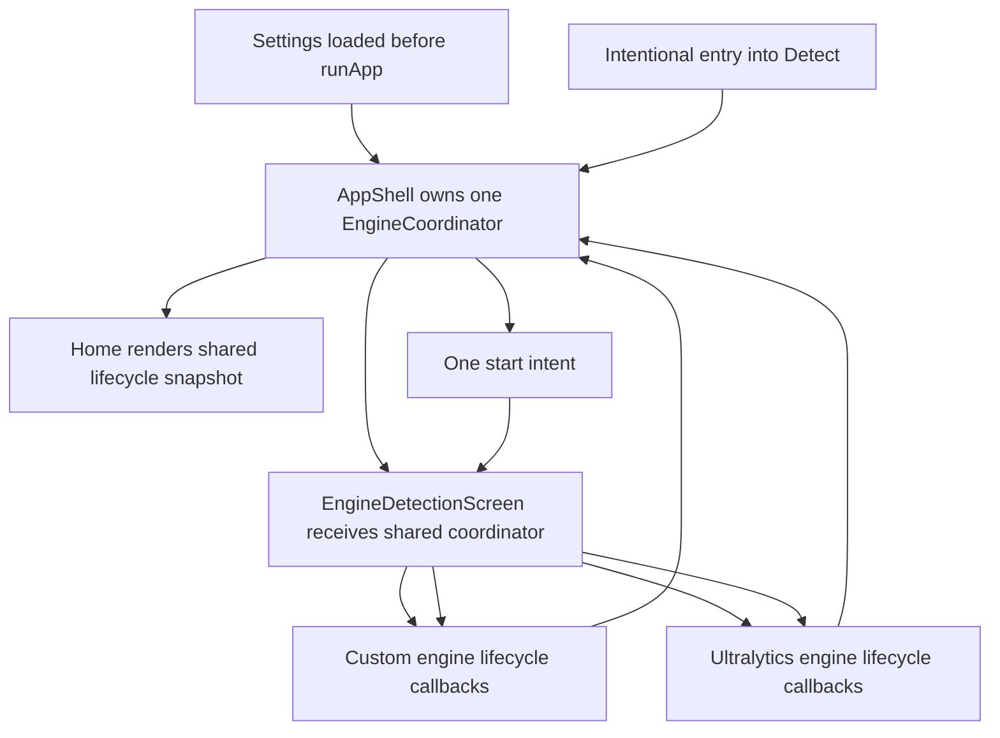
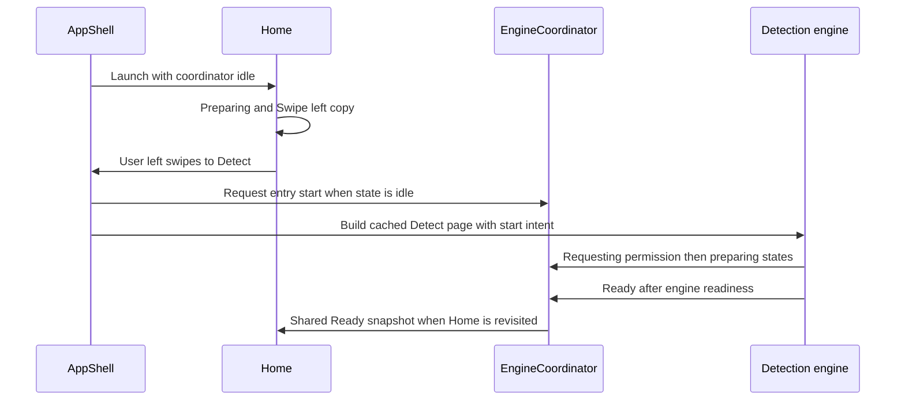
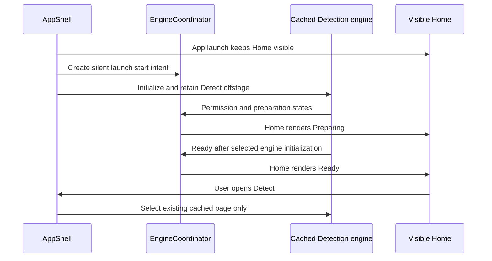

# EyeCue — Finalized Home and Detection State Feasibility Audit

> **Stage:** Planning-only architecture and implementation-feasibility audit.
>
> **Scope authority:** The finalized behavior in the task request supersedes
> earlier Home, Detection, and navigation planning records where they disagree.
>
> **Document change boundary:** This update changes only this plan,
> incrementally. No application source, tests, dependencies, configuration,
> assets, or other documentation are changed by this task.

## 1. Executive decision

**Verdict: every finalized behavior is feasible without a broad state-management
migration.** The smallest safe route is to promote the existing
[`EngineCoordinator`](../../lib/services/engine_coordinator.dart:14) from the
Detect-tab-local runtime observer to the single app-shell-owned, user-facing
Detection lifecycle/status source. It must supply the shared snapshot used by
Home, Custom Detection, and Ultralytics Detection for **Preparing**, **Ready**,
**Paused**, **Stopped**, and **Unavailable**. Extend its state vocabulary with an
explicit manual **Stopped** state and a one-shot start-intent token.

This is not a proposal to move camera, inference, TTS, haptics, assistive
post-processing, telemetry, or engine-specific control into a new global
service. The two engine screens retain those responsibilities and may retain
engine-local booleans strictly for camera/controller/inference mechanics. The
shared coordinator is the sole authority for every **user-facing** lifecycle or
status interpretation, including session lifecycle, failure, engine
selection/fallback, and pending start intent. No Home or Detection UI may derive
visible lifecycle status independently from engine-local flags.

| Finalized behavior | Feasible | Architecture decision | Evidence / caveat |
|---|---|---|---|
| Remove Home CTA without replacement | Yes | Remove the CTA callback and [`AccessibleButton`](../../lib/widgets/accessible_button.dart:8) use from Home only. | **[Actual product-decision conflict]** The current Home CTA and its callback are present in [`HomeScreen`](../../lib/screens/home_screen.dart:22) and wired by [`AppShellState._buildPage`](../../lib/navigation/app_shell.dart:246), so they must be deliberately removed rather than preserved. |
| Preserve Home → Detect left swipe, bottom bar, Back, and hidden-bar preference | Yes | Leave the shell gesture recognizer, `NavigationBar`, `PopScope`, and effective-hide logic structurally intact; only add lifecycle entry notification to the existing tab-selection paths. | **[Confirmed from code]** The shell maps a negative horizontal delta to `+1` at [`_SingleFingerHorizontalDragRecognizer._handleEnd`](../../lib/navigation/app_shell.dart:102), begins at Home at [`_index`](../../lib/navigation/app_shell.dart:159), and renders the existing bar at [`AppShellState.build`](../../lib/navigation/app_shell.dart:294). |
| Auto-start OFF starts when the user enters Detect, but not at launch | Yes | Keep Detect lazy when startup preference is off; on an intentional entry into tab 1, issue one shared start intent without writing settings. | **[Actual product-decision conflict]** Both engines currently condition their first automatic start on `autoStartDetection` in [`DetectionScreen.initState`](../../lib/screens/detection_screen.dart:178) and [`UltralyticsDetectionScreen.initState`](../../lib/screens/ultralytics_detection_screen.dart:119). With the preference off, the current Detect tab shows manual Start controls instead. |
| Auto-start ON prepares while Home remains visible | Yes, subject to device validation | Construct and retain Detect at app-shell startup when the already-loaded preference is on; issue one silent startup intent before first visual visit. | **[Actual product-decision conflict]** The shell currently marks only Home visited at [`_visited`](../../lib/navigation/app_shell.dart:159), so Detect and either engine are absent at launch. **[Needs Verification — Context7 unavailable]** The Context7 lookup for Flutter [`IndexedStack`](../../lib/navigation/app_shell.dart:323) behavior failed, so its offstage native-camera behavior must be verified on the physical Android target rather than assumed from framework memory. |
| Home and both Detection implementations present genuine shared lifecycle status | Yes | Give Home and both Detection status renderers the same app-shell-owned coordinator snapshot. Home only renders it and never starts a camera or maintains a parallel notifier; Detection reports engine facts but renders visible lifecycle status from that same snapshot. | **[Actual product-decision conflict]** Home currently derives its badge and copy solely from [`SettingsService.autoStartDetection`](../../lib/screens/home_screen.dart:153), while the coordinator is constructed inside Detect at [`_EngineDetectionScreenState`](../../lib/screens/engine_detection_screen.dart:47) and both Detection implementations interpret local flags for visible status. |
| Manual pause/stop remains paused/stopped across normal tab leave/return in the retained current session | Yes | Publish pause/resume/stop into the shared lifecycle source, add explicit `stopped`, and only issue automatic entry start from the initial `idle` state. No persistence through process death or a fresh launch is proposed. | **[Actual product-decision conflict]** Custom pause/stop change local booleans only at [`_pauseDetection`](../../lib/screens/detection_screen.dart:367) and [`_stopDetection`](../../lib/screens/detection_screen.dart:341); Custom does not publish paused/stopped state. Ultralytics publishes `paused`, but returns to ambiguous `idle` on stop at [`_stopDetection`](../../lib/screens/ultralytics_detection_screen.dart:211). |
| Preserve engine fallback, local gestures, haptics, TTS, cached pages, and accessibility | Yes | Keep existing engine-screen action ownership; add state-report calls around those actions and route programmatic starts through existing engine start paths. | **[Confirmed from code]** The coordinator already preserves preferred versus temporary active engine at [`EngineCoordinator.reportFailure`](../../lib/services/engine_coordinator.dart:94); both engines map their local gestures to the shell at [`DetectionScreen._onGesture`](../../lib/screens/detection_screen.dart:456) and [`UltralyticsDetectionScreen._onGesture`](../../lib/screens/ultralytics_detection_screen.dart:388). |

## 2. Evidence labels and audit boundary

Every non-trivial conclusion below uses one of these labels:

- **[Confirmed from code]** directly established by a current source or test.
- **[Inferred from code]** a bounded conclusion from established code flow, not
  an explicit product rule.
- **[Needs Verification — source]** cannot be established from project source;
  its uncertainty source is named.
- **[Actual product-decision conflict]** current code contradicts the finalized
  required behavior and must not be silently retained.

The direct dependency trace inspected for this audit is:

- app composition: [`main.dart`](../../lib/main.dart:15),
  [`app_shell.dart`](../../lib/navigation/app_shell.dart:116), and
  [`home_screen.dart`](../../lib/screens/home_screen.dart:11);
- engine orchestration and shared models: [`engine_detection_screen.dart`](../../lib/screens/engine_detection_screen.dart:18),
  [`engine_coordinator.dart`](../../lib/services/engine_coordinator.dart:7),
  [`detection_runtime_state.dart`](../../lib/models/detection_runtime_state.dart:3),
  [`detection_failure.dart`](../../lib/models/detection_failure.dart:1),
  [`app_settings.dart`](../../lib/models/app_settings.dart:57), and
  [`settings_service.dart`](../../lib/services/settings_service.dart:57);
- Custom and Ultralytics runtime paths: [`detection_screen.dart`](../../lib/screens/detection_screen.dart:51),
  [`ultralytics_detection_screen.dart`](../../lib/screens/ultralytics_detection_screen.dart:44),
  [`inference_isolate.dart`](../../lib/services/inference_isolate.dart:25), and
  [`inference_worker_lifecycle.dart`](../../lib/services/inference_worker_lifecycle.dart:30);
- shared assistive and status presentation: [`assistive_detection_controller.dart`](../../lib/services/assistive_detection_controller.dart:14),
  [`detection_state_panel.dart`](../../lib/widgets/detection_state_panel.dart:11),
  [`status_pill.dart`](../../lib/widgets/status_pill.dart:6),
  [`app_colors.dart`](../../lib/theme/app_colors.dart:3), and
  [`app_spacing.dart`](../../lib/theme/app_spacing.dart:1);
- focused regression coverage: [`widget_test.dart`](../../test/widget_test.dart:14),
  [`app_shell_test.dart`](../../test/navigation/app_shell_test.dart:24),
  [`gesture_navigation_direction_test.dart`](../../test/screens/gesture_navigation_direction_test.dart:7),
  [`semantics_test.dart`](../../test/accessibility/semantics_test.dart:456),
  [`engine_coordinator_test.dart`](../../test/services/engine_coordinator_test.dart:7), and
  [`theme_test.dart`](../../test/theme_test.dart:20).

## 3. Current architecture, traced before conclusions

### 3.1 Startup, page ownership, and navigation

| Current mechanism | Audited result |
|---|---|
| Settings are loaded before the app is run | **[Confirmed from code]** [`main`](../../lib/main.dart:15) creates `SettingsService`, awaits [`SettingsService.load`](../../lib/services/settings_service.dart:76), then creates [`EyeCueApp`](../../lib/main.dart:61). The finalized startup decision can therefore use the persisted `autoStartDetection` value before the first shell build. |
| Home is the initial primary tab | **[Confirmed from code]** [`AppShellState._index`](../../lib/navigation/app_shell.dart:159) starts at `0` and the first element of [`_visited`](../../lib/navigation/app_shell.dart:160) is `true`. |
| Pages are lazy and cached | **[Confirmed from code]** [`AppShellState._ensurePage`](../../lib/navigation/app_shell.dart:278) returns a placeholder until a tab is visited, then caches its page widget in [`_pages`](../../lib/navigation/app_shell.dart:161). The cached children are hosted by [`IndexedStack`](../../lib/navigation/app_shell.dart:323). The existing test explicitly protects Detection page retention at [`app_shell_test.dart`](../../test/navigation/app_shell_test.dart:216). |
| CTA and bar both use direct tab selection | **[Confirmed from code]** Home receives `onGoToDetection: () => goToTab(1)` at [`AppShellState._buildPage`](../../lib/navigation/app_shell.dart:251); the visible `NavigationBar` also calls [`goToTab`](../../lib/navigation/app_shell.dart:330). |
| Home left swipe moves to Detect | **[Confirmed from code]** The shell converts negative `dx` to `+1` at [`_SingleFingerHorizontalDragRecognizer._handleEnd`](../../lib/navigation/app_shell.dart:102), while [`navigateRelative`](../../lib/navigation/app_shell.dart:200) applies `+1` as the next tab. This is protected at [`app_shell_test.dart`](../../test/navigation/app_shell_test.dart:139). |
| Detection owns its viewport horizontal gestures | **[Confirmed from code]** The shell disables its recognizer while tab 1 is active at [`AppShellState.build`](../../lib/navigation/app_shell.dart:314). Both Detection implementations forward their own recognized left/right gesture at [`DetectionScreen._onGesture`](../../lib/screens/detection_screen.dart:456) and [`UltralyticsDetectionScreen._onGesture`](../../lib/screens/ultralytics_detection_screen.dart:388). |
| Back, hidden navigation, Settings, and Logs & Reports | **[Confirmed from code]** Back returns non-Home tabs to Home at [`AppShellState.build`](../../lib/navigation/app_shell.dart:296); effective bar visibility preserves accessibility override at [`_effectiveHideBar`](../../lib/navigation/app_shell.dart:289); Logs & Reports remains pushed from Settings at [`openLogsReports`](../../lib/navigation/app_shell.dart:233). |

### 3.2 Current Home status is a preference projection, not runtime truth

**[Confirmed from code]** [`HomeScreen`](../../lib/screens/home_screen.dart:22)
is stateless and receives only `settings` plus the CTA callback at
[`HomeScreen` constructor](../../lib/screens/home_screen.dart:26). Its private
[`_StatusBadge`](../../lib/screens/home_screen.dart:141) listens to settings and
uses `autoStartDetection` to decide `READY` versus `AUTO-START OFF` at
[`_StatusBadge.build`](../../lib/screens/home_screen.dart:152). Its lower copy
does the same at [`_InstructionRegion.build`](../../lib/screens/home_screen.dart:217).

**[Actual product-decision conflict]** This violates the finalized requirement
that Home consume the shared Detection lifecycle and that Auto-start control
startup only. Existing copy also promises Detect will begin *when opened*, which
is incompatible with the required app-launch background preparation when
Auto-start is on.

**[Confirmed from code]** The existing Home CTA is an
[`AccessibleButton`](../../lib/widgets/accessible_button.dart:8) labelled
`Go to Live Camera` at [`_InstructionRegion.build`](../../lib/screens/home_screen.dart:242).
The finalized requirement removes it and forbids replacement. The lower
decorative cyan rail is already non-interactive and excluded from semantics at
[`_InstructionRegion.build`](../../lib/screens/home_screen.dart:249), so it can
remain decorative rather than becoming a replacement control.

### 3.3 Existing shared abstractions and their actual limits

| Candidate abstraction | What it currently owns | Reuse decision |
|---|---|---|
| [`DetectionRuntimeState`](../../lib/models/detection_runtime_state.dart:4) | Cross-engine enum: idle, permission request, camera start, model load, ready, paused, recovery, fallback, failure, and disposed. Its `isBusy` grouping is at [`DetectionRuntimeStateX.isBusy`](../../lib/models/detection_runtime_state.dart:31). | **[Confirmed from code]** Reuse and extend with `stopped`; do not invent a Home-only or Detection-local user-facing lifecycle enum. **[Actual product-decision conflict]** existing `idle` and `disposed` cannot truthfully distinguish not-started from explicit manual stop. |
| [`DetectionFailure`](../../lib/models/detection_runtime_state.dart:69) | Typed category, safe user message, technical detail, recoverability, engine, retry count, and fallback availability. `userMessage` returns `safeMessage` at [`DetectionFailure.userMessage`](../../lib/models/detection_runtime_state.dart:92). | **[Confirmed from code]** Reuse the shared safe message in every Unavailable renderer; do not add a separate Home or engine-local error classification/copy. |
| [`EngineCoordinator`](../../lib/services/engine_coordinator.dart:14) | `ChangeNotifier` with preferred/active engine, shared runtime state, failure, fallback status, and stale generation filtering. It is currently owned only by [`_EngineDetectionScreenState`](../../lib/screens/engine_detection_screen.dart:47). | **[Confirmed from code]** It is the smallest viable shared state source. Lift its lifetime to `AppShell`, inject it into Home and Engine Detection, and make its snapshot the authoritative source for every user-facing lifecycle/status renderer. Do not create a parallel provider, second notifier, or Detection-local visible-status interpretation. |
| [`InferenceService.lifecycleStream`](../../lib/services/inference_isolate.dart:81) and [`InferenceWorkerLifecycle`](../../lib/services/inference_worker_lifecycle.dart:30) | Custom engine worker/model lifecycle, recovery, port ownership, and generation filtering. | **[Confirmed from code]** Keep Custom-specific; forward its resulting state through the existing callback pipeline only. It cannot represent Ultralytics camera/model state. |
| [`AssistiveDetectionController`](../../lib/services/assistive_detection_controller.dart:20) | Shared post-inference spatial analysis, tracking, telemetry, TTS, correction, and detection records after normalized results. | **[Confirmed from code]** Do not use as a lifecycle source or modify it. Its boundary begins after `updateDetections` at [`AssistiveDetectionController.updateDetections`](../../lib/services/assistive_detection_controller.dart:44). |
| [`SettingsService`](../../lib/services/settings_service.dart:60) and [`AppSettings`](../../lib/models/app_settings.dart:61) | Persisted preferences including `autoStartDetection`, engine, confidence, audio, power, vibration, and hidden navigation. | **[Confirmed from code]** Leave unchanged. `autoStartDetection` remains a startup input; it must not become Home readiness state or receive writes for manual pause/stop. |
| [`DetectionStatePanel`](../../lib/widgets/detection_state_panel.dart:16) and [`StatusPill`](../../lib/widgets/status_pill.dart:8) | Detection visual status and safe failure presentation. | **[Actual product-decision conflict]** Retain them only as renderers of the injected coordinator snapshot. Update their exhaustive shared-state handling if `stopped` is added; they must not select visible lifecycle/status copy from private engine flags. Do not make Home reuse their actionable panel or controls. |

### 3.4 Current `EngineCoordinator` lifecycle and ownership

**[Confirmed from code]** The coordinator initializes selected active engine from
the persisted inference-engine preference at
[`_EngineDetectionScreenState._coordinator`](../../lib/screens/engine_detection_screen.dart:47).
Each selected child reports state and failure through callbacks at
[`EngineDetectionScreen.build`](../../lib/screens/engine_detection_screen.dart:109).
The coordinator accepts only current mount and Custom worker generations at
[`EngineCoordinator._acceptsGeneration`](../../lib/services/engine_coordinator.dart:242).

**[Confirmed from code]** A non-permission, eligible Ultralytics failure causes
one temporary Custom fallback without rewriting the persisted engine preference
at [`EngineCoordinator.reportFailure`](../../lib/services/engine_coordinator.dart:94).
The existing deterministic test locks this behavior at
[`engine_coordinator_test.dart`](../../test/services/engine_coordinator_test.dart:24).

**[Actual product-decision conflict]** The coordinator becomes available only
after tab 1 is created, but Home is created before it. Thus Home cannot currently
observe state, failure, selected-engine fallback, or readiness. Moving the same
coordinator instance to [`AppShellState`](../../lib/navigation/app_shell.dart:147)
is a targeted ownership change; it is not a new state-management framework.

### 3.5 Current Custom lifecycle, transitions, and status derivation

| Lifecycle concern | Current concrete mechanism | Requirement impact |
|---|---|---|
| Initialization | **[Confirmed from code]** [`DetectionScreen.initState`](../../lib/screens/detection_screen.dart:178) subscribes to inference streams and calls [`InferenceService.initIsolate`](../../lib/services/inference_isolate.dart:150) unconditionally when the widget first mounts. Camera setup is called only if the preference is on. | **[Actual product-decision conflict]** Detect is lazy, so Auto-start on cannot initialize Custom while Home is visible. Auto-start off has no entry-start request. |
| Permission | **[Confirmed from code]** [`_setupCamera`](../../lib/screens/detection_screen.dart:216) sets `requestingPermission`, requests Camera permission, and reports typed `permissionDenied` failure at [`DetectionScreen._setupCamera`](../../lib/screens/detection_screen.dart:220). | Forward unchanged failure into the app-shell coordinator; Home and Custom Detection render the shared Unavailable state and `safeMessage`. |
| Camera/start | **[Confirmed from code]** Camera initialization starts a YUV image stream and sets local camera/active flags at [`DetectionScreen._setupCamera`](../../lib/screens/detection_screen.dart:279), then reports `ready` at [`DetectionScreen._setupCamera`](../../lib/screens/detection_screen.dart:307). Manual start is routed through [`_startDetection`](../../lib/screens/detection_screen.dart:318). | A shared start intent must call this existing engine start path once, not duplicate camera setup. |
| Worker/model lifecycle | **[Confirmed from code]** Worker events are mapped to local runtime state at [`DetectionScreen._handleInferenceLifecycle`](../../lib/screens/detection_screen.dart:518); [`InferenceService._initialize`](../../lib/services/inference_isolate.dart:184) loads model/labels then starts a worker. | **[Actual product-decision conflict]** Custom currently reports `ready` from camera completion and from `workerReady`, before a shared definition proves both camera and model are ready. The implementation must publish shared `ready` only after active camera streaming **and** model-loaded lifecycle evidence. |
| Pause | **[Confirmed from code]** [`_pauseDetection`](../../lib/screens/detection_screen.dart:367) retains preview but drops inference frames through the guard at [`_processCameraImage`](../../lib/screens/detection_screen.dart:666). | **[Actual product-decision conflict]** It does not report `paused` to the coordinator, so Home would otherwise remain stale. Publish `paused`, and publish `ready` on resume. |
| Stop | **[Confirmed from code]** [`_stopDetection`](../../lib/screens/detection_screen.dart:341) stops stream, clears detections, changes local flags, and speaks stopped. | **[Actual product-decision conflict]** It does not publish a lifecycle state. Add explicit shared `stopped`, not `idle` or `disposed`, after the local operation succeeds. |
| Error/recovery | **[Confirmed from code]** [`_reportFailure`](../../lib/screens/detection_screen.dart:591) publishes typed failure; retry invokes isolate retry and either camera start or setup at [`_retryRuntime`](../../lib/screens/detection_screen.dart:605). | Retain recovery and fallback pipeline. Home and both Detection status surfaces render the coordinator's resulting shared state/failure; neither engine renders an independent lifecycle interpretation. |
| Status UI | **[Confirmed from code]** The top pill derives stopped/paused/detecting from private booleans at [`_buildTopBar`](../../lib/screens/detection_screen.dart:848), while busy/failure panels derive from private runtime state at [`_buildMainArea`](../../lib/screens/detection_screen.dart:887). | **[Actual product-decision conflict]** Replace this separate visible-status interpretation. The Custom status pill and state panel must render Preparing, Ready, Paused, Stopped, and Unavailable from the injected coordinator snapshot. Private flags remain only for camera, controller, and inference mechanics. |

### 3.6 Current Ultralytics lifecycle, transitions, and status derivation

| Lifecycle concern | Current concrete mechanism | Requirement impact |
|---|---|---|
| Initialization | **[Confirmed from code]** [`UltralyticsDetectionScreen.initState`](../../lib/screens/ultralytics_detection_screen.dart:119) loads labels and schedules a post-frame start only when `autoStartDetection` is true. | **[Actual product-decision conflict]** This runs only after lazy tab construction, not during app launch on Home; remove direct settings-based auto-start and react to the shared start intent instead. |
| Permission | **[Confirmed from code]** [`_ensureCameraPermission`](../../lib/screens/ultralytics_detection_screen.dart:163) emits permission-requesting state and typed permission failure. | Preserve the existing safe message and failure callback path to the shared snapshot rendered by Home and Ultralytics Detection. |
| Start/model ready | **[Confirmed from code]** [`_startDetection`](../../lib/screens/ultralytics_detection_screen.dart:190) guards against duplicate starts using `_starting || _detectionActive`, sets `loadingModel`, then creates [`YOLOView`](../../lib/screens/ultralytics_detection_screen.dart:539) after active state is true. `onModelLoad` reports `ready` at [`UltralyticsDetectionScreen._buildMainArea`](../../lib/screens/ultralytics_detection_screen.dart:549). | This is already closer to the required ready definition. A parent-issued start request must preserve the current duplicate-start guard. |
| Pause/resume | **[Confirmed from code]** [`_pauseDetection`](../../lib/screens/ultralytics_detection_screen.dart:236) calls native controller pause and publishes `paused`; [`_resumeDetection`](../../lib/screens/ultralytics_detection_screen.dart:245) calls resume and publishes `ready`. | Reuse the existing reports. |
| Stop | **[Confirmed from code]** [`_stopDetection`](../../lib/screens/ultralytics_detection_screen.dart:211) calls native `stop`, clears local data, and publishes `idle`. | **[Actual product-decision conflict]** `idle` is indistinguishable from never started. Publish explicit `stopped` to preserve the finalized return-to-Detect behavior. |
| Native model error | **[Confirmed from code]** [`YOLOView.onModelError`](../../lib/screens/ultralytics_detection_screen.dart:559) creates an engine-specific safe failure that advertises fallback availability. | Preserve the shared fallback behavior; map an initialized temporary fallback to shared Ready, not to a fifth status. Home and both Detection implementations render that same outcome. |
| Status UI | **[Confirmed from code]** The pill derives stopped, paused, loading, and detecting from private flags at [`_buildTopBar`](../../lib/screens/ultralytics_detection_screen.dart:451); the main area derives failure, permission, and inactive presentation at [`_buildMainArea`](../../lib/screens/ultralytics_detection_screen.dart:516). | **[Actual product-decision conflict]** Replace this separate visible-status interpretation. The Ultralytics status pill and state panel must render Preparing, Ready, Paused, Stopped, and Unavailable from the injected coordinator snapshot. Private flags remain only for native controller and inference mechanics. |

### 3.7 App lifecycle and resource implications

**[Confirmed from code]** No project source references
`WidgetsBindingObserver`, `AppLifecycleState`, or `didChangeAppLifecycleState`.
There is therefore no current app foreground/background policy that pauses or
releases either camera engine on lifecycle transitions.

**[Confirmed from code]** Custom starts the native camera image stream at
[`DetectionScreen._setupCamera`](../../lib/screens/detection_screen.dart:290) and
keeps it until its widget disposes at [`DetectionScreen.dispose`](../../lib/screens/detection_screen.dart:198).
Ultralytics owns a `YOLOViewController`, invokes native stop on user stop at
[`UltralyticsDetectionScreen._stopDetection`](../../lib/screens/ultralytics_detection_screen.dart:211),
and disposes the controller at [`UltralyticsDetectionScreen.dispose`](../../lib/screens/ultralytics_detection_screen.dart:132).

**[Inferred from code]** Genuine Auto-start ON background preparation will
request camera permission and may initialize a camera/native inference path while
Home is selected. That is the required behavior, but it increases foreground
camera, battery, thermal, and privacy-indicator exposure compared with the
current lazy first visit.

**[Needs Verification — Flutter/Ultralytics native runtime]** Whether an
offstage [`CameraPreview`](../../lib/screens/detection_screen.dart:1022) or
[`YOLOView`](../../lib/screens/ultralytics_detection_screen.dart:539) initializes
and continues camera use correctly while retained in the shell's
[`IndexedStack`](../../lib/navigation/app_shell.dart:323) cannot be proven from
this repository. The Context7 Flutter documentation request failed before a
library identifier could be resolved, and the native package source was not
available through the configured Dart package tool. Physical-device validation
is mandatory before treating background preparation as verified.

**[Needs Verification — product decision / app lifecycle]** The finalized
request specifies normal tab leave/return within the retained current session
only. Manual pause/stop has no proposed persistence through process death or a
fresh launch. Android backgrounding/foregrounding, process death, camera
pre-emption, and return from app settings remain unresolved and out of scope for
this task; this plan defines no behavior for them.

## 4. Actual conflicts requiring deliberate change

| # | Current behavior | Conflict with finalized behavior | Required resolution |
|---:|---|---|---|
| 1 | Home renders `READY` / `AUTO-START OFF` and lower copy directly from settings at [`home_screen.dart`](../../lib/screens/home_screen.dart:153). | **[Actual product-decision conflict]** Auto-start is currently presentation state; it must instead be startup-only. | Replace both Home settings listeners with one listener to the app-shell-owned coordinator snapshot. |
| 2 | Home retains the `Go to Live Camera` button at [`home_screen.dart`](../../lib/screens/home_screen.dart:242). | **[Actual product-decision conflict]** The finalized behavior removes it without replacement. | Remove the constructor callback, button import/use, CTA-specific layout gap, and CTA tests/semantics. Do not turn the rail, logo, or copy into a control. |
| 3 | Detect is not built until visited because `_visited[1]` starts false at [`app_shell.dart`](../../lib/navigation/app_shell.dart:160). | **[Actual product-decision conflict]** Auto-start ON must prepare while Home is visible. | When loaded startup preference is on, initialize Detect as visited/cached before first render and issue one silent startup intent. |
| 4 | Auto-start OFF leaves both engines inactive after first build, as shown by [`DetectionScreen.initState`](../../lib/screens/detection_screen.dart:187) and [`UltralyticsDetectionScreen.initState`](../../lib/screens/ultralytics_detection_screen.dart:124). | **[Actual product-decision conflict]** Intentional entry into Detect must start immediately. | Existing shell entry routes request start only from initial idle; the mounted engine consumes one request. Do not mutate `autoStartDetection`. |
| 5 | Coordinator is Detect-local at [`engine_detection_screen.dart`](../../lib/screens/engine_detection_screen.dart:47). | **[Actual product-decision conflict]** Home cannot consume the same status source. | Construct exactly one coordinator in the shell and inject it into Home and Engine Detection. |
| 6 | Custom pause and stop have no coordinator publication; Ultralytics stop publishes idle; both Detection UIs interpret visible status locally. | **[Actual product-decision conflict]** Home and either Detection UI can distinguish lifecycle differently, and returning can restart ambiguous idle state. | Report paused/ready/stopped from both engine actions, add explicit `stopped` state, and make all three user-facing status surfaces render the same coordinator snapshot. |
| 7 | Custom reports ready after camera initialization at [`detection_screen.dart`](../../lib/screens/detection_screen.dart:307) and can report it on worker readiness at [`detection_screen.dart`](../../lib/screens/detection_screen.dart:527). | **[Actual product-decision conflict]** Any user-facing Ready claim must represent actual lifecycle readiness, not partial setup. | Gate Custom shared ready on both camera streaming and model-loaded evidence. |
| 8 | Engine widgets independently read `autoStartDetection` in their lifecycle. | **[Actual product-decision conflict]** Startup policy is duplicated and cannot implement the finalized launch and entry flows consistently. | Remove engine-local settings-based auto-start branches; engines act only on one shared initial/entry start request. **[Needs Verification — product decision]** A persisted Auto-start change while the app is already running is out of scope and must not receive a behavior rule in this task. |
| 9 | Existing tests assert the CTA exists and its callback works at [`widget_test.dart`](../../test/widget_test.dart:18), [`semantics_test.dart`](../../test/accessibility/semantics_test.dart:456), and [`theme_test.dart`](../../test/theme_test.dart:26). | **[Actual product-decision conflict]** Those assertions now protect forbidden behavior. | Replace them with removal/no-button assertions and shared lifecycle-source assertions across Home and both Detection implementations. |

## 5. Smallest safe shared-state design

### 5.1 Ownership and boundaries

**[Confirmed from code]** [`EngineCoordinator`](../../lib/services/engine_coordinator.dart:14)
already has the correct core characteristics: a `ChangeNotifier`, engine
selection, shared `DetectionRuntimeState`, `DetectionFailure`, temporary
fallback handling, and mount/worker generation protection. Reusing it avoids a
new provider, stream layer, DI framework, or a Home-owned notifier.

**Proposed minimum design:**

1. [`AppShellState`](../../lib/navigation/app_shell.dart:147) creates one
   coordinator from the already-loaded persisted preferred engine.
2. The shell passes that same instance to [`HomeScreen`](../../lib/screens/home_screen.dart:22)
   and [`EngineDetectionScreen`](../../lib/screens/engine_detection_screen.dart:18).
3. [`EngineDetectionScreen`](../../lib/screens/engine_detection_screen.dart:109)
    continues to mount one selected engine and forwards each lifecycle/failure
    callback to the injected coordinator using the existing generation values.
4. The selected engine remains the only owner of its camera, native controller,
    inference service, local detection data, gestures, TTS calls, haptics, and
    assistive controller. Its local flags may control those mechanics but may not
    derive user-facing lifecycle/status content.
5. Home uses one [`ListenableBuilder`](../../lib/screens/home_screen.dart:153)
    over the coordinator and maps its snapshot to the finalized Home copy. It
    neither queries settings for status nor performs any lifecycle action.
6. Custom Detection and Ultralytics Detection render their pill and state-panel
   lifecycle/status from that same coordinator snapshot and shared five-outcome
   mapping. They report engine facts to the coordinator; they do not render a
   competing interpretation from private booleans.



### 5.2 Required lifecycle vocabulary and intent

The plan extends the existing shared enum rather than adding a Home-specific
state machine.

| Shared state / field | Meaning | Why it is needed |
|---|---|---|
| existing `idle` | Session has not started and no initialization is active. | **[Confirmed from code]** This state already exists. It maps to the finalized Auto-start-OFF initial Home copy only. |
| existing busy states | `requestingPermission`, `startingCamera`, `loadingModel`, and `recovering`. | **[Confirmed from code]** They already expose `isBusy` at [`DetectionRuntimeStateX.isBusy`](../../lib/models/detection_runtime_state.dart:31) and map to shared user-facing Preparing while an engine is actively initializing. |
| existing `ready` | Active selected engine is genuinely prepared for detection. | **[Actual product-decision conflict]** Custom needs a small readiness gate so this does not mean camera-only or worker-port-only readiness. |
| existing `paused` | Detection is active but inference is deliberately paused. | **[Confirmed from code]** Ultralytics already publishes it; Custom must publish it. |
| new `stopped` | User explicitly stopped the current session. | **[Actual product-decision conflict]** Required to distinguish manual stop from idle and from widget disposal. Do not overload `disposed`, which is emitted by coordinator teardown at [`EngineCoordinator.disposeCoordinator`](../../lib/services/engine_coordinator.dart:208). |
| existing `failed` plus `failure` | Current user-safe unavailable state. | **[Confirmed from code]** The coordinator already retains failure at [`EngineCoordinator.failure`](../../lib/services/engine_coordinator.dart:36). |
| existing `fallback` | Temporary Custom engine is successfully active after a preferred-engine failure. | **[Inferred from code]** Map this to shared user-facing Ready because `reportReady` intentionally republishes fallback after Custom becomes ready at [`EngineCoordinator.reportReady`](../../lib/services/engine_coordinator.dart:77). It must not create a fifth status. |
| monotonic start-intent token | A one-shot request to start a mounted or soon-to-mount selected engine. It includes a silent startup origin versus user-entry origin. | **[Actual product-decision conflict]** The existing coordinator has state reports but no command channel, so it cannot start a lazy engine for the required flows. A token prevents a pre-mount request being lost and lets each engine ignore an already-consumed request. |

The start intent is a narrow command handshake, not persistent state:

- **Auto-start launch intent:** created once at shell startup only when the
  loaded setting is on; it requests no start haptic or start speech, matching
  current Ultralytics auto-start arguments at
  [`UltralyticsDetectionScreen.initState`](../../lib/screens/ultralytics_detection_screen.dart:124).
- **Intentional Detect-entry intent:** created only when the shared state is
  initial `idle`; it uses the existing engine start route rather than creating a
  new Home interaction.
- **Paused, stopped, busy, ready, fallback, or failed state:** entry creates no
  implicit new intent. Resume, start, retry, and fallback actions remain
  Detection-local and explicit, but their resulting user-facing status is
  rendered only from the coordinator snapshot.
- **Manual stop:** publishes `stopped`, preserving the no-auto-restart latch for
  normal tab leave/return in the retained current session without writing any
  setting. It neither proposes nor implies persistence through process death or
  a fresh launch.

**[Needs Verification — product decision]** The finalized request does not
define what should happen if the persisted Auto-start setting changes while the
app is already running. That transition is out of scope for this task: do not
implement, test as finalized behavior, or infer a status/restart rule for it.

**[Needs Verification — product decision]** The exact audible/haptic treatment
of an Auto-start-OFF *navigation-triggered* start is not specified independently
of the requirement to preserve Detection-local haptics and TTS. No additional
audible/haptic rule is selected in this plan. Confirm the desired treatment on
the physical device with TalkBack/TTS enabled; do not add a separate Home
announcement without a product decision.

### 5.3 Shared user-facing presentation mapping

Home and both Detection implementations must derive their user-facing lifecycle
status from this coordinator snapshot and failure. The table is presentation
logic, not a second lifecycle model; no status renderer may read
`autoStartDetection`, local camera booleans, engine-specific flags, or detection
results to select Preparing, Ready, Paused, Stopped, or Unavailable. Detection
surfaces may use different layout and control affordances, but not a different
lifecycle/status interpretation.

| Shared lifecycle source | User-facing state | Home headline / supporting copy | Detection status rendering | Presentation notes |
|---|---|---|---|---|
| initial `idle` | `Preparing` | `Swipe left to start!` / `Detection begins immediately.` | Render Preparing from the shared snapshot; do not select a local inactive status. | This is the finalized Auto-start-OFF, not-started presentation. **[Actual product-decision conflict]** It replaces current `AUTO-START OFF` copy. |
| `requestingPermission`, `startingCamera`, `loadingModel`, or `recovering` | `Preparing` | `Getting things ready` / `Detection is preparing.` | Render Preparing from the shared snapshot; local setup flags remain mechanical only. | **[Confirmed from code]** Each source is already shared enum state. This wording must not be used merely because a preference is enabled. |
| `ready` or healthy temporary `fallback` | `Ready` | `Ready when you are` / `Detection is ready.` | Render Ready from the shared snapshot; a healthy fallback is not an independent local status. | **[Confirmed from code]** `fallback` can represent active Custom after a preferred-engine failure; it is not a user-facing error if it reached healthy readiness. |
| `paused` | `Paused` | `Detection is paused` / `Open Detect to resume.` | Render Paused from the shared snapshot. | **[Confirmed from code]** Resume remains an explicit Detection-local action. |
| new `stopped` | `Stopped` | `Detection is stopped` / `Open Detect to start again.` | Render Stopped from the shared snapshot. | The start remains explicit; tab entry alone does not restart it. |
| `failed` with `failure` | `Unavailable` | `Detection needs attention` / current [`DetectionFailure.userMessage`](../../lib/models/detection_runtime_state.dart:92) | Render Unavailable and the shared safe message; no technical detail. | **[Confirmed from code]** It reuses the shared user-safe error source. |
| `disposed` | No user-visible state during normal retained-session operation. | Not applicable. | Not applicable. | **[Confirmed from code]** It is coordinator/application teardown, not user stop. **[Needs Verification — app lifecycle]** If a mounted status surface can observe it, this plan specifies no mapping; do not infer Stopped or any process-disruption behavior. |

**[Confirmed from code]** Existing Home color tokens already provide an on-state
cyan, muted off-state ink, and a Preparing amber at
[`app_colors.dart`](../../lib/theme/app_colors.dart:123). Existing status/error
tokens are at [`app_colors.dart`](../../lib/theme/app_colors.dart:38). No new
token, asset, dependency, or shared status widget is justified by the finalized
behavior unless implementation reveals an actual missing semantic visual role.

### 5.4 Auto-start OFF flow



1. **[Confirmed from code]** [`SettingsService.load`](../../lib/services/settings_service.dart:76)
   completes before the shell exists, so the shell can read Auto-start OFF.
2. The shell leaves tab 1 unvisited; no engine widget, camera controller, native
   view, or Custom isolate is constructed during Home launch.
3. Home observes coordinator `idle` and renders exactly `Preparing`, `Swipe left
   to start!`, and `Detection begins immediately.`
4. A user reaches Detect through existing `goToTab(1)` or `navigateRelative(+1)`.
   The shell marks it visited and requests one entry start because state is
   `idle`. This is navigation integration, not a Home CTA.
5. [`EngineDetectionScreen`](../../lib/screens/engine_detection_screen.dart:18)
   mounts the persisted selected engine. The engine consumes the intent once,
   starts through its existing start path, and reports its normal transitions.
6. On ready, the shared snapshot becomes Ready; Home reflects it when visible,
   and the active Detection status renderer reflects the same outcome. On a
   permission/model/camera failure, all status renderers use shared Unavailable
   and the shared safe message.
7. A user pause or stop changes shared state to `paused` or `stopped`; subsequent
   tab leave/return does not create another entry start intent. Only existing
   Detection Resume/Start actions may proceed.

### 5.5 Auto-start ON flow

**Finalized sequence:** app launch keeps Home visible; Detection initializes and
starts in the background; the shared coordinator moves through Preparing to
Ready or Unavailable; Home reflects that shared snapshot; and a later opening
of Detect reuses the initialized instance without starting it again.



1. **[Confirmed from code]** Startup settings are loaded before
   [`runApp`](../../lib/main.dart:36), so the shell can make the prewarm decision
   synchronously from the persisted setting.
2. The shell creates the one coordinator, keeps Home visible at `_index == 0`,
   marks Detect visited before first shell build, and submits one silent launch
   start intent.
3. The cached selected engine mounts behind visible Home, asks camera permission
   if needed, and initializes/starts current camera/model work in the
   background. The shared snapshot moves through Preparing and then Ready or
   Unavailable; Home reflects that same snapshot.
4. The engine publishes Ready only when its readiness definition is satisfied:
    Custom requires camera stream plus model-loaded; Ultralytics requires its
    `onModelLoad` callback after start. Any typed failure flows through the
    coordinator.
5. Opening Detect changes selected tab only. It must not create a second start
   intent while shared state is busy, ready, paused, stopped, failed, or
   fallback; the cached page prevents a second widget initialization.
6. **[Needs Verification — physical Android device]** Verify that permission
   prompting, native camera creation, inference, and surface presentation are
   stable while Home remains selected for both engines. This is an explicit
   release-blocking validation item, not an implementation assumption.

## 6. Implementation scope classification

### 6.1 Required production files

| File | Required change | Why it is in scope |
|---|---|---|
| [`lib/navigation/app_shell.dart`](../../lib/navigation/app_shell.dart:116) | Own one coordinator for shell lifetime; initialize tab-1 cache and silent launch intent for startup Auto-start ON; make existing tab-entry paths request start only from initial idle; inject coordinator into Home and Engine Detection; remove stale CTA-oriented comments. Preserve recognizer thresholds/arbitration, `NavigationBar`, `PopScope`, Logs route, and hidden-bar behavior. | Shared ownership and lifecycle-aware navigation cannot be achieved elsewhere without duplicating state. |
| [`lib/services/engine_coordinator.dart`](../../lib/services/engine_coordinator.dart:14) | Retain existing selection/fallback/generation behavior; add explicit `stopped` support, a monotonic start-intent contract, and guarded transition APIs needed by the shell/engines. Do not own camera/controller instances. | It is the current cross-engine `ChangeNotifier` and is the smallest reuse path. |
| [`lib/models/detection_runtime_state.dart`](../../lib/models/detection_runtime_state.dart:3) | Add `stopped`; update enum label and busy/default interpretation. Keep `DetectionFailure` as current typed safe-message source. | Current enum cannot distinguish no session from manual stop. |
| [`lib/screens/home_screen.dart`](../../lib/screens/home_screen.dart:22) | Replace settings-derived status with coordinator-derived mapping; remove CTA parameter/import/widget and related layout gap; render exact finalized strings and safe error message; preserve decorative logo/rail, light local theme, scrolling, and accessibility. | This is the Home behavior/rendering change; its visible lifecycle/status mapping is shared with both Detection implementations. |
| [`lib/screens/engine_detection_screen.dart`](../../lib/screens/engine_detection_screen.dart:18) | Receive injected coordinator rather than constructing/disposal-owning it; preserve callbacks/generation forwarding; pass start-intent changes to currently mounted engine; synchronize the selected-engine setting. **[Needs Verification — product decision]** The effect of any settings-driven remount on retained-session manual pause/stop, and of an Auto-start preference change while running, is out of scope and receives no behavior rule. | This bridges shared session state to the active engine without moving engine logic into Home/shell. |
| [`lib/screens/detection_screen.dart`](../../lib/screens/detection_screen.dart:67) | Remove direct `autoStartDetection` branch; consume shared start intent once; report paused/resumed/stopped to coordinator; gate shared ready on camera-stream plus model-loaded rather than partial readiness; render all user-facing lifecycle/status UI from the coordinator snapshot; preserve Custom camera, isolate, gestures, controls, haptics, TTS, recovery, and assistive behavior. | Required for truthful shared state and entry/launch intent handling. |
| [`lib/screens/ultralytics_detection_screen.dart`](../../lib/screens/ultralytics_detection_screen.dart:44) | Remove direct settings-based post-frame start; consume shared start intent once with existing duplicate guard; publish explicit stopped instead of idle; render all user-facing lifecycle/status UI from the coordinator snapshot; preserve native controller, callbacks, gestures, controls, haptics, TTS, and fallback failure reporting. | Required for the same cross-engine lifecycle contract. |
| [`lib/widgets/detection_state_panel.dart`](../../lib/widgets/detection_state_panel.dart:16) and [`lib/widgets/status_pill.dart`](../../lib/widgets/status_pill.dart:8) | Add exhaustive `stopped` handling and accept/render the injected coordinator snapshot for all user-facing lifecycle/status outcomes; preserve actions and safe failure display. | The enum extension and single-visible-source requirement make these direct compile and behavior dependencies. |

### 6.2 Required automated-test files

| File | Required regression change |
|---|---|
| [`test/services/engine_coordinator_test.dart`](../../test/services/engine_coordinator_test.dart:7) | Test start-intent monotonicity/one-consumer contract, launch versus entry intent, no entry auto-start after paused/stopped/failed/ready, stopped transition, current fallback preservation, and stale mount/worker callback filtering. **[Needs Verification — product decision]** Do not specify a response to Auto-start changes while the app is already running. |
| [`test/navigation/app_shell_test.dart`](../../test/navigation/app_shell_test.dart:24) | Remove the CTA-oriented stub/test assertions. Add startup Auto-start ON prewarm versus OFF lazy behavior using a test seam; verify Home-left still advances exactly one tab; verify direct tab selection uses the same entry policy; keep all current gesture, hidden-bar, Back, and page-cache assertions. **[Needs Verification — product decision]** Do not test a response to an Auto-start change after launch. |
| [`test/widget_test.dart`](../../test/widget_test.dart:14) | Replace preference badge/CTA tests with coordinator-snapshot fixtures for not-started, preparing, ready, paused, stopped, and failure-safe-message states; assert no `Go to Live Camera` text/button remains and both Detection implementations render the same user-facing lifecycle outcome for the same injected snapshot. |
| [`test/accessibility/semantics_test.dart`](../../test/accessibility/semantics_test.dart:456) | Remove CTA button expectations. Assert each Home and Detection shared-status state exposes text/semantics that do not depend on color, only one EyeCue wordmark remains, no replacement action is exposed, the shared error safe message is read, and all required variants have no overflow at 200% scale. |
| [`test/theme_test.dart`](../../test/theme_test.dart:20) | Replace Home CTA expectation with the new Home lifecycle-source baseline while retaining startup theme regression coverage. |

### 6.3 Conditional files only if implementation exposes a real dependency

| File | Trigger | Constraint |
|---|---|---|
| [`test/screens/gesture_navigation_direction_test.dart`](../../test/screens/gesture_navigation_direction_test.dart:7) | Only if refactoring entry plumbing accidentally changes the existing pure left/right helper API. | The test's direction contract itself must remain unchanged. |
| [`lib/theme/app_colors.dart`](../../lib/theme/app_colors.dart:3) | Only if the finalized status display needs a semantic color role unavailable from existing Home/status tokens. | Do not invent values; current cyan, amber, and error/status tokens appear sufficient. |
| [`lib/theme/app_spacing.dart`](../../lib/theme/app_spacing.dart:1) | Only if CTA removal leaves a new spacing value not represented by existing tokens. | Use existing tokens first; no visual redesign is implied by lifecycle work. |

### 6.4 Explicitly untouched files and subsystems

| Area | Untouched decision |
|---|---|
| [`lib/main.dart`](../../lib/main.dart:15) | **[Confirmed from code]** Startup already loads settings before app construction. The shell can own the coordinator, so no service wiring change in main is required. |
| [`lib/models/app_settings.dart`](../../lib/models/app_settings.dart:61) and [`lib/services/settings_service.dart`](../../lib/services/settings_service.dart:57) | Do not add a persisted manual pause/stop field; do not write `autoStartDetection` during entry, pause, stop, or Home rendering. **[Needs Verification — product decision]** Auto-start changes while the app is running are out of scope; this plan defines no reaction to them. |
| [`lib/services/assistive_detection_controller.dart`](../../lib/services/assistive_detection_controller.dart:20) | No changes: its post-inference shared behavior is already correctly separate from lifecycle ownership. |
| [`lib/services/inference_isolate.dart`](../../lib/services/inference_isolate.dart:37) and [`lib/services/inference_worker_lifecycle.dart`](../../lib/services/inference_worker_lifecycle.dart:36) | Do not migrate worker/camera ownership. Detection screen only refines how existing lifecycle evidence is aggregated before shared Ready. |
| [`lib/widgets/gesture_surface.dart`](../../lib/widgets/gesture_surface.dart) and [`lib/services/gesture_controller.dart`](../../lib/services/gesture_controller.dart) | Preserve Detection-local gesture capture and do not redesign known edge cases. |
| [`lib/screens/settings_screen.dart`](../../lib/screens/settings_screen.dart:22), [`lib/screens/logs_reports_screen.dart`](../../lib/screens/logs_reports_screen.dart:1), and [`lib/screens/help_screen.dart`](../../lib/screens/help_screen.dart:1) | No visual, navigation, or behavior change. Settings remains the source of the startup preference; Logs & Reports stays its current route. |
| [`pubspec.yaml`](../../pubspec.yaml), Android configuration, assets, dependencies, and all other documentation | No changes. The task authorizes exactly this audit document. |

## 7. Reuse, centralization, and obsolete-code removal

### Reuse and centralization requirements

1. **One lifecycle source:** exactly one app-shell-owned
   [`EngineCoordinator`](../../lib/services/engine_coordinator.dart:14). Home,
   Custom Detection, and Ultralytics Detection render its snapshot; Engine
   Detection forwards engine facts to it; neither instantiates a second
   coordinator.
2. **One shared enum:** extend
    [`DetectionRuntimeState`](../../lib/models/detection_runtime_state.dart:4)
    with `stopped`; do not create `HomeStatus`, `HomeReadiness`, or boolean
    copies of `isReady`, `isPaused`, `isStopped`, or `isInitializing`.
3. **One failure record:** Home, Custom Detection, and Ultralytics Detection
   render [`DetectionFailure.userMessage`](../../lib/models/detection_runtime_state.dart:92),
   never a copied error string or technical exception.
4. **One engine-selection/fallback policy:** preserve existing
    [`EngineCoordinator.reportFailure`](../../lib/services/engine_coordinator.dart:94)
    and generation guards. Home does not choose or retry an engine.
5. **One start-command path:** shell-issued launch/entry intent is consumed by
    the selected engine's existing Start logic. Home has no callback, button,
    gesture handler, or command API.
6. **One visible-status mapping:** Home, Custom Detection, and Ultralytics
   Detection render their lifecycle/status from the coordinator snapshot and
   shared lifecycle vocabulary. Engine-local booleans may govern mechanics but
   cannot determine user-facing Preparing, Ready, Paused, Stopped, or
   Unavailable content.

### Obsolete material to remove, not preserve

| Obsolete item | Removal reason |
|---|---|
| `HomeScreen.onGoToDetection` and its shell closure | **[Actual product-decision conflict]** It exists solely for the forbidden Home CTA. |
| Home import/use of [`AccessibleButton`](../../lib/widgets/accessible_button.dart:8) | **[Actual product-decision conflict]** Home must not replace the CTA with another action. |
| Home `READY`, `AUTO-START OFF`, and preference-derived instructional copy | **[Actual product-decision conflict]** They are not shared lifecycle truth. |
| Engine-local `autoStartDetection` startup branches | **[Actual product-decision conflict]** They are duplicated startup policy and cannot meet background preparation plus entry/manual-hold rules. |
| Custom and Ultralytics status decisions derived from private flags | **[Actual product-decision conflict]** Detection and Home must not display competing lifecycle interpretations; retain private flags only for engine mechanics. |
| CTA-specific widget/semantics/theme/app-shell tests | **[Actual product-decision conflict]** They assert removed behavior. Replace rather than leave stale expectations/comments. |
| Coordinator construction/disposal inside [`_EngineDetectionScreenState`](../../lib/screens/engine_detection_screen.dart:47) | **[Actual product-decision conflict]** It prevents Home from observing the same instance. The injected shell instance owns its lifetime. |

## 8. Detailed implementation sequence

1. **Add the lifecycle contract first.** Extend
   [`DetectionRuntimeState`](../../lib/models/detection_runtime_state.dart:4)
   with explicit `stopped`; update every exhaustive state mapping in
   [`detection_runtime_state.dart`](../../lib/models/detection_runtime_state.dart:17)
   and [`detection_state_panel.dart`](../../lib/widgets/detection_state_panel.dart:127).
2. **Extend, do not replace, the coordinator.** In
   [`engine_coordinator.dart`](../../lib/services/engine_coordinator.dart:14),
   retain current selection/fallback/generation logic and add the narrow
   session/start-intent APIs. Establish guards: only initial idle accepts an
   automatic entry start; manual paused/stopped/failed state rejects it.
3. **Move coordinator lifetime to the shell.** In
   [`app_shell.dart`](../../lib/navigation/app_shell.dart:147), construct the
   coordinator once, dispose it with the shell, pass it to Home/Engine
   Detection, and leave current TTS settings listener, primary navigation,
   route, Back, and bar logic intact.
4. **Implement the launch policy at shell creation.** If the loaded Auto-start
    preference is on, make Detect cached before first frame and submit one silent
    launch intent while Home remains selected. If off, leave Detect unbuilt and
    coordinator idle. **[Needs Verification — product decision]** A persisted
    Auto-start preference change after launch is out of scope: do not add a
    reactive behavior, state mapping, or test for it in this task.
5. **Make existing tab-entry paths lifecycle-aware but behaviorally identical.**
   Update [`goToTab`](../../lib/navigation/app_shell.dart:192) and
   [`navigateRelative`](../../lib/navigation/app_shell.dart:200) to request the
   entry start only when entering Detect from `idle`. Preserve all existing
   navigation feedback and do not touch recognized gesture thresholds or edge
   cases.
6. **Inject coordinator into Engine Detection.** In
    [`engine_detection_screen.dart`](../../lib/screens/engine_detection_screen.dart:47),
    remove local creation/lifetime ownership, continue forwarding current mount
    and worker generations, and deliver current start intent to the mounted
    engine exactly once. Preserve selected-engine settings synchronization and
    temporary fallback UI. **[Needs Verification — product decision]** Do not
    define retained-session behavior for a settings-driven remount.
7. **Unify Custom reports with actual readiness.** In
    [`detection_screen.dart`](../../lib/screens/detection_screen.dart:104),
    remove direct Auto-start preference branching, consume start intent, publish
    pause/resume/stop state, and add minimal camera-ready/model-loaded aggregation
    so the coordinator receives Ready only once both are available. Make its
    status pill and state panel render the shared coordinator snapshot rather
    than private lifecycle flags. Leave camera preprocessing, worker recovery,
    detection flow, and local controls intact.
8. **Unify Ultralytics reports.** In
    [`ultralytics_detection_screen.dart`](../../lib/screens/ultralytics_detection_screen.dart:80),
    remove direct Auto-start post-frame behavior, consume intent with current
    `_starting`/`_detectionActive` guard, publish stopped, and make its status
    pill and state panel render the shared coordinator snapshot rather than
    private lifecycle flags. Keep current native callbacks, pause/resume,
    error/fallback, controls, and assistive path.
9. **Replace Home presentation.** In
   [`home_screen.dart`](../../lib/screens/home_screen.dart:22), remove CTA
   plumbing and use a coordinator listener to render the exact mapping in
   section 5.3. Keep the static rail decorative, existing responsive scroll
   structure, local Home theme, one live wordmark, and status semantics.
10. **Update focused regressions, then validate on Android.** Apply the test
    plan below, including an identical coordinator-snapshot status assertion for
    Home, Custom Detection, and Ultralytics Detection. Run static/widget
    validation, then execute the physical matrix before claiming background
    startup works on either engine.

## 9. Automated verification plan

### Coordinator/unit coverage

Extend [`engine_coordinator_test.dart`](../../test/services/engine_coordinator_test.dart:7)
to prove:

1. one silent launch start intent is observable by the first mounted engine;
2. one manual entry request is observable when the state is initial idle;
3. navigation into busy, ready, fallback, paused, stopped, and failed state does
   not create a second automatic request;
4. explicit local resume/start/retry can make the expected state transitions
   without changing `autoStartDetection`;
5. `stopped` stays distinct from `idle` and `disposed`;
6. temporary Ultralytics→Custom fallback still leaves the persisted preferred
   engine unchanged, retains generation filtering, and reports healthy fallback
   presentation correctly; and
7. stale mount/worker reports cannot overwrite new session state, preserving
   existing tests at [`engine_coordinator_test.dart`](../../test/services/engine_coordinator_test.dart:84).

**[Needs Verification — product decision]** Do not add a test that specifies a
response to Auto-start changes while the app is already running; that behavior
is out of scope for this task.

### Shell/widget coverage

Extend [`app_shell_test.dart`](../../test/navigation/app_shell_test.dart:92) to
prove:

1. initial selected page remains Home in both startup modes;
2. Auto-start ON creates/caches Detect before visual tab entry and emits one
   silent startup request;
3. Auto-start OFF does not create Detect at launch;
4. Home left swipe still advances exactly Home→Detect, and a bottom-bar Detect
   selection follows the same intentional-entry policy;
5. returning from paused/stopped Detect does not issue automatic restart;
6. cached Detect identity remains stable across Home/Settings/Help navigation;
7. existing Back, boundary feedback, multi-pointer, shell-versus-Detection
   gesture ownership, slider, hidden navigation, and accessible-navigation
   tests remain unchanged in purpose and passing.

Extend [`widget_test.dart`](../../test/widget_test.dart:18) and
[`semantics_test.dart`](../../test/accessibility/semantics_test.dart:456) with a
testable coordinator fixture to verify all six required shared user-facing
outcomes in Home, Custom Detection, and Ultralytics Detection:

| Fixture | Required assertion |
|---|---|
| idle/not started | `Preparing`, `Swipe left to start!`, and `Detection begins immediately.` |
| active initialization | `Preparing`, `Getting things ready`, and `Detection is preparing.` |
| ready / healthy fallback | `Ready`, `Ready when you are`, and `Detection is ready.` |
| paused | `Paused`, `Detection is paused`, and `Open Detect to resume.` |
| stopped | `Stopped`, `Detection is stopped`, and `Open Detect to start again.` |
| failure | `Unavailable`, `Detection needs attention`, and injected safe message with no technical detail. |

For every shared-status fixture, assert:

- no `Go to Live Camera` text, button semantics, callback, or substitute action;
- the decorative logo and rail remain excluded from duplicate semantics;
- color is not the sole state communication;
- 200% text scale produces no overflow; and
- local Home theme/wordmark regression remains protected by
  [`theme_test.dart`](../../test/theme_test.dart:26).
- Home, Custom Detection, and Ultralytics Detection select the same
  user-facing lifecycle outcome from the same coordinator snapshot, even where
  their layouts and available controls differ.

Run the established automated gate after implementation:

```text
flutter analyze
flutter test
```

**[Needs Verification — project execution]** This planning-only audit did not
run those commands because it changed no implementation. The later
implementation stage must report their actual output rather than assuming a
passing result.

## 10. Physical Android validation matrix

The project rule requires a physical Android device for UI verification. Each
case below must record visible Home copy, Detection state, TTS/haptic behavior,
camera/native initialization, logcat exceptions, and whether any RenderFlex
overflow occurs.

| ID | Selected engine | Startup setting | Device action | Required observation |
|---|---|---|---|---|
| A1 | Custom | Off | Cold launch, remain on Home. | Home shows initial Preparing/Swipe-left copy; no camera permission prompt, camera stream, or active Custom setup before entry. |
| A2 | Custom | Off | Left-swipe Home→Detect, then return Home. | Existing one-finger direction remains; detection starts immediately once; Home and Custom Detection display the same shared Ready or Unavailable outcome. |
| A3 | Custom | Off | Pause, leave to Home, return Detect; then stop, leave/return. | Home and Custom Detection both show Paused, then Stopped. Neither resumes or restarts automatically on retained-session tab return; explicit Detection Resume/Start works and preserves local haptic/TTS. |
| A4 | Custom | On | Cold launch and stay Home through camera/model preparation. | Permission/preparation occurs while Home is visible; Home and Custom Detection transition through the same shared Preparing→Ready or Unavailable outcome; opening Detect reuses the same initialized page with no duplicate initialization. |
| B1 | Ultralytics | Off | Repeat A1–A3. | Native controller follows the same shared lifecycle presentation and retained-session manual-hold rules. |
| B2 | Ultralytics | On | Repeat A4. | Offstage native `YOLOView` preparation works or failure is captured; Home and Ultralytics Detection show the same shared outcome, with no duplicate native camera/model setup on opening Detect. |
| C1 | Preferred Ultralytics | On and Off | Induce or use controlled model-init failure where feasible. | Permission denial is Unavailable in all visible status surfaces without fallback; eligible native/model failure follows existing one-shot Custom fallback and all surfaces reach shared Ready only after Custom is genuinely ready. |
| C2 | Either | Either | Enable hidden bottom navigation, then enable Android accessibility navigation. | Existing hide-bar preference remains respected and TalkBack override retains visible bar; Home→Detect left swipe policy still works. |
| C3 | Either | Either | Use Bottom Navigation, Home left swipe, Detection local left/right swipe, system Back, Settings, and Logs & Reports. | No navigation regression, no changed Detection gesture direction/arbitration, no broken routes, and no duplicate navigation feedback. |
| C4 | Either | On | Background/foreground app, lock/unlock, deny then grant permission via Android settings, and return. | **[Needs Verification — product decision / app lifecycle]** Out of scope for this task. Capture observations only; do not claim or implement a lifecycle/persistence policy from them. |
| C5 | Either | Either | TalkBack and 200% system font scale. | Home state is announced as text, not color alone; no CTA replacement exists; Detection-local controls and existing TTS remain usable. |

## 11. Risks and mitigations

| Risk | Classification | Mitigation / required proof |
|---|---|---|
| Offstage camera/native view does not reliably initialize or retain resources | **[Needs Verification — Flutter/Ultralytics native runtime]** | Validate A4/B2 on physical Android before release. If a platform limitation is observed, stop and resolve architecture with a confirmed package/platform behavior; do not fake Ready on Home. |
| Custom Ready is reported before both camera and model are usable | **[Confirmed from code]** | Add the narrow camera-plus-model readiness gate before coordinator `ready` publication; add deterministic state-transition tests. |
| Entry start duplicates Custom camera setup while Auto-start is already in progress | **[Inferred from code]** Custom `_startDetection` can call `_setupCamera` whenever local camera init is not yet complete at [`detection_screen.dart`](../../lib/screens/detection_screen.dart:318). | Consume only one coordinator intent and reject new entry requests in all busy states. Add a local setup-in-progress guard if code inspection during implementation shows concurrent call risk. |
| Engine preference/confidence changes remount the selected child | **[Confirmed from code]** [`EngineDetectionScreen._handleSettingsChanged`](../../lib/screens/engine_detection_screen.dart:67) can remount active engine. | **[Needs Verification — product decision]** Whether a settings-driven remount preserves a manually paused/stopped retained-session state is unresolved and out of scope. Do not define or add a regression for it here. |
| Auto-start background camera increases battery/privacy/thermal use | **[Inferred from code]** Both engine paths can start camera/inference while Home selected. | This is inherent to the finalized requirement. Validate long enough on target device; document observed behavior, not assumptions. |
| No current Android app lifecycle policy | **[Confirmed from code]** No observer exists in the codebase. | **[Needs Verification — product decision / app lifecycle]** Out of scope. Do not expand scope or infer a background/foreground, process-death, or camera-pre-emption policy. |
| Shared Unavailable text may be longer than the intended compact layout | **[Confirmed from code]** Failure messages are safe but have varying length, for example Custom permission message at [`detection_screen.dart`](../../lib/screens/detection_screen.dart:232). | Use responsive wrapping/scrolling already present in Home and verify the shared safe message at 200% scale in both Detection implementations; do not truncate into a separate invented error classification. |
| Existing primary gesture device issues | **[Confirmed from project documentation]** The unresolved detection/global multi-pointer and viewport gesture issues are documented in [`known-issues.md`](../known-issues.md). | Out of scope. Preserve gesture code and test behavior; do not combine this lifecycle task with edge-case redesign. |

## 12. Open Questions / Needs Verification

1. **[Needs Verification — Flutter/Ultralytics native runtime]** Confirm on the
   physical Android device that an offstage cached Custom
   [`CameraPreview`](../../lib/screens/detection_screen.dart:1022) and native
   [`YOLOView`](../../lib/screens/ultralytics_detection_screen.dart:539) can
   genuinely prepare at launch while Home is selected, including permission
   dialog behavior and duplicate-open prevention. Context7 was attempted but
   unavailable due a fetch failure, so no external framework/package behavior is
   asserted from memory.
2. **[Needs Verification — product decision / app lifecycle]** Manual
   pause/stop is finalized as retained-session-only behavior for normal tab
   leave/return. Android backgrounding/foregrounding, process death, camera
   pre-emption, and return from app settings are explicitly out of scope; do not
   infer persistence or fresh-launch behavior for this task.
3. **[Needs Verification — product decision]** Confirm whether an intentional
   Auto-start-OFF navigation start should retain the existing Detection start
   haptic/TTS exactly, or be silent to avoid overlapping left-swipe wayfinding
   feedback. No behavior is selected here beyond the finalized silent launch
   Auto-start requirement.
4. **[Needs Verification — product decision]** A persisted Auto-start setting
   change while the app is already running is out of scope. Do not infer a
   restart, stop, status, or persistence rule from the launch-time setting.
5. **[Needs Verification — product decision]** Changing engine or confidence
   while a manually paused/stopped session exists may remount the selected child,
   but retained-session semantics for that remount are unresolved and out of
   scope for this task.
6. **[Needs Verification — physical Android device]** Measure and record
   foreground battery, thermal, privacy-indicator, and camera-contention impact
   of genuine Auto-start ON. It cannot be deduced from Dart source.

## 13. Source-of-truth conclusion

**[Confirmed from code]** The current code already has a reusable shared
cross-engine coordinator and shared runtime/failure contracts, but their
ownership is one level too low and engine lifecycle publication is incomplete.
The finalized behavior does not require a broad migration: lifting the existing
coordinator to [`AppShellState`](../../lib/navigation/app_shell.dart:147), adding
an explicit stopped/start-intent contract, making both engines publish truthful
lifecycle transitions, and requiring Home plus both Detection implementations to
render the coordinator snapshot gives every user-facing lifecycle/status surface
the required single source of truth.

**[Actual product-decision conflict]** The existing Home CTA, preference-derived
status, lazy Auto-start-ON initialization, Auto-start-OFF manual-only entry,
incomplete Custom/Ultralytics manual-state reports, and Detection-local visible
status derivation cannot remain. They are explicitly superseded by the finalized
requirements and are listed for removal or narrow correction above.

All finalized behaviors are implementation-feasible. The unresolved items are
external runtime/product validations, not blockers to the implementation plan;
they must be verified before declaring physical-device behavior complete.
